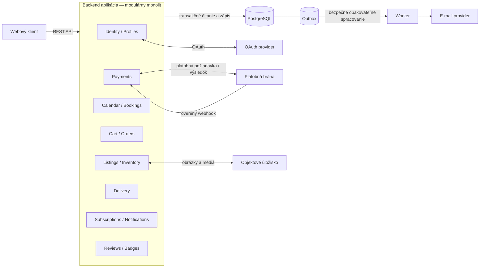

# ADR-001: Vybrať modulárny monolit pre E-Farmers MVP

- Status: Prijaté
- Dátum: 2026-10-28

## Kontext

E-Farmers je platforma spájajúca lokálnych farmárov, zákazníkov a kuriérov. Systém potrebuje:

- registráciu e-mailom alebo cez OAuth, prihlásenie, odhlásenie a správu profilu;
- roly zákazníka, farmára a kuriéra vrátane zmien rolí;
- farmárske profily, ponuky, boxy, úpravu a mazanie ponúk a sezónny kalendár;
- zobrazenie dostupných boxov blízko dátumu spotreby;
- vyhľadávanie, košík, rezervácie boxov a prijatie alebo odmietnutie rezervácie farmárom;
- objednávky, bezpečnú platbu cez externú bránu, históriu objednávok a stav doručenia;
- výber doručenia, dostupnosť kuriérov a notifikácie/odbery;
- komentáre po nákupe, odznaky farmárov a osobné stránky používateľov.

Najdôležitejšie technické vlastnosti sú:

- zásoba nesmie byť prekročená ani znovu rezervovaná a box po dátume spotreby sa nesmie ponúkať ani rezervovať;
- stavy rezervácie a objednávky musia byť jednoznačné;
- platobné a notifikačné integračné systémy môžu zlyhať alebo opakovať požiadavky;
- platba prebieha cez externú platobnú bránu, preto neexistuje jediné ACID potvrdenie cez E-Farmers a banku.

Pre MVP je dôležité mať vysokú spoľahlivosť, jednoduché nasadenie, jednoduchý lokálny vývoj a dobrú konzistenciu v kritických tokoch. Tím pravdepodobne nebude veľký a úvodná prevádzka nebude intenzívna.

## Rozhodnutie

Pre prvú verziu E-Farmers budeme používať architektúru A: modulárny monolit.

### Základný návrh

- jedna backendová aplikácia, nasadená ako jeden celok;
- interné moduly s jasnými hranicami: Identity/Profiles, Listings & Inventory, Calendar/Bookings, Cart & Orders, Payments, Delivery, Subscriptions/Notifications a Reviews/Badges;
- jedna relačná databáza (odporúčane PostgreSQL) ako zdroj pravdy;
- obrázky a médiá v objektovom úložisku;
- webové rozhranie komunikuje s backendom cez REST API;
- samostatný worker/pracovný proces rieši e-maily, notifikácie, expiráciu nevybavených rezervácií podľa `decision_deadline` a webhooky;
- integrácie s externými službami (OAuth, platobná brána, notifikačný provider) sú realizované cez adaptéry, nie priamo v doménovej logike.

### Diagram zvolenej architektúry

Moduly sú súčasťou jednej backendovej aplikácie a PostgreSQL je zdrojom pravdy. Outbox záznam sa ukladá spolu s doménovou zmenou; worker ho bezpečne spracúva a posiela e-maily. Platobná brána a OAuth sú externé systémy. Citlivé platobné údaje spracúva poskytovateľ platby; aplikácia si uchováva iba potrebné referencie a stav.

### Dôležité pravidlá implementácie

- moduly nesmú zdieľať databázové tabuľky bez jasného doménového vlastníctva;
- inventár, rezervácie a objednávky musia byť chránené transakciami v relačnej databáze;
- pri vytvorení rezervácie sa overí `food_expires_at` aj dostatočná dostupná zásoba; `decision_deadline` sa používa samostatne na určenie platnosti žiadosti a uvoľnenie jej hold-u;
- posledný box sa musí spravovať pomocou podmieneného update alebo optimistického zamknutia;
- stavy objednávky a rezervácie musia mať jednoznačný stavový automat;
- všetky webhooky a externé odpovede budú idempotentné;
- platobný retry a webhook reconciliation budú riešené ako prvky doménovej logiky, nie ako „ošetrenie na konci“;
- server-side autorizácia bude kontrolovať oprávnenia vždy, nie len v UI.

## Alternatívy zvážené v diskusii

### A. Modulárny monolit

Prijaté. Je to najlepšie východiskové riešenie pre MVP v E-Farmers, pretože:

- poskytuje jednoduchú, spoľahlivú konzistenciu pre zásobu, rezerváciu a objednávku;
- demonštruje jasné doménové rozdelenie bez operatívnej zložitosti mikroslužieb;
- umožňuje rýchly vývoj a jednoduché ladenie pri malom tíme;
- redukuje náklady a zložitosť spojené s vlastnou infraštruktúrou.

### B. Doménové mikroslužby

| V čom je lepšia než A | Prečo ju teraz nevyberáme |
|---|---|
| Služby možno nasadzovať a škálovať nezávisle, napríklad zvýšiť kapacitu vyhľadávania alebo notifikácií bez škálovania celého backendu. | Prináša vysokú prevádzkovú a vývojovú zložitosť, ktorú malý tím nemusí vedieť efektívne pokryť. |
| Každá služba môže vlastniť svoje dáta a technológie, čím vznikajú explicitnejšie hranice zodpovednosti. | Konzistencia naprieč službami je distribuovaná; treba navrhnúť ságy, kompenzácie, idempotenciu a odolné spracovanie udalostí. |
| Poruchu alebo vysoké zaťaženie jednej služby možno lepšie izolovať od ostatných. | Vyžaduje broker a prevádzku eventov, outbox/inbox, observabilitu a správu API/event kontraktov. |
| Samostatné doménové tímy môžu pracovať a vydávať zmeny autonómnejšie. | Pre MVP zatiaľ nie je dostatok tímov ani preukázaná potreba nezávislého škálovania, ktorá by tieto náklady ospravedlnila. |

### C. Serverless a spravované cloudové služby

| V čom je lepšia než A | Prečo ju teraz nevyberáme |
|---|---|
| Poskytovateľ spravuje runtime a servery, čím znižuje potrebu ich údržby a vlastného nastavovania autoscalingu. | Vytvára závislosť od konkrétneho poskytovateľa a jeho služieb; IAM, fronty, workflow, plánovače a nasadzovanie stále vyžadujú návrh a prevádzku. |
| Funkcie a spravované fronty sa môžu automaticky prispôsobiť nárazovej či nepredvídateľnej záťaži; účtovanie podľa využitia môže byť výhodné pri nízkom alebo kolísavom dopyte. | Cold starts, limity funkcií a náročnejšie lokálne testovanie zvyšujú zložitosť. Náklady a latencia môžu byť pri častom volaní alebo veľkom objeme udalostí ťažšie predvídateľné. |
| Spravované fronty, plánovače a workflow môžu zjednodušiť asynchrónne úlohy, expirácie a dlhšie checkout procesy. | Opakovanie udalostí a bezpečné spracovanie stavov zostávajú zodpovednosťou aplikácie; serverless neodstraňuje externú platobnú hranicu ani konzistenčné požiadavky. |
| Funkcie možno nasadzovať a škálovať samostatne; pri spoločnej relačnej databáze možno zachovať lokálne transakcie pre zásobu a rezervácie. | Pre MVP tieto prevádzkové výhody neprevažujú nad cloudovou špecifickosťou a dodatočnou zložitosťou konfigurácie a testovania. |

### Súhrnné porovnanie A/B/C

| Kritérium | A: Modulárny monolit | B: Mikroslužby | C: Serverless |
|---|---|---|---|
| Konzistencia | Najjednoduchšia silná konzistencia v rámci jednej relačnej DB; externé platby a asynchrónne úlohy sú stále mimo lokálnej transakcie. | Väčšinou eventual consistency naprieč službami/DB; potrebné sú ságy, kompenzácie a idempotentné spracovanie. | Pri navrhnutej spoločnej relačnej DB môže byť lokálna konzistencia podobná A; workflow, fronty a externé služby sú asynchrónne. |
| Prevádzková zložitosť | Nízka až stredná; jeden backend a prípadne worker, no treba udržiavať runtime a hranice modulov. | Vysoká; viac služieb, deploymentov, databáz, kontraktov, monitorovania a riešenia distribuovaných zlyhaní. | Stredná; poskytovateľ spravuje servery, ale IAM, kvóty, funkcie, fronty, workflow, observabilita a cloudová konfigurácia zostávajú. |
| Škálovanie | Zvyčajne sa škáluje celý backend; možnosť nezávislého škálovania komponentov je obmedzená. | Najvyššia flexibilita: služby sa škálujú nezávisle podľa domény a záťaže. | Funkcie a asynchrónni konzumenti sa môžu automaticky a nezávisle škálovať podľa požiadaviek a udalostí. |
| Nasadenie | Jeden koordinovaný release backendu; jednoduchšie pipeline a kompatibilita verzií. | Služby možno nasadzovať nezávisle, ale treba viac pipeline a kompatibilitu API/eventov medzi verziami. | Nasadzujú sa funkcie a cloudové zdroje; runtime nasadzuje/spravuje poskytovateľ, no infraštruktúra ako kód a konfigurácia sú dôležité. |
| Lokálny vývoj | Najjednoduchší: aplikáciu a databázu možno spustiť a ladiť lokálne. | Najnáročnejší: treba koordinovať viac služieb a závislostí alebo používať vzdialené prostredia. | Zložitejší než A: emulácia managed služieb nemusí byť úplná a testovanie často vyžaduje cloudové prostredie. |
| Náklady | Zvyčajne najpredvídateľnejšie a nižšie pre malé MVP; jeden runtime a databázová platforma. | Vyššie fixné a prevádzkové náklady na viac služieb a platformu; môžu sa oplatiť pri veľkom rozsahu a samostatných tímoch. | Platba podľa využitia môže byť výhodná pri nízkej či premenlivej záťaži; pri vysokej frekvencii, prenose dát alebo mnohých managed službách môžu byť náklady menej predvídateľné. |
| Vendor lock-in | Nízky až stredný; závisí od zvolených databázových a cloudových služieb. | Nízky až stredný pri prenositeľných technológiách; závisí od brokera a infraštruktúry. | Najvyšší, najmä pri použití proprietárnych funkcií, workflow, eventov a IAM konkrétneho cloudu. |
| Vhodnosť pre malý tím | Vysoká; jednoduchšie vlastníctvo a prevádzka jedného systému. | Nízka bez platformového zázemia a autonómnych doménových tímov. | Stredná až vysoká, ak tím pozná cloud a záťaž je premenlivá; zložitosť konfigurácie a testovania však zostáva. |

## Dôsledky

### Pozitívne

- jednoduché lokálne spustenie a debugovanie;
- jednoduchá transakčná konzistencia v jednej relačnej databáze;
- rýchlejší vývoj pre MVP a nižšie náklady na prevádzku;
- lepšia zrozumiteľnosť architektúry pre malý tím;
- ľahšie zavedenie bezpečnostných a doménových pravidiel.

### Negatívne

- je potrebné prísne vynucovať moduly a hranice vlastníctva dát;
- škálovanie je obmedzené na celé backendové jadro, nie na jednotlivé domény;
- pri raste produktu bude potrebné zvážiť exrakciu modulov alebo prechod na iný model.

### Budúce rozhodnutia

- Architektúru znovu posúdime, keď nastane niektorý z týchto konkrétnych signálov:
  1. **Fan-out notifikácií zaťažuje hlavnú DB:** rast odberateľov a notifikačných úloh opakovane zhoršuje latenciu alebo dostupnosť transakcií objednávok, rezervácií či zásob, a optimalizácia dotazov/frontu problém nevyrieši.
  2. **Tímy si prekážajú pri releasoch:** viac tímov opakovane čaká na spoločné nasadenie backendu alebo koordináciu zmien, čo merateľne spomaľuje dodávku funkcií alebo zvyšuje riziko regresií.
  3. **Škálovanie celého backendu je neprimerané:** opakované špičky v jednej doméne vyžadujú škálovať celý backend a zvyšujú náklady alebo zhoršujú výkon ostatných domén.
- **Prvý kandidát na vyčlenenie:** modul `Subscriptions/Notifications` (odbery a notifikačný fan-out), keďže jeho práca je prevažne asynchrónna a možno ju oddeliť cez outbox/udalosti. Vyčlenenie sa začne iba po potvrdení spúšťača a s jasným vlastníctvom dát a idempotentným spracovaním.
- Serverless zvážime osobitne, ak sa ukáže, že premenlivá záťaž a požiadavka na menšiu správu runtime prevážia nad cloudovou závislosťou, konfiguráciou a nákladovou neistotou.
- V každom prípade budeme zachovať rovnaké zásady: jasné doménové hranice, idempotencia, robustný stavový model a bezpečné platobné integračné vzory.
