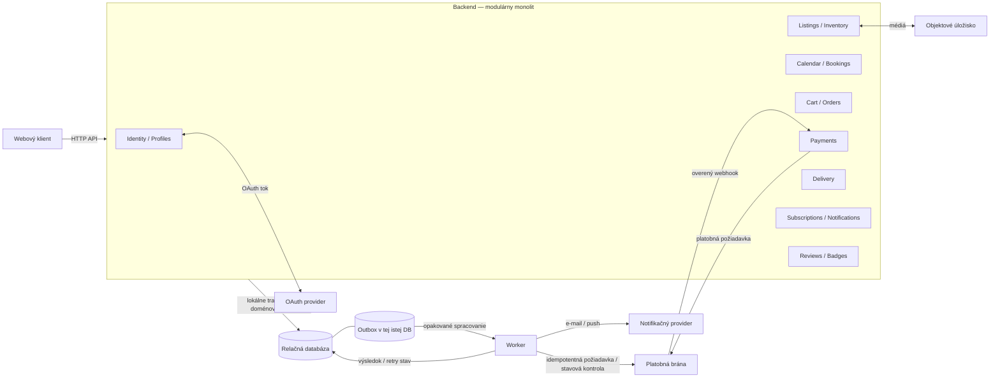

# ADR-002: Modulárny monolit pre E-Farmers MVP

- **Stav:** Navrhnuté — zvolená možnosť je odporúčaním asistenta; toto ADR samo osebe nepredstavuje nové schválenie používateľom.
- **Dátum:** 2026-10-28
- **Rozsah:** Architektúra aplikačného backendu pre MVP E-Farmers.
- **Súvisiaci záznam:** `../adr.md` (ADR-001, eviduje prijatý modulárny monolit).

## Kontext

E-Farmers spája lokálnych farmárov, zákazníkov a kuriérov. Požiadavky pokrývajú:

- registráciu a prihlásenie e-mailom alebo OAuth, odhlásenie, profily a zmenu rolí;
- farmárske profily, ponuky a boxy, úpravu/mazanie, vyhľadávanie a sezónny kalendár;
- rezervácie boxov s rozhodnutím farmára, košík, objednávky, platbu a históriu;
- doručenie kuriérom, odbery farmárov, notifikácie, komentáre po nákupe a odznaky.

Najvýznamnejšie architektonické ovládače:

1. **Správnosť zásob a stavov:** súbežné požiadavky nesmú predať ani rezervovať viac boxov, než je dostupných; rezervácie a objednávky musia mať jednoznačné povolené prechody.
2. **Bezpečná platba:** platobná brána je externý systém; jej timeout alebo návratová URL nepotvrdzujú výsledok platby.
3. **Serverová autorizácia:** roly, vlastníctvo ponúk a vzťah kuriéra k objednávke sa overujú pri každej operácii na serveri.
4. **Odolnosť asynchrónnych účinkov:** platobné webhooky, expirácia rezervácií a notifikácie sa môžu oneskoriť, opakovať alebo zlyhať.
5. **Primeranosť MVP:** zadanie nepreukazuje potrebu nezávislého škálovania služieb, viacerých autonómnych tímov ani konkrétneho cloudu.

Požiadavky neurčujú návštevnosť, objem dát, dostupnosť, latenciu, obnovu po havárii, rozpočet, hosting ani veľkosť tímu. Predpoklad jedného produktového tímu a relačnej databázy je pracovný predpoklad, nie známy fakt. Preto toto ADR neurčuje kapacitné ciele ani konkrétny databázový/cloudový produkt. Výber poskytovateľa platieb, pravidlá refundácie a právne/regulačné posúdenie sú mimo tohto rozhodnutia.

## Rozhodnutie

Pre MVP **odporúčame modulárny monolit s relačnou databázou, outboxom a samostatným workerom**. Backend sa rozdelí na doménové moduly s explicitným vlastníctvom dát a rozhraniami; kritické obchodné zmeny sa vykonajú v lokálnej databázovej transakcii. Asynchrónne úlohy a komunikácia s externými poskytovateľmi sa budú bezpečne opakovať a zosúlaďovať.

Táto voľba uprednostňuje správnosť rezervácií, zásob a objednávok, jednoduchosť vývoja a prevádzky a možnosť postupného rastu. Mikroslužby ani cloudovo špecifická serverless architektúra sa teraz nezavádzajú bez preukázanej potreby.

ADR-001 v koreňovom priečinku už označuje modulárny monolit ako prijatý. Toto ADR dokumentuje samostatný návrh pre Run 2 a zachováva rozdiel medzi týmto odporúčaním a formálnym prijatím; nemení stav ADR-001.

## Zvolená architektúra

### Komponenty a hranice

- **Webový klient:** zobrazovanie a používateľské vstupy; nie je autoritou pre roly, cenu, zásobu ani stav platby.
- **Backend aplikácia:** jedno nasadzované aplikačné jadro s modulmi:
  - `Identity/Profiles` — účty, autentifikácia a profily;
  - `Listings/Inventory` — ponuky, boxy, dostupnosť a médiá;
  - `Calendar/Bookings` — žiadosti o rezerváciu, rozhodnutia farmára a holdy zásoby;
  - `Cart/Orders` — košík, checkout, objednávky a cenový snapshot;
  - `Payments` — lokálny stav platby a adaptér platobnej brány;
  - `Delivery` — priradenie a stav doručenia;
  - `Subscriptions/Notifications` — odbery a notifikačné úlohy;
  - `Reviews/Badges` — komentáre a úspechy farmárov.
- **Relačná databáza:** zdroj pravdy pre používateľov/roly, ponuky/boxy, rezervácie, objednávky, platobné referencie a stavy. Každý modul vlastní svoje tabuľky a povoľuje prístup cez doménové rozhrania; spoločná databáza nie je dôvod na priame obchádzanie vlastníctva.
- **Outbox a worker:** outbox záznam sa zapisuje v rovnakej transakcii ako doménová zmena, ktorá vyžaduje asynchrónny účinok. Worker spracúva notifikácie, expiráciu nevybavených rezervácií a opakované pokusy/reconciliation. Záznamy sa deduplikujú a ich stav spracovania je dohľadateľný.
- **Externé systémy:** OAuth provider, platobná brána a e-mail/push provider; integrácia prebieha cez adaptéry. Obrázky a médiá patria do objektového úložiska. Konkrétni poskytovatelia sa vyberú samostatne.

Backend a worker môžu používať ten istý kód a byť nasadené ako samostatné procesy; logické rozdelenie modulov nesľubuje nezávislé nasadzovanie domén. Web komunikuje s backendom cez serverové HTTP API.

### Diagram

Diagram nezobrazuje ACID transakciu cez aplikáciu a externého poskytovateľa. Outbox je súčasťou tej istej databázy, nie samostatný zdroj pravdy. Webhook vstupuje cez backend a musí byť overený pred zmenou lokálneho stavu.

## Kritické toky a pravidlá

### Rezervácia kalendárového boxu

1. Server overí identitu, oprávnenie zákazníka a aktuálnu dostupnosť.
2. V jednej DB transakcii skontroluje `food_expires_at`, dostupnosť a vytvorí žiadosť v stave `PENDING` spolu s holdom zásoby. Podmienená aktualizácia alebo ekvivalentné zamykanie zabráni prekročeniu zásoby pri súbehu.
3. Oprávnený farmár môže žiadosť zmeniť na `ACCEPTED` alebo `DECLINED`; worker ju môže po `decision_deadline` zmeniť na `EXPIRED`. Prechod z `PENDING` je podmienený aktuálnym stavom, takže oneskorená alebo duplicitná akcia neuvoľní ani nealokuje zásobu druhýkrát.
4. Hraničné pravidlá: box možno ponúkať/rezervovať iba pred `food_expires_at`; po okamihu `decision_deadline` čakajúca žiadosť expiruje. Čas meria dôveryhodný server/databázový UTC čas. Konkrétne časové pásmo zobrazenia a dĺžka lehoty vyžadujú doménové rozhodnutie.

`food_expires_at` je dátum/čas použiteľnosti produktu; `decision_deadline` je lehota na rozhodnutie farmára. Nie sú zameniteľné. Rezervácia z kalendára nie je objednávka. Požiadavky neurčujú, či prijatá rezervácia následne vytvára checkout, ani jeho platobnú lehotu; toto zostáva otvorené.

### Checkout a platba

1. Košík je iba zámer nákupu, nie garantovaná zásoba (pracovný predpoklad). Checkout na serveri znovu overí cenu, dostupnosť, expiráciu a oprávnenie.
2. Jedna DB transakcia vytvorí objednávku s cenovým/produktovým snapshotom, zarezervuje zásobu podľa definovaného pravidla a zapíše požiadavku na začatie platby do outboxu. Súbeh na posledný kus zlyhá bezpečne pre požiadavky, ktoré už nemajú dostupnú zásobu.
3. Po commite worker odošle platobnú požiadavku s idempotency key. Výsledok alebo referencia poskytovateľa sa zapíše späť do databázy; opakované spracovanie outboxu používa rovnaký kľúč. Platobná brána je mimo lokálnej transakcie. Platobné údaje spracúva poskytovateľ; aplikácia uchová iba potrebné referencie a stav.
4. Timeout vytvára výsledok „neznámy/čaká sa“, nie automatické zlyhanie. Pred opakovaním sa overí stav cez webhook alebo reconciliation; slepé opakovanie nesmie vytvoriť druhé strhnutie.
5. Webhook sa autentifikuje podľa mechanizmu poskytovateľa, deduplikuje podľa identifikátora udalosti a aplikuje iba povolený prechod. Klientova návratová URL nie je dôkazom zaplatenia. Ak platba definitívne zlyhá, objednávka a zásoba prejdú do definovaného kompenzačného stavu; presná lehota/terminológia pre rezerváciu zásoby je otvorená.

### Asynchrónne spracovanie a autorizácia

- Outbox záznam a obchodná zmena sa commitnú spolu; worker môže správu spracovať viac než raz. Každý účinok (notifikácia, expirácia, webhook) je idempotentný.
- Dočasné zlyhania sa opakujú s limitom a odkladom; trvalé zlyhania sa zaznamenajú na dohľad a manuálnu obnovu, nie ako úspech. Stav fronty/outboxu a chyby nesmú obsahovať tajomstvá ani citlivé platobné údaje.
- Autorizačné kontroly sa vykonávajú na serveri pri každej operácii. Farmár môže meniť iba vlastné ponuky a rozhodovať iba o rezervácii svojej ponuky; kuriér môže meniť stav iba objednávky, ku ktorej je oprávnene priradený. Zmena roly na farmára/kuriéra vyžaduje serverové pravidlá oprávnenosti, ktoré zatiaľ nie sú špecifikované.
- Stav doručenia je auditovateľný; konkrétne stavové prechody, spôsob priradenia kuriéra a pravidlá refundácie/kompenzácie zostávajú otvorené.

## Zvažované alternatívy

### B. Doménové mikroslužby s databázou na službu

**V čom sú lepšie než zvolená možnosť:** služby môžu vlastniť dáta a releasy nezávisle; domény s odlišnou záťažou (napr. notifikácie) sa dajú škálovať samostatne; zlyhanie jednej služby možno lepšie izolovať; autonómne tímy môžu pracovať nezávisle.

**Prečo ich teraz nevyberáme:** požiadavky nepreukazujú viac tímov ani doménu, ktorá potrebuje nezávislé nasadenie/škálovanie. Rozdelenie Booking, Inventory a Orders mení lokálnu transakciu na koordinovaný tok: vyžaduje idempotentné API/udalosti, outbox/inbox, ságové kroky a kompenzácie. Broker, observabilita a lokálny vývoj viacerých služieb zvyšujú náklady a prevádzkovú záťaž pre predpokladané MVP. Sú vhodnejšie, keď merania alebo štruktúra tímu tieto výhody odôvodnia.

### C. Serverless/event-driven riešenie na spravovaných cloudových službách

**V čom je lepšie než zvolená možnosť:** poskytovateľ spravuje runtime; funkcie a fronty sa môžu prispôsobiť nepravidelnej záťaži a účtovanie podľa využitia môže byť výhodné pri nízkom či kolísavom dopyte. Spravované plánovače/fronty/workflow môžu znížiť vlastnú údržbu asynchrónneho behu.

**Prečo ho teraz nevyberáme:** cloudový provider ani variabilná záťaž nie sú požiadavkou. Cloudové API, IAM, workflow a deployment vytvárajú závislosť a lokálne testovanie nemusí presne zodpovedať produkcii. Súbežný beh funkcií môže naraziť na limity spojení databázy; náklady môžu byť pri častom volaní menej predvídateľné. Spravovaný runtime nevyrieši idempotenciu, stav platieb ani konzistenciu zásob. Tento variant by bol vhodnejší pri preukázanej premenlivej záťaži, nízkej kapacite na správu runtime a prijatej cloudovej závislosti.

### Súhrnné porovnanie

| Kritérium | A — Modulárny monolit (zvolený) | B — Mikroslužby | C — Serverless |
|---|---|---|---|
| Zásoba, rezervácia a objednávka | Prirodzená lokálna transakcia v jednej DB | Silná konzistencia iba v rámci služby; koordinácia medzi Booking/Orders je eventual | Možná lokálna transakcia pri spoločnej relačnej DB; workflow je mimo nej |
| Platba | Externá asynchrónna hranica; idempotencia a reconciliation | Rovnaká externá hranica plus koordinácia služieb/saga | Rovnaká externá hranica; workflow môže koordinovať, ale neposkytuje ACID cez bránu |
| Prevádzka a lokálny vývoj | Najjednoduchšie; jeden backend a worker | Najnáročnejšie; viac služieb, kontraktov, monitorovania a závislostí | Stredná zložitosť; managed runtime, no cloudová konfigurácia a emulácia |
| Škálovanie a izolácia | Väčšinou sa škáluje celý backend; spoločná DB | Najlepšia nezávislosť služieb a izolácia domén | Funkcie sa škálujú samostatne; DB/kvóty ostávajú spoločným limitom |
| Nasadenie a tím | Koordinovaný release, primeraný jednému tímu | Nezávislé releasy, vhodnejšie pre autonómne tímy | Funkcie/zdroje môžu byť samostatné; infra a cloudové zmeny treba koordinovať |
| Náklady a prenositeľnosť | Nižšie počiatočné režijné náklady, zvyčajne predvídateľnejšie; nízky až stredný lock-in | Vyššie fixné náklady; lock-in závisí od brokera a platformy | Platba podľa využitia môže pomôcť pri premenlivom dopyte; silnejší lock-in a neistota nákladov |
| Vhodné, keď… | MVP bez preukázanej potreby samostatného škálovania | Sú autonómne tímy alebo meraná potreba izolácie/škálovania | Záťaž je premenlivá, tím pozná cloud a chce obmedziť správu runtime |

Porovnanie je kvalitatívne a vychádza z dostupných user stories a výslovne uvedeného pracovného predpokladu MVP/jedného tímu. Nie sú známe merania, ktoré by umožňovali kvantitatívne skóre alebo kapacitné garancie.

## Dôsledky

### Pozitívne

- zásoba, rezervácia a objednávka môžu využívať jednu lokálnu transakčnú hranicu;
- jednoduchšie nasadzovanie, testovanie a lokálne ladenie než pri viacerých nezávislých službách;
- jasné doménové moduly poskytujú základ pre budúce oddelenie bez toho, aby sa oddelenie zavádzalo vopred;
- outbox a worker umožňujú obnoviteľné spracovanie notifikácií, expirácií a integrácií.

### Negatívne a prijaté kompromisy

- backend sa zvyčajne škáluje ako celok; zdieľaná databáza je spoločný prevádzkový bod;
- modulárnosť sa musí vynucovať cez vlastníctvo tabuliek a rozhrania, inak vznikne ťažko oddeliteľný monolit;
- worker/outbox vyžadujú prevádzkový dohľad, retry limity, deduplikáciu a postup pri trvalých zlyhaniach;
- platba a notifikácie zostávajú eventual/asynchrónne; používateľ môže vidieť čakajúci stav a systém potrebuje reconciliation.

## Riziká, otvorené otázky a budúce rozhodnutia

- **Obchodné pravidlá:** aký je časový limit rozhodnutia farmára; čo presne rezervuje kalendárový hold; ako prijatá rezervácia nadväzuje na objednávku/checkout; dokedy drží checkout zásobu; čo sa stane po definitívnom zlyhaní platby?
- **Čas a stav:** aké sú časové pásmo a hraničné pravidlá pre `food_expires_at` a `decision_deadline`; ktoré stavy a prechody platia pre objednávku, platbu a doručenie?
- **Bezpečnosť a prevádzka:** aké pravidlá povoľujú zmenu používateľa na farmára/kuriéra; aké auditné, súkromnostné, retenčné a obnovovacie požiadavky platia?
- **Ciele a obmedzenia:** aké sú SLO, objem/špičky, RPO/RTO, rozpočet, hosting, tím a platobný/OAuth provider? Tieto údaje môžu zmeniť primeranosť variantu.
- **Riziko spoločnej databázy:** sleduje sa latencia a chybovosť kritických transakcií, vyťaženie spojení, zálohovanie a obnova; konkrétne prevádzkové ciele treba určiť samostatne.

## Spúšťače na prehodnotenie

Rozhodnutie otvoriť znovu iba na základe pozorovateľných signálov, nie hypotetického rastu:

1. Notifikačný fan-out alebo iný asynchrónny modul opakovane zhoršuje latenciu/dostupnosť objednávok, rezervácií či zásob aj po optimalizácii dotazov a workerov. **Prvý kandidát:** `Subscriptions/Notifications`; oddeliť až po ustálení kontraktu, vlastníctva dát a idempotentných udalostí.
2. Samostatné tímy sa opakovane blokujú pri spoločných releasoch a koordinácia merateľne spomaľuje dodávku alebo zvyšuje regresie. Zvážiť extrakciu modulu, ktorého nezávislé releasy majú preukázanú hodnotu.
3. Namerané špičky v jednej doméne nútia škálovať celý backend a zvyšujú náklady alebo degradujú iné domény. Najprv identifikovať skutočný limit; pri príčine v async fan-out zvážiť worker/službu, pri výpočtovej záťaži zvážiť izoláciu danej domény.
4. Preukázaná nepravidelná záťaž a nízka kapacita na správu runtime, spolu s porovnaním celkových nákladov a prijatím cloudovej závislosti, môže odôvodniť serverless variant.

## Zdroj

- Funkčné požiadavky: `Tasks/data/EFarmers.txt`.
- Pracovné porovnanie alternatív a zaznamenané predpoklady: `run2/notes.md`.
