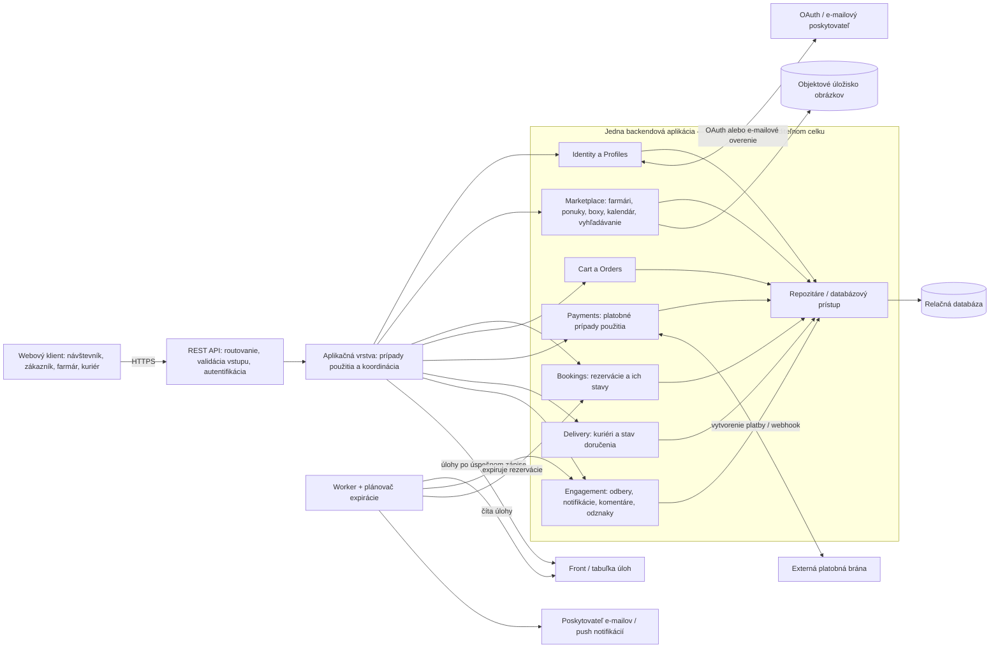
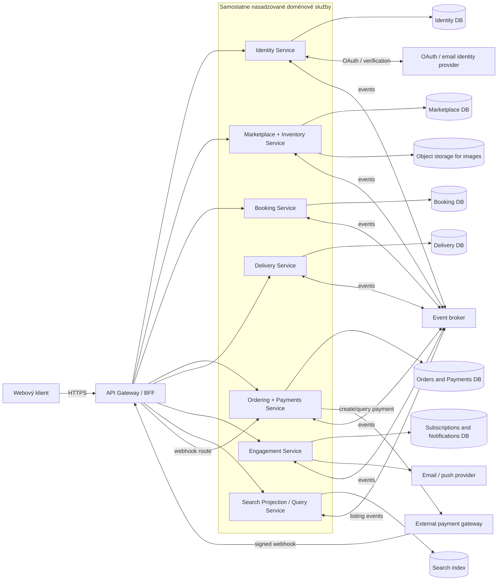
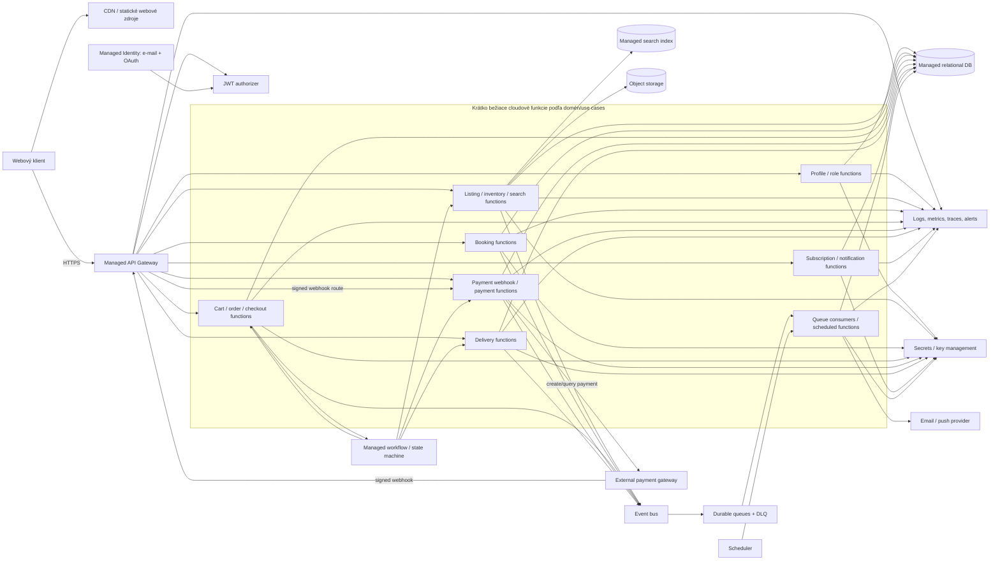

# E-Farmers — priebežné poznámky k architektúram

## Východiská z požiadaviek

E-Farmers spája lokálnych farmárov, zákazníkov a kuriérov. Systém potrebuje:

- registráciu e-mailom alebo cez OAuth, prihlásenie, odhlásenie a správu profilu;
- roly zákazníka, farmára a kuriéra vrátane zmeny roly;
- farmárske profily, ponuky (insertions), boxy, úpravu a mazanie ponúk, expiráciu a sezónny kalendár;
- vyhľadávanie ponúk, košík, rezervácie boxov a prijatie alebo odmietnutie rezervácie farmárom;
- objednávky, bezpečnú platbu cez externú bránu, históriu objednávok a stav doručenia;
- výber doručenia, dostupnosť kuriérov a ich osobnú stránku;
- odbery farmárov, notifikácie, komentáre po nákupe a odznaky farmárov.

Z toho vyplývajú dôležité technické vlastnosti: sklad/počet boxov sa nesmie predať alebo rezervovať nad dostupné množstvo; objednávka a platba musia mať jednoznačné stavy; platobné a notifikačné integrácie môžu zlyhať alebo opakovať požiadavky; rezervácie a potraviny majú časové obmedzenia. Pri zmene roly treba kontrolovať oprávnenia na serveri, nie iba skryť alebo zobraziť prvky rozhrania.

## Návrh A — modulárny monolit

Jedna backendová aplikácia nasadená ako jeden celok, vnútorne rozdelená na moduly s jasnými hranicami: Identity/Profiles, Listings & Inventory, Calendar/Bookings, Cart & Orders, Payments, Delivery, Subscriptions/Notifications a Reviews/Badges. Webové rozhranie komunikuje s backendom cez REST API. Primárnym úložiskom je relačná databáza (napr. PostgreSQL); obrázky ponúk môžu byť v objektovom úložisku. Samostatný worker a front správ môžu spracúvať e-maily, notifikácie, expiráciu rezervácií a webhooky.

Objednávka, rezervácia a skladové množstvo majú relačné transakcie. Platobná brána zostáva externá: aplikácia vytvorí platobnú požiadavku, bezpečne spracuje webhook a používa idempotentné identifikátory, aby opakovaný webhook nevytvoril druhú platbu či objednávku. E-mail/OAuth a platby sa integrujú cez adaptéry, aby ich bolo možné meniť bez premiešania doménovej logiky.

**Výhody:** jednoduchšie lokálne spustenie, nasadenie, ladenie a transakcie; nižšia prevádzková zložitosť; vhodné pre malý tím a prvú verziu.

**Nevýhody a bolestivé miesta:** hranice modulov treba dodržiavať aj v jednom procese; nepozorné priame zdieľanie tabuliek a logiky vytvorí „monolitický monolit“. Škálovať sa dá najmä celý backend naraz, nie iba vyhľadávanie alebo notifikácie. Worker, plánovač expirácie a webové požiadavky potrebujú koordinované nasadenie a monitorovanie.

**Rizikové implementačné detaily:** súbežné pridelenie posledného boxu (transakcia/optimistické zamykanie alebo podmienený update); stavový automat objednávky a rezervácie; idempotentné webhooky; pravidlá, kto môže meniť ponuku alebo stav doručenia; ochrana pred tým, aby používateľ zmenou identifikátora upravil cudziu ponuku.

## Návrh B — doménové mikroslužby a udalosti

Samostatne nasadzované služby rozdelené podľa doménových hraníc: Identity, Marketplace (farmári/ponuky/sklad), Booking, Ordering/Payments, Delivery a Notifications/Engagement (odbery, komentáre, odznaky). Každá služba vlastní svoje dáta a poskytuje API; služby si neposkytujú priamy prístup do databázy inej služby. API gateway alebo backend-for-frontend dáva webovej aplikácii jednotný vstup. Zmeny sa oznamujú cez broker udalostí (napr. „BoxReserved“, „PaymentConfirmed“, „OrderReadyForDelivery“, „DeliveryCompleted“).

Príklad toku: Booking si rezervuje dostupný box vo svojom úložisku a publikuje udalosť; Ordering/Payments vytvorí alebo aktualizuje objednávku a spustí platbu; po potvrdení platby Delivery môže vytvoriť požiadavku pre dostupného kuriéra. Notifications reaguje na udalosti odberov či zmeny stavu. Každá služba môže používať úložisko vhodné pre svoju doménu, ale hranice vlastníctva dát musia byť explicitné.

**Výhody:** nezávislé nasadzovanie a škálovanie (napr. vyhľadávanie alebo notifikácie), izolácia porúch a možnosť rozdeliť vlastníctvo medzi viac tímov.

**Nevýhody a bolestivé miesta:** najvyššia prevádzková a vývojová zložitosť; lokálny vývoj, deployment, observabilita, verzovanie API a riešenie incidentov sú náročnejšie. Jedna databázová transakcia už nemôže jednoducho pokryť rezerváciu, objednávku a platbu. Konzistencia medzi službami je často eventual consistency.

**Rizikové implementačné detaily:** saga/kompenzačné kroky pri zlyhaní platby po rezervácii; outbox pattern, aby sa databázový zápis a publikovanie udalosti nerozišli; deduplikácia správ a idempotentní konzumenti; opakované pokusy a dead-letter front; korelácia objednávky naprieč službami; autorizácia medzi službami; dohľadateľnosť stavov pri oneskorených alebo chybných udalostiach.

## Návrh C — serverless a spravované cloudové služby

Webový klient komunikuje cez spravovanú API bránu s krátko bežiacimi funkciami (napr. AWS Lambda/Azure Functions). Identity rieši spravovaná služba identity s e-mailom a OAuth. Dáta sú v spravovanej databáze; vhodná je relačná databáza pre objednávky, rezervácie a platby, prípadne doplnená o vyhľadávaciu službu. Obrázky sa ukladajú do objektového úložiska. Fronty a plánované udalosti spúšťajú spracovanie webhookov, notifikácií, expirácie ponúk/rezervácií a úloh doručenia.

Funkcie sú rozdelené podľa prípadov použitia alebo domén (ponuka, rezervácia, objednávka, doručenie). Dlhšie procesy sú orchestráciou stavov (napr. spravovaným workflow): rezervovať box → autorizovať/overiť platbu → potvrdiť objednávku alebo uvoľniť rezerváciu → zariadiť doručenie. Nie je to „bez serverov“; infraštruktúra, limity, prístupové práva a pozorovateľnosť sú stále zodpovednosťou tímu, hoci časť prevádzky preberá poskytovateľ.

**Výhody:** nízka potreba spravovať servery, automatické škálovanie a platba podľa využitia; vhodné pri kolísavej prevádzke a malom prevádzkovom tíme.

**Nevýhody a bolestivé miesta:** závislosť od poskytovateľa a jeho služieb; limity behu funkcií, studené štarty a zložité lokálne napodobnenie cloudu; náklady a latencia môžu byť ťažko predvídateľné pri častom volaní funkcií alebo veľkom objeme udalostí. Rozdelenie funkcií môže viesť k neprehľadnému systému, ak sa doménové hranice neurčia vopred.

**Rizikové implementačné detaily:** funkcia/fronta môže správu spracovať viackrát, preto treba idempotenciu; limity súbežnosti môžu narušiť rezervovanie posledného boxu; workflow musí mať timeouty a kompenzácie; webhooky platobnej brány musia byť overené a bezpečne opakovateľné; prístupové práva každej funkcie treba nastaviť s minimálnymi oprávneniami.

## Predbežné porovnanie a otázky na diskusiu

| Kritérium | A: Modulárny monolit | B: Mikroslužby | C: Serverless |
|---|---|---|---|
| Prevádzková zložitosť | nízka až stredná | vysoká | stredná, čiastočne skrytá v cloude |
| Transakcie a konzistencia | najjednoduchšie v relačnej DB | najťažšie, naprieč službami | závisí od úložiska/workflow; opakovanie je bežné |
| Nezávislé škálovanie | obmedzené | silné | prirodzené pre jednotlivé funkcie |
| Vhodné pre | prvú verziu, malý tím | viac tímov, veľkú prevádzku/domény | malý tím, premenlivú záťaž, cloud-first produkt |
| Hlavné riziko | prerastanie hraníc modulov | distribuovaná zložitosť | vendor lock-in a rozptýlená logika |

Na základe samotných požiadaviek nie je dôvod začínať mikroslužbami: návrh A je rozumný východiskový bod, ak tím a objem prevádzky nie sú veľké. Serverless je alternatíva, ak je prioritou obmedziť správu infraštruktúry a ak je prijateľná závislosť od cloudu. Mikroslužby dávajú zmysel pri preukázanej potrebe samostatného škálovania, nasadzovania alebo vlastníctva domén viacerými tímami. Pred konečným výberom treba zistiť očakávanú záťaž, veľkosť tímu, cloudové obmedzenia, rozpočet a požiadavky na dostupnosť.

## Podrobnejšie komponenty návrhu A — modulárny monolit



### Zodpovednosti komponentov

- **Webový klient:** zobrazuje stránky a formuláre pre návštevníka, zákazníka, farmára a kuriéra. Nedôveruje sa mu pri rozhodovaní o oprávneniach ani dostupnosti boxov.
- **REST API:** vstupná hranica backendu; mapuje HTTP požiadavky na prípady použitia, kontroluje formát vstupov a autentifikačné údaje a vracia HTTP odpovede. Autorizáciu vlastní serverová aplikačná/doménová logika.
- **Aplikačná vrstva:** vykonáva prípady použitia (napr. publikovať ponuku, rezervovať box, vytvoriť objednávku). Koordinuje moduly a transakčné hranice; nemá byť miestom pre HTTP detaily ani pre priame volanie cudzej databázy.
- **Identity a Profiles:** registrácia/prihlásenie/odhlásenie, prepojenie OAuth identity, profil a roly. Overuje, či používateľ smie vykonať operáciu v roli zákazníka, farmára alebo kuriéra.
- **Marketplace:** farmárske profily, ponuky, boxy, množstvá, sezónny kalendár a vyhľadávanie. Presadzuje pravidlá úpravy/vlastníctva ponuky a dostupnosti produktu.
- **Bookings:** požiadavky na rezerváciu boxov, ich stavy, prijatie/odmietnutie farmárom a expirácia. Pri zmene dostupnosti používa bezpečnú databázovú transakciu alebo podmienený zápis, aby sa neprekročilo množstvo.
- **Cart a Orders:** obsah košíka a vytvorenie objednávky z košíka, ako aj história objednávok. Zachytáva cenu a položky pri objednaní podľa definovaných obchodných pravidiel.
- **Payments:** doménová koordinácia platby a jej stavov. Neuchováva citlivé platobné údaje, ktoré má spracúvať brána; overuje podpis webhooku a používa idempotenciu pri opakovaných oznámeniach.
- **Delivery:** voľba doručenia, dostupnosť kuriérov, priradenie a aktualizácie stavu doručenia. Kontroluje, že stav mení oprávnený kuriér alebo iná autorizovaná rola.
- **Engagement:** odbery/odbery zrušené, centrum notifikácií, komentáre oprávnené po nákupe a pravidlá udeľovania odznakov. E-mail alebo push odosiela asynchrónne.
- **Repozitáre / databázový prístup:** perzistencia a načítavanie dát pre moduly; udržiava transakcie a neumožňuje modulom obchádzať vlastníctvo dát iného modulu len tým, že majú spoločnú databázu.
- **Relačná databáza:** hlavný zdroj pravdy pre používateľov, ponuky, zásoby, rezervácie, objednávky a stavy. Kľúče, obmedzenia a transakcie chránia integritu dát.
- **Objektové úložisko:** obrázky produktov/profilov; v databáze sa drží ich identifikátor alebo URL, nie zbytočne veľký binárny obsah.
- **Front / tabuľka úloh:** oddeľuje rýchlu webovú odpoveď od opakovateľnej práce na pozadí. Úloha sa má zapísať spoľahlivo spolu s databázovou zmenou (napr. transactional outbox), aby sa udalosť nestratila pri páde procesu.
- **Worker a plánovač:** samostatný proces z toho istého backendového kódu/nasadenia, ktorý spracúva úlohy, posiela notifikácie a pravidelne expiruje rezervácie. Nie je to samostatná mikroslužba: zdieľa doménové moduly a databázu, hoci môže bežať ako oddelený proces.
- **Externá platobná brána:** bezpečne spracúva platobné údaje a posiela výsledok cez webhook; aplikácia musí správu overiť a tolerovať opakovanie alebo oneskorenie.
- **OAuth/e-mailový a notifikačný poskytovateľ:** externé adaptéry pre prihlasovanie, overovanie e-mailu a doručovanie oznámení; výpadok posielania notifikácie nemá zmazať úspešnú objednávku.

### Príklad toku objednávky

1. Klient odošle požiadavku na objednanie; API overí identitu a aplikačná vrstva skontroluje košík.
2. Moduly objednávok a zásob v databázovej transakcii vytvoria objednávku a odpočítajú alebo rezervujú dostupné boxy. Ak posledný box už získal iný zákazník, transakcia zlyhá bezpečne.
3. Platobný modul začne platbu u brány. Objednávka má zatiaľ stav typu „čaká na platbu“.
4. Overený webhook zmení stav platby/objednávky idempotentne. Následná úloha vo fronte vyvolá notifikáciu a podľa nastaveného procesu sprístupní objednávku na doručenie.
5. Worker opakuje dočasne neúspešné notifikácie; zlyhanie e-mailu nemení potvrdenie platby ani objednávky.

## Checkout a platba — user stories 16 a 17

### Databázy a záznamy

- **Aplikačná relačná databáza (napr. PostgreSQL):** jediný zdroj pravdy E-Farmers. Obsahuje košík (`carts`, `cart_items`), objednávku a nemenný snapshot jej položiek/cien (`orders`, `order_items`), dostupné a rezervované množstvá pri ponukách/boxoch, záznam platby (`payments` s interným stavom a referenciou brány), spracované identifikátory webhookov/idempotency kľúče a outbox úlohy.
- **Databáza platobnej brány:** patrí poskytovateľovi a aplikácia do nej priamo nepristupuje. Brána uchováva vlastné transakčné údaje a podľa integrácie platobný token alebo údaje potrebné na spracovanie karty. E-Farmers uchováva len bezpečnú referenciu/identifikátor brány a potrebné stavové údaje; úplné číslo karty ani bezpečnostný kód do vlastnej databázy neukladá.
- **Front správ:** buď samostatný broker, alebo tabuľka outboxu v aplikačnej databáze. Obsahuje opakovateľné úlohy (napr. odoslať potvrdenie); nesmie byť druhým zdrojom pravdy o tom, či bola objednávka zaplatená.

### Tok krok za krokom

1. **Zákazník spustí checkout (klient → REST API).** Klient odošle identifikátor košíka a výber dopravy, nie dôveryhodnú cenu. API overí prihlásenie a odovzdá požiadavku aplikačnej vrstve.
2. **Server overí košík (Cart/Orders + Marketplace).** Backend načíta položky, overí, že ponuky sú stále aktívne a pre zákazníka dostupné, a z databázy vypočíta aktuálne ceny, dane/dopravu podľa pravidiel. Cenu z prehliadača nikdy nepovažuje za autoritatívnu.
3. **Vytvorí sa čakajúca objednávka a rezervuje sa sklad (Orders + Marketplace, jedna DB transakcia).** Transakcia zapíše `orders` so stavom napr. `PENDING_PAYMENT`, skopíruje položky a ceny do `order_items`, a rezervuje požadované množstvo. Podmienený update/zámok zabezpečí, že súbežné checkouty neprekročia dostupný počet. Rezervácia má časový limit. Ak nie je dosť kusov, transakcia sa vráti späť a checkout sa odmietne.
4. **Založí sa interný záznam platby (Payments, tá istá DB).** V `payments` vznikne pokus v stave `INITIATED`/`PENDING`, previazaný s objednávkou a s jedinečným idempotency kľúčom. Objednávka ešte nie je zaplatená.
5. **Platobná brána sa zavolá mimo DB transakcie (Payments → brána).** Backend vytvorí platobnú reláciu s identifikátorom objednávky, sumou, menou a URL-ami návratu/webhooku. Pri hosťovanej platobnej stránke zákazník zadáva údaje priamo bráne; pri tokenizácii používa token brány. Dlhá sieťová požiadavka sa nesmie držať vo vnútri databázovej transakcie.
6. **Uloží sa referencia brány (Payments → aplikačná DB).** Po odpovedi sa referencia relácie/transakcie uloží do `payments`; API vráti klientovi presmerovanie alebo token, ktorým pokračuje v platbe. Opakovanie požiadavky s tým istým idempotency kľúčom nesmie založiť duplicitnú platbu.
7. **Zákazník zaplatí na strane brány.** Brána komunikuje s bankou/kartovou sieťou a zaznamená výsledok vo vlastnom systéme. Presmerovanie späť na stránku E-Farmers je iba UX signál — samo osebe nepotvrdzuje úspešnú platbu.
8. **Brána pošle webhook (brána → REST API → Payments).** Backend overí podpis/autenticitu, identifikátor a sumu/meny voči čakajúcej platbe. Opakované alebo oneskorené webhooky deduplikuje podľa ID udalosti/idempotency záznamu. Až dôveryhodný výsledok brány môže potvrdiť platbu.
9. **Stavy sa zmenia transakčne (Payments + Orders + Marketplace, aplikačná DB).** Pri úspechu sa `payments` označí `SUCCEEDED`, objednávka `PAID`/`CONFIRMED`, rezervované množstvo sa stane predaným a do outboxu sa vloží úloha pre potvrdenie a ďalšie spracovanie doručenia. Pri definitívnom odmietnutí sa platba označí `FAILED`, objednávka `PAYMENT_FAILED`/`CANCELLED` a rezervované množstvo sa uvoľní. Zmena stavov a outbox zápis prebehnú v jednej databázovej transakcii.
10. **Worker vykoná následné úlohy.** Worker odošle potvrdenie zákazníkovi a prípadne sprístupní objednávku modulu Delivery. Zlyhanie e-mailu sa opakuje; nemení stav platby ani objednávky.
11. **Nejednoznačný timeout sa nerieši odhadom.** Ak sa spojenie preruší po odoslaní požiadavky bráne, výsledok môže byť neznámy. Objednávka zostane čakajúca; Payments použije rovnaký idempotency kľúč, overí stav u brány alebo počká na webhook/reconciliation. Sklad sa neuvoľní, kým systém spoľahlivo neurčí výsledok alebo neuplynie bezpečná lehota podľa pravidiel brány.

Stavy sú príkladom návrhu, nie požiadavkou zo špecifikácie; treba ich definovať ako povolený stavový automat. Kritická hranica: objednávka sa nepovažuje za zaplatenú na základe klientského presmerovania, ale až po overenom výsledku platobnej brány.

## Nízkoúrovňová odolnosť checkoutu a webhookov

### Poradie operácií a zlyhanie vytvorenia objednávky

Objednávka sa musí trvalo vytvoriť v aplikačnej databáze v stave `PENDING_PAYMENT` ešte pred tým, ako aplikácia požiada bránu o strhnutie/zaúčtovanie platby. V prvej databázovej transakcii sa vytvoria objednávka, snapshot jej položiek/cien, rezervácia zásob, platobný pokus a outbox úloha na vytvorenie platobnej relácie. Worker potom kontaktuje bránu. Ak databázová transakcia na vytvorenie objednávky zlyhá, transakcia sa vráti späť a platobná požiadavka sa vôbec neodosiela.

Nie je možné spraviť jednu ACID transakciu zahŕňajúcu lokálnu databázu aj externú platobnú bránu. Preto sa po úspešnej platbe môže stať, že proces spadne alebo lokálna DB nebude dostupná skôr, než sa uloží stav `PAID`. Riešenie:

1. Objednávka aj platobný pokus už existujú lokálne; webhook smeruje podľa nemennej `order_id`/`payment_id` a referencie brány.
2. Webhook handler overí podpis, identifikátor účtu/poskytovateľa, sumu a menu. Úspech z redirect URL sa nepovažuje za dôkaz.
3. V jednej lokálnej DB transakcii deduplikuje udalosť, zmení platbu a objednávku do úspešných stavov a vloží outbox záznamy. Potvrdí webhook (HTTP 2xx) až po commite.
4. Ak DB transakcia zlyhá alebo je DB nedostupná, handler vráti chybu (nie úspešnú odpoveď), aby brána webhook zopakovala. Ak poskytovateľ negarantuje opakovanie, reconciliation job periodicky zisťuje stav platieb `PENDING` priamo cez API brány a znovu aplikuje rovnakú idempotentnú logiku.
5. Ak záznam objednávky skutočne chýba alebo už bola objednávka nezvratne zrušená, systém nezahodí úspešnú platbu ani ju potichu nepriradí inam: zaznamená incident/položku na reconciliation a iniciuje void/refund cez bránu. Toto je ochranná vetva; správne poradie má chýbajúcu objednávku prakticky vylúčiť.

Pri expirácii rezervácie treba serializovať prechod stavov s webhookom. Napríklad worker najprv zamkne objednávku a platobný pokus; uvoľní zásoby iba ak objednávka je stále `PENDING_PAYMENT` a výsledok platby je bezpečne neúspešný/expirujúci. Ak výsledok nie je známy, nechá stav na reconciliation alebo použije autorizáciu platby s neskorším capture. Ak po uvoľnení zásob dorazí platný úspech, nemožno objednávku označiť ako splniteľnú bez kontroly zásob: treba znovu zabezpečiť tovar, alebo zrušiť/refundovať platbu a informovať zákazníka.

### Deduplikácia webhooku pri opakovaní aj súbehu

Databáza vynucuje unikátnosť, nie iba kontrola v aplikačnom kóde:

```sql
CREATE TABLE processed_webhook_events (
    provider TEXT NOT NULL,
    provider_event_id TEXT NOT NULL,
    received_at TIMESTAMP NOT NULL DEFAULT CURRENT_TIMESTAMP,
    PRIMARY KEY (provider, provider_event_id)
);

CREATE UNIQUE INDEX uq_payments_provider_reference
    ON payments (provider, provider_payment_id);
```

Princíp handlera (syntaktický pseudokód; SQL dialekt a názvy stĺpcov treba prispôsobiť):

```text
over podpis a payload webhooku
BEGIN;
  vlož (provider, event_id) do processed_webhook_events
    s ON CONFLICT DO NOTHING
  ak sa nevložil nový riadok:
    COMMIT; vráť HTTP 2xx                 -- udalosť už bola aplikovaná

  načítaj payment + order podľa payment reference FOR UPDATE
  over order_id, menu, sumu a povolený prechod stavov
  nastav payment = SUCCEEDED a order = PAID (iba ak prechod platný)
  vlož outbox udalosť s unikátnym event key (napr. order-paid:<order_id>)
COMMIT;
vráť HTTP 2xx
```

V reálnom handleri treba rozlíšiť „už spracované“ od „neznáma platba/neplatný payload“: prvé je bezpečný opakovaný webhook a zvyčajne dostane 2xx; druhé sa zaloguje/eskaluje podľa politiky a nesmie meniť objednávku. Pri neznámej platbe alebo dočasnej nekonzistencii sa transakcia s vloženým event ID rollbackne a odpovie sa retryovateľnou chybou alebo sa udalosť uloží do karantény na reconciliation; nesmie sa potvrdiť ako spracovaná skôr než je bezpečne asociovaná. Neplatný podpis sa odmietne bez zmeny DB. Kľúč webhooku je ID udalosti poskytovateľa; unikátny je aj identifikátor platby brány. Ak poskytovateľ nemá stabilné event ID, vytvorí sa deduplikačný kľúč z dôveryhodných polí a presného identifikátora transakcie, podľa dokumentácie brány.

Aj keď poskytovateľ pošle tú istú platobnú skutočnosť pod iným event ID, stavový guard musí zabrániť druhej aplikácii: aktualizovať sa smie iba platba v očakávanom stave a outbox má unikátny kľúč pre efekt (napr. jeden `order-paid:<order_id>`). Tak sa neduplikujú ani následné efekty ako potvrdenie objednávky.

Stavový prechod musí byť monotónny a obmedzený: napr. `PENDING -> SUCCEEDED` alebo `PENDING -> FAILED`; neskorý `PENDING` webhook nesmie prepísať `SUCCEEDED`. Konfliktný neskorý výsledok (napr. refund/chargeback) sa spracuje ako samostatný stav/udalosť, nie ako obyčajné prepísanie platby. Outbox consumer tiež deduplikuje podľa outbox event ID, pretože doručenie úlohy môže byť aspoň raz (at-least-once).

### Prečo tento vzor rieši oba scenáre

- **Zlyhá vytvorenie objednávky pred platbou:** lokálna DB transakcia rollbackne a platobná brána sa nevolá, takže zákazníka nemožno zaťažiť za neexistujúcu objednávku.
- **Platba uspela, ale zápis `PAID` zlyhal:** objednávka už existuje ako `PENDING_PAYMENT`; opakovaný webhook alebo reconciliation bezpečne dokončí prechod.
- **Webhook prišiel dvakrát alebo súbežne:** unikátny kľúč v DB dovolí aplikovať tú istú udalosť iba raz; zamknutie/optimistická kontrola stavov bráni konfliktným prechodom.
- **Platba uspela, ale objednávka sa už nedá splniť:** kompenzačná akcia void/refund a notifikácia; nevytvárať falošný stav „objednávka úspešne vybavená“.

## Súbeh pri poslednom boxe — atómová rezervácia zásoby

### Zvolený mechanizmus: podmienený UPDATE v transakcii (PostgreSQL)

Predpoklad: riadok boxu má `available_quantity`, ktoré znamená počet kusov, ktoré ešte nie sú ani rezervované, ani predané. Každé vytvorenie rezervácie alebo checkout musí prejsť tým istým mechanizmom; žiadny endpoint nesmie kontrolovať zásobu iba načítaním hodnoty v aplikačnom kóde.

```sql
BEGIN;

UPDATE boxes
SET available_quantity = available_quantity - 1
WHERE id = :box_id
  AND available_quantity >= 1
RETURNING id;

-- Aplikácia skontroluje počet vrátených riadkov:
-- 0 riadkov => box nie je dostupný; ROLLBACK a vráť "vypredané".
-- 1 riadok  => pokračuj.

INSERT INTO reservations
    (id, box_id, customer_id, status, expires_at, request_key)
VALUES
    (:reservation_id, :box_id, :customer_id, 'PENDING', :expires_at, :request_key);

COMMIT;
```

V produkčnej implementácii sa pri `UPDATE` bez vráteného riadku transakcia rollbackne; vloženie rezervácie je v tej istej transakcii ako odpočet. `request_key` má unikátne obmedzenie v rozsahu zákazníka (alebo checkoutu), aby retry klienta po sieťovom timeoute nevytvoril druhú rezerváciu. Pri košíku s viacerými boxmi sa všetky podmienené odpočty a zápisy rezervácií vykonajú v jednej transakcii; ak zlyhá čo i len jeden box, rollbacknú sa všetky. Riadky boxov sa zamykajú v stabilnom poradí ID, aby sa znížilo riziko deadlocku.

### Prečo zvíťazí iba jeden zákazník

Ak zostáva jeden box, obaja zákazníci môžu súčasne odoslať `UPDATE`. PostgreSQL zamkne menený riadok. Jeden update vykoná `available_quantity = 0` a vráti jeden riadok. Druhý počká na zámok; po commite prvého sa jeho podmienka `available_quantity >= 1` vyhodnotí znova nad aktuálnou hodnotou `0`, takže update zmení nula riadkov. Druhý zákazník dostane „vypredané“. Kontrola a odpočet sú jediná atómová DB operácia, preto medzi nimi nevznikne okno, v ktorom by obaja videli starú hodnotu 1 a obaja uspeli.

Izolácia `READ COMMITTED` v PostgreSQL stačí pre tento konkrétny podmienený update; invariant posilňuje aj `CHECK (available_quantity >= 0)`. DB constraint je poistka proti chybám iných zápisových ciest, nie náhrada atómového odpočtu. Samostatný vzor `SELECT available_quantity` → kontrola v aplikácii → obyčajný `UPDATE` bez podmienky nie je bezpečný.

### Prepojenie s rezerváciou a checkoutom

- **Rezervácia:** transakcia odpočíta voľný kus a vytvorí rezerváciu `PENDING` s časom expirácie. Pri prijatí farmárom sa rezervácia zmení na potvrdenú, ale zásoba sa neodpočíta druhýkrát — kus bol vyhradený už pri vytvorení rezervácie.
- **Priama kúpa cez checkout:** tá istá podmienená operácia odpočíta kus pri vytvorení čakajúcej objednávky. Platba sa spúšťa až po commite tejto transakcie, ktorá vytvorila objednávku aj rezervovala sklad.
- **Uvoľnenie:** expirácia alebo definitívne zlyhanie platby musí v jednej transakcii najprv úspešne zmeniť stav držby z aktívneho na `EXPIRED`/`RELEASED` pod podmienkou, že bola stále aktívna, a iba vtedy pripočítať kus späť. Opakované spracovanie tak nepridá zásobu dvakrát. Ak súčasne príde úspešná platba, oba procesy zamknú/porovnajú ten istý stav držby; len jeden povolený prechod môže uspieť.
- **Neznámy výsledok platby:** kus sa neuvoľňuje na základe timeoutu HTTP samotného. Čaká sa na webhook alebo overenie stavu u brány; inak by sa mohol predať box, za ktorý už zákazník zaplatil.

### Alternatívy

- `SELECT ... FOR UPDATE`, potom načítať množstvo, skontrolovať ho a zmeniť v tej istej transakcii. Tiež serializuje zápisy na riadok a je zrozumiteľné, ak treba pri zámku vykonať viacero rozhodnutí; vyžaduje, aby všetky zápisové cesty dodržiavali protokol zámku.
- Optimistické zamykanie: `UPDATE boxes SET available_quantity = ..., version = version + 1 WHERE id = :id AND version = :old_version AND available_quantity >= 1`. Úspech vyžaduje jeden aktualizovaný riadok; nula znamená konflikt/vypredané a aplikácia môže transakciu bezpečne opakovať alebo odmietnuť. Pri poslednom kuse sa aj tak len jednému klientovi podarí podmienku splniť.

Pre tento prípad volím podmienený atómový `UPDATE`: je krátky, priamo vyjadruje invariant zásoby a nevyžaduje osobitný cyklus čítanie–kontrola–zápis.

## Expirujúce boxy a farmárom schvaľované rezervácie

### Dve odlišné expirácie

Treba oddeliť:

1. **Expiráciu potravín/boxu** (`food_expires_at`): po tomto čase sa box nesmie ponúkať ani rezervovať. Story 11 zobrazuje ešte dostupné boxy, ktorých dátum spotreby sa blíži (napr. do konfigurovateľného okna).
2. **Expiráciu žiadosti o rezerváciu** (`decision_deadline`): dokedy má farmár akceptovať/odmietnuť žiadosť. Po tejto lehote sa nevybavený hold uvoľní.

Oba časy sa ukladajú ako `TIMESTAMPTZ` v UTC. Zmena času v UI je iba prezentácia; porovnanie robí databáza.

### Navrhovaný dátový model (relačná DB)

- `boxes(id, listing_id, food_expires_at, total_quantity, available_quantity, status, ...)`; `available_quantity >= 0` je počet nealokovaných kusov. `food_expires_at` je dátum bezpečnej použiteľnosti produktu; nesmie sa zamieňať s časom vypršania rezervácie.
- `booking_requests(id, box_id, customer_id, quantity, status, decision_deadline, created_at, decided_at, decided_by, idempotency_key, ...)`. `status` má obmedzené hodnoty, napr. `PENDING_FARMER`, `CONFIRMED`, `DECLINED`, `EXPIRED`, `CANCELLED`, `FULFILLED`. Unikátny `(customer_id, idempotency_key)` chráni pred duplicitou pri opakovaní požiadavky.
- Stavové udalosti/audit (`booking_request_events`) môžu uchovať kto a kedy žiadosť zmenil, hlavne ak treba vysvetliť akceptovanie alebo expiráciu.
- Indexy: napr. `(status, decision_deadline)` pre expiračný worker a `(box_id, status)` pre správu rezervácií. Kontroly/foreign keys zabezpečujú platné množstvá a vzťahy.

Žiadosť vytvára **dočasný inventory hold**. V jednej DB transakcii sa overí, že box je aktívny, jeho `food_expires_at > CURRENT_TIMESTAMP` a dostupné množstvo postačuje; vykoná sa podmienené odpočítanie `available_quantity = available_quantity - :qty WHERE available_quantity >= :qty`, a vloží sa žiadosť `PENDING_FARMER` s `decision_deadline`. Ak ktorýkoľvek krok zlyhá, rollbackne sa celý pokus. Tak sa neprekročí zásoba ani pri súbežných rezerváciách.

Pri akceptovaní farmár vykoná podmienený stavový prechod v transakcii, napr. `UPDATE ... SET status='CONFIRMED', decided_at=now(), decided_by=:farmer WHERE id=:id AND status='PENDING_FARMER' AND decision_deadline > now()`. Súčasne sa overí vlastníctvo ponuky/boxu. Ak sa zmení jeden riadok, akceptovanie uspelo; nula riadkov znamená, že žiadosť už bola vybavená, expirovala alebo ju farmár nevlastní (vlastníctvo sa overuje samostatne a neoprávnený pokus sa odmietne). Akceptovanie **neodpočíta zásobu druhýkrát** — hold vznikol už pri žiadosti. Akceptovaná rezervácia zostáva alokovaná až do checkoutu/fulfillmentu alebo explicitného zrušenia; platobný/checkout deadline je samostatné pravidlo, ak ho produkt vyžaduje.

Pri odmietnutí platí rovnaký guard `status='PENDING_FARMER'`. Prechod `PENDING_FARMER -> DECLINED` a vrátenie `quantity` do `boxes.available_quantity` prebehnú v jednej transakcii. Keďže odmietnutie mení zásobu, najprv zamkne box a až potom booking request, rovnako ako expiry worker. Akceptovať a odmietnuť súťažiace požiadavky nemôžu uspieť obe: databáza serializuje zápisy na riadku žiadosti a iba jeden prechod z `PENDING_FARMER` zmení riadok. Akceptovanie nemusí meniť zásobu, ale stále podmienene zamkne/zmení request; ak treba konzistentne serializovať aj zmenu/archiváciu boxu, možno aj pri akceptovaní dodržať rovnaké poradie zámkov.

Zákazníkovi sa stav pre story 32 poskytuje čítaním jeho vlastných `booking_requests`, s kontrolou `customer_id`; môže vidieť napr. „čaká na farmára“, „potvrdená“, „zamietnutá“ alebo „expirovaná“. Farmárova akcia a zákazníkov prehľad používajú rovnaký stavový záznam, nie samostatné nezhodné flagy.

### Výpis boxov blízko expirácie potravín

Story 11 je primárne query, nie úloha, ktorú musí scheduler včas vykonať:

```sql
SELECT id, listing_id, food_expires_at, available_quantity
FROM boxes
WHERE status = 'ACTIVE'
  AND available_quantity > 0
  AND food_expires_at > CURRENT_TIMESTAMP
  AND food_expires_at <= CURRENT_TIMESTAMP + :expiring_window
ORDER BY food_expires_at;
```

Pri rezervácii/checkout sa rovnaká hranica `food_expires_at > CURRENT_TIMESTAMP` znovu kontroluje v databázovom zápise; UI ani výsledok staršieho vyhľadávania nie sú zárukou dostupnosti. Po dátume spotreby sa box nezobrazí ako predajný, aj keby denné upratovanie ešte neprebehlo. Ak obchodné pravidlá rozlišujú „minimálnu trvanlivosť do“ od „spotrebujte do“, typ dátumu a predaj po dátume musia byť explicitne definované; bezpečnostné pravidlo sa nesmie hádať z UI.

Rezervačný deadline sa nastaví najneskôr na bezpečný limit súvisiaci s `food_expires_at`; systém nesmie potvrdiť alebo fulfillnúť rezerváciu po dátume, kedy potravinu už nemožno dodať. Ak box expiroval počas už potvrdenej rezervácie, pravidlo musí definovať jej zrušenie, uvoľnenie (ak tovar je stále bezpečný), prípadne refund a zákaznícku notifikáciu. To je samostatný obchodný proces, nie automatické premenovanie rezervácie na farmárom zamietnutú.

### Expirácia čakajúcich žiadostí: scheduler aj bezpečný fallback

**Primárny scheduler/worker** beží periodicky a spracováva dávky nevybavených žiadostí po `decision_deadline`. Používa index na `(status, decision_deadline)` na nájdenie ID kandidátov. Každú položku spracuje v krátkej transakcii so spoločným poradím zámkov `box -> booking_request` (rovnakým ako pri lazy-expirácii), znovu overí stav a deadline, zmení stav na `EXPIRED` a iba vtedy uvoľní zásobu. Viac workerov môže načítať rovnaké kandidátske ID; zámok boxu a následná kontrola stavu zaistia, že druhý worker už neuvoľní množstvo druhýkrát. Ak je potrebné vyhnúť sa duplicitným kandidátom bez porušenia poradia zámkov, možno použiť samostatné claim tabuľky/frontu úloh; nesmie sa zamknúť booking riadok pred boxom, ak iná cesta zamyká v opačnom poradí.

Pre každú kandidátsku rezerváciu v jednej DB transakcii:

1. načíta box ID; zamkne riadok boxu;
2. zamkne booking request a znovu skontroluje `status='PENDING_FARMER'` a `decision_deadline <= CURRENT_TIMESTAMP`;
3. zmení ju podmienene na `EXPIRED`;
4. len ak statusový prechod zmenil presne jeden riadok, pripočíta jej quantity späť do boxu;
5. commitne zmenu stavu aj uvoľnenie zásoby spolu.

Operácia je idempotentná: po commite už žiadosť nie je `PENDING_FARMER`, preto retry nepripočíta množstvo druhýkrát. Ak proces spadne pred commitom, DB rollbackne oba zápisy a ďalší worker to skúsi znovu. Scheduler môže zapísať outbox notifikáciu o expirácii v tej istej transakcii.

**Čo keď scheduler padne?**

- Nevybavená žiadosť môže ostať v DB stave `PENDING_FARMER` po deadline a dočasne držať zásobu, ale nesmie sa už dať akceptovať: farmárov endpoint vždy kontroluje `decision_deadline > CURRENT_TIMESTAMP`. Stav v UI možno odvodiť ako „expirovaná, čaká sa na upratanie“, prípadne lazy-expiráciou ho pri čítaní/akcii zmeniť.
- Aby výpadok neblokoval zásobu natrvalo, pri novej rezervácii pre daný box sa v transakcii najprv zamkne riadok boxu, vyberú/zamknú sa jeho čakajúce rezervácie s uplynutým deadline, prepnú sa na `EXPIRED` a ich množstvo sa uvoľní. Až potom sa vykoná podmienený odpočet pre novú rezerváciu. Všetky cesty dodržiavajú rovnaké poradie zámkov (box, potom booking rows) a transakcia je krátka.
- Scheduler sa obnoví a pokračuje od zvyšných záznamov; monitoruje sa jeho posledný úspešný beh a počet po termíne čakajúcich rezervácií. Outbox spracovanie doručí upozornenia po obnove.
- Pre food expiry je systém bezpečný aj bez schedulera, pretože čítanie aj zápis rezervácie filtrujú priamo podľa `food_expires_at`. Scheduler môže dodatočne označiť staré boxy `EXPIRED` pre prehľadnosť/archiváciu, ale tento flag nie je jedinou ochranou pred predajom.

Poznámka k účinnosti: query „blíži sa expirácia“ zobrazuje iba boxy ešte pred dátumom expirácie; samostatný feed môže zobrazovať aj už expirované/archivované položky, ak to produkt potrebuje. Dĺžka rezervačného hold-u a okno „čoskoro expiruje“ sú obchodné konfigurácie, nie hodnoty stanovené požiadavkami.

## Notifikácie o nových ponukách — odbery a veľký fan-out

### Dátový model

- `farmer_subscriptions(id, farmer_id, customer_id, status, subscribed_at, unsubscribed_at, ...)`, s unikátnym aktívnym odberom na dvojicu zákazník/farmár (napr. partial unique index `WHERE status='ACTIVE'`). Odhlásenie mení stav na `UNSUBSCRIBED`, nemaže históriu; opätovné prihlásenie môže obnoviť odber alebo vytvoriť novú verziu.
- `notifications(id, customer_id, type, listing_id, created_at, read_at, ...)` je trvalý záznam centra notifikácií (story 36). Unikátny kľúč (napr. `(customer_id, type, listing_id)`) zabráni duplicitnej in-app notifikácii pri opakovanom spracovaní.
- `notification_deliveries(id, notification_id, channel, status, attempt_count, next_attempt_at, provider_message_id, last_error_code, ...)` sleduje doručenie e-mailom/push osobitne pre každú notifikáciu a kanál. Unikátne `(notification_id, channel)` je idempotency hranica pre vytvorenie úlohy.
- `outbox_events(id, event_type, aggregate_id, payload, created_at, published_at, ...)` sa vloží v tej istej transakcii, v ktorej sa ponuka označí ako publikovaná. Nestratí sa tak udalosť pri páde medzi DB commitom a odoslaním do fronty.
- Fan-out úloha môže mať `listing_id`, `farmer_id`, `published_at`, `cursor_subscription_id` a stav; umožní dávkový a obnoviteľný postup bez načítania všetkých 10 000 odberateľov naraz.

Indexy zahŕňajú odbery podľa `(farmer_id, status, id)` alebo ekvivalentný index len pre aktívne odbery, neprečítané notifikácie podľa `(customer_id, read_at, created_at)` a pripravené doručenia podľa `(status, next_attempt_at)`.

### Tok od publikovania po doručenie

1. Farmár publikuje ponuku. Aplikačná DB transakcia uloží stav `PUBLISHED` a outbox udalosť `ListingPublished`. Odpoveď farmárovi nečaká na rozposlanie 10 000 správ.
2. Outbox publisher bezpečne odovzdá udalosť do fronty; pri opakovaní ju konzument deduplikuje podľa outbox event ID. Worker vytvorí fan-out job.
3. Fan-out worker číta odbery farmára po stránkach (napr. stovky záznamov) cez index a keyset cursor. Pre každého oprávneného zákazníka vloží in-app notifikáciu a príslušné delivery úlohy s unikátnymi kľúčmi. Zápisy sú dávkové a opakovateľné; worker uloží cursor až po úspešnom commite dávky. Opakovanie dávky nevyrobí duplicity.
4. Delivery worker vyberie úlohy po dávkach, s limitom súbežnosti/rate limitom poskytovateľa. E-mail/push posiela cez adaptér; in-app notifikácia je už v našej DB a zákazník ju vie čítať aj pri výpadku externého poskytovateľa.
5. Každý kanál a príjemca má vlastný výsledok. Jedna chyba nevracia späť úspešné doručenia iným zákazníkom.

### Semantika odhlásenia (story 35)

Odhlásenie je idempotentná zmena odberu na neaktívny stav; pri ďalšom spracovaní sa nezakladajú nové oznámenia. Odber sa kontroluje pri výbere príjemcov aj tesne pred odoslaním externého kanála, aby odhlásenie počas dlhého fan-outu potlačilo ešte neodoslané e-mailové/push správy. Už odoslanú správu nemožno vziať späť. Už vytvorená in-app notifikácia môže zostať v centre ako historická; odhlásenie zabraňuje budúcim notifikáciám, nemaže históriu. Nová ponuka vzniknutá po odhlásení zákazníkovi notifikáciu nevytvorí. Nové prihlásenie znovu aktivuje odber.

Ak produkt namiesto toho chce zachovať presnú množinu odberateľov v okamihu publikovania (aj pri neskoršom odhlásení), treba snapshotovať recipient set alebo použiť historické časové intervaly odberu. Pre jednoduchší marketplace volím efektívne pravidlo „odhlásenie potlačí ešte neodoslané správy“; je to produktová semantika, ktorú treba uviesť v UI.

### 10 000 odberateľov, zlyhá 5 000 doručení

**Nerobíme jeden synchronný loop v HTTP požiadavke a nepovažujeme batch za all-or-nothing.** Vytvorí sa 10 000 samostatných (alebo dávkovo vložených) doručovacích záznamov. Približne 5 000 úspešných sa označí `SENT`; zvyšných 5 000 zostane retryovateľných alebo sa označí ako trvalá chyba podľa kódu odpovede.

- **Dočasné chyby** (timeout, 429, 5xx, sieťová chyba): exponential backoff s jitterom, `next_attempt_at`, rešpektovanie `Retry-After`, horný limit súbežnosti a konečný počet/čas retry. Záznam zostáva viditeľný ako čakajúci/neúspešný; neblokuje ostatných.
- **Trvalé chyby** (neplatná adresa/token, odhlásenie alebo permanentný reject): neopakovať donekonečna; nastaviť `PERMANENT_FAILURE`/`SUPPRESSED`, zaznamenať bezpečný error code a podľa pravidiel kanál deaktivovať alebo používateľa informovať v aplikácii.
- **Po vyčerpaní retry:** presunúť do dead-letter stavu/fronty, alertovať prevádzku a umožniť bezpečné opätovné spustenie po oprave. Záznamy sa nemažú potichu.
- **Masový výpadok poskytovateľa:** circuit breaker pozastaví/obmedzí odosielanie a zabráni retry stormu; úlohy zostanú trvalé a čakajú. Metriky a alerty sledujú mieru chýb, vek najstaršej úlohy, front lag, DLQ a úspešnosť podľa providera/kanála.
- **Duplicitné pokusy:** delivery key je stabilný podľa notifikácie a kanála; pri podpore sa používa aj idempotency key poskytovateľa. Systém poskytuje at-least-once spracovanie, nie všeobecnú garanciu exactly-once doručenia do e-mailovej schránky/telefónu. Pri timeout-e po prijatí správou poskytovateľom treba stav overiť podľa provider message ID alebo akceptovať riziko duplicity podľa schopností API.
- **Čiastočný úspech bulk API:** výsledky sa mapujú jednotlivo na jednotlivých príjemcov; celá dávka sa neoznačí ako úspešná len preto, že HTTP request vrátil 200.

In-app záznam v `notifications` je oddelený od externého doručenia. Ak e-mail zlyhá aj po všetkých retry, zákazník stále nájde upozornenie v centre notifikácií (pokiaľ produktová politika nevytvára in-app záznam až po kontrole odberu). Story 36 tým nie je závislá od dostupnosti e-mailového/push poskytovateľa.

## Testovanie a observabilita modulárneho monolitu

### Testovacia stratégia

**Unit testy (rýchle, bez databázy a siete):**

- Doménové pravidlá/stavové automaty: ponuku možno publikovať iba oprávneným farmárom; rezerváciu možno akceptovať/odmietnuť iba raz a pred deadline; objednávka neprejde na `PAID` bez potvrdenej platby; odhlásený zákazník nedostane novú notifikáciu.
- Hraničné prípady času cez vložené/falšovateľné hodiny: presne na `food_expires_at`/`decision_deadline`, pred a po termíne, UTC/DST prezentácia.
- Cenotvorba a výpočet objednávky z autoritatívnych cien, výpočet dostupného množstva, retry/backoff a kategorizácia dočasných vs. trvalých chýb.
- Idempotentné spracovanie na úrovni aplikačnej funkcie a validácia prechodov stavov. Externé rozhrania sa nahradia test doubles; testy nevolajú skutočnú platobnú bránu ani e-mailového poskytovateľa.

**Integračné testy (skutočné komponenty hranice):**

- Aplikačná databáza rovnakého typu/verzie ako v produkcii (napr. PostgreSQL cez izolované test DB/containers): migrácie, constraints, transakcie, `ON CONFLICT`, zámky a query. Nenahrádzať súbežné DB správanie iba mockmi alebo SQLite.
- Rezervácie: dve alebo viac súbežných transakcií o posledný kus — presne jedna uspeje; rollback po zlyhaní INSERT neodpočíta sklad; dvojité expiry/decline nevráti množstvo dvakrát.
- Platby: podpísané/nesprávne podpísané webhooky, opakovaný webhook s rovnakým event ID, rovnaká platba pod ďalším event ID, zlá suma/mena, timeout a retry; stav objednávky/outbox sa zmení najviac raz.
- Outbox/fronta/worker: crash pred commitom, crash po enqueue, duplicitná úloha, dead-letter, obnovenie cursora fan-outu a čiastočné zlyhanie delivery provideru.
- Contract testy adaptérov voči sandboxu/mock serveru externého poskytovateľa podľa jeho API kontraktu; zmluvy nepredpokladajú exactly-once doručenie.
- Testy hraníc modulov: modul nepíše priamo do tabuliek vlastnených iným modulom mimo schváleného API/repozitára.

**End-to-end testy (staging/test prostredie):**

- Zákazník sa zaregistruje/prihlási, nájde box, vloží ho do košíka a checkoutne cez platobnú bránu v sandboxe; webhook potvrdí platbu a história/objednávka ukazuje správny stav.
- Farmár publikuje ponuku; odberateľ dostane jednu in-app notifikáciu, odhlásený zákazník nedostane novú; stav doručenia notifikácie je viditeľný.
- Zákazník požiada o rezerváciu; farmár ju akceptuje alebo zamietne; zákazník vidí výsledný stav. Druhá akcia alebo požiadavka po deadline je odmietnutá.
- Negatívne E2E scenáre: vypredaný posledný kus, neúspešná platba, oneskorený webhook, neautorizovaná úprava cudzej ponuky, výpadok poskytovateľa.
- E2E majú overovať používateľsky pozorovateľné správanie a hlavné integrácie; všetky kombinácie chýb a stavových prechodov patria skôr do unit/integračných testov.

Testovacie dáta sa izolujú medzi testami; hodiny a externé služby sú deterministicky ovládateľné. CI vykonáva unit suite pri každom commite, DB/queue integračné testy a cielené E2E pred merge/release. Staging testuje migrácie a webhook konfiguráciu so sandboxom. Výkonový test osobitne simuluje fan-out pre 10 000 odberateľov, burst rezervácií a backlog spracovania.

### Korelácia chyby cez viac komponentov

- Pri vstupe HTTP requestu sa vytvorí alebo validuje `trace_id` (W3C trace context) a `request_id`; klientom vrátené ID nemá byť dôkaz identity. Každý log z API, aplikačnej vrstvy, modulu a workeru obsahuje trace ID.
- Pre obchodný tok sa pridá náhodné/opaque `order_id`, `payment_id`, `booking_request_id`, `listing_id`, `notification_id` a `outbox_event_id`. Sú korelačné polia, nie tajomstvá; citlivé údaje ani celé tokeny sa do logu nedávajú.
- Propagovať trace/correlation context do outbox eventu a hlavičiek správ; worker vytvorí span konzumenta prepojený s pôvodným trace (alebo span link, ak je úloha veľmi oneskorená). Uchovať koreláciu aj pri retry.
- Použiť štruktúrované JSON logy s timestampom UTC, službou/procesom (web/worker), modulom, operáciou, výsledným stavom, duration, attempt, error code a correlation IDs. Logovať prechody stavov (old/new) bez platobných údajov, hesiel, OAuth tokenov, e-mailového obsahu a nepotrebných osobných údajov.
- Distribuované trasovanie (OpenTelemetry alebo ekvivalent) ukáže čas/API→DB→platobná brána a webhook→DB→outbox→worker→provider. DB query logovať selektívne/s pomalými query metrikami; nie každý SQL payload.
- Chyba sa vyšetruje od `trace_id` alebo business ID v log/trace nástroji, potom sa sleduje posledný úspešný stav a outbox/delivery záznam v DB. Pri platbe sa overí aj stav priamo v sandboxe/portáli brány podľa provider reference; webhook payload sa nehľadá v bežných logoch, ak obsahuje citlivé dáta.

### Čo monitorovať a alertovať

**Technické zdravie:** HTTP request rate, p50/p95/p99 latency, 4xx/5xx podľa endpointu, proces/worker restarty, CPU/pamäť, DB connection pool, dostupnosť DB, deadlocky, lock wait, slow query, disk/IO, chyby a latencia externých brán.

**Obchodné a dátové invarianty:**

- počet konfliktov/vypredaných pokusov; `available_quantity < 0` musí byť nemožné a ak sa zistí, ide o kritický alert;
- počet a vek rezervácií po deadline stále v `PENDING_FARMER`;
- počet a vek objednávok/platobných pokusov v `PENDING_PAYMENT`, nesúlad payment/order state, neznáme platobné webhooky, invalid signature a reconciliation/refund incidents;
- webhook success/retry rate a čas od platby po lokálne potvrdenie;
- počet outbox udalostí najstaršieho veku, front depth/lag, retry rate, DLQ count;
- fan-out progress/cursor, počet príjemcov spracovaných/za sekundu, dedupe conflicts;
- delivery success/failure/temp/permanent podľa kanála a providera, retry attempts, vek najstaršej úlohy, circuit-breaker stav;
- počet aktívnych odberov a pomer notifikácií na publikovanú ponuku ako detekcia výpadku fan-outu.

Alerty majú mať prahy a runbook: napr. rastúci vek pending payments/outbox, náhle zvýšený provider error rate, DLQ > 0, expiračný scheduler bez úspešného behu, vysoký DB lock wait. Metriky používajú nízko-kardinalitné štítky (endpoint, modul, provider, stav); nikdy nie `user_id`, `order_id` alebo e-mail ako label. Detailné ID patria do logov/traces s obmedzenou retenciou a prístupom.

Testy chaos/fault injection v neprodukčnom prostredí overia pád DB, workeru, fronty, timeout provideru a opakované webhooky. Všetky logy/trace majú retenčné a prístupové pravidlá, redakciu PII a audit prístupu; telemetria nesmie vytvoriť nový únik osobných alebo platobných dát.

## Najbolestivejšie miesta a drahé zmeny po spustení

### Najbolestivejšia nízkoúrovňová implementácia

1. **Súbežnosť a životný cyklus zásob.** Rezervácia, checkout, farmárske odmietnutie, expirácia a webhook môžu naraz meniť ten istý box alebo hold. Všetky cesty musia zdieľať jeden invariant a konzistentné poradie zámkov; inak hrozí oversell, dvojité uvoľnenie zásoby alebo deadlock. Treba testovať súbežné transakcie proti produkčnému DB enginu, nie iba mockmi.
2. **Platba a lokálna objednávka sú dva systémy.** Neexistuje spoločný ACID commit s platobnou bránou. Timeout môže znamenať „brána prijala, odpoveď sa stratila“. Idempotency, webhook overenie, outbox, reconciliation a void/refund kompenzácie sú potrebné prevádzkové správanie, nie iba implementačný detail.
3. **Stavové automaty a preteky v čase.** Treba presne definovať povolené prechody objednávky, platby, rezervácie, doručenia a notifikácie. Neskorý/duplicitný webhook ani scheduler nesmie prepísať novší stav. Deadliny sa kontrolujú voči databázovému času; hraničné okamihy, oneskorenie schedulera a neistý stav brány vyžadujú explicitnú politiku.
4. **Spoločná databáza bez modulárneho chaosu.** Jeden deploy a jedna DB uľahčujú štart, ale moduly môžu začať čítať a meniť cudzie tabuľky priamo. Ak nebudú pravidlá vlastníctva, transakčné hranice a schválené interné API, zmena jednej schémy rozbije neviditeľne mnoho častí.
5. **Asynchrónne spracovanie bez „exactly once“.** Fronty bežne doručujú aspoň raz, nie presne raz. Každý worker musí zvládať retry, deduplikáciu, čiastočné batch zlyhania, poison messages, poradie udalostí a bezpečné obnovenie cursora. Pre veľký fan-out môže byť doručenie dlhé, aj keď HTTP publikovanie ponuky už uspelo.
6. **Prístupové pravidlá a osobné/platobné údaje.** Zmena role zákazník → farmár/kuriér nesmie automaticky udeliť neoverené oprávnenia. Vlastníctvo ponúk, prístup k objednávke, podpis webhooku, OAuth väzby, upload obrázkov a redakcia telemetrie musia byť bezpečné na každej serverovej ceste.
7. **Čas a produktové nejednoznačnosti.** „Expirujúci box“, dátum bezpečnej spotreby, termín farmárovho rozhodnutia, držanie zásoby a termín checkoutu sú odlišné pojmy. Nejasné obchodné pravidlá sa nedajú opraviť elegantným kódom; vedú k nejednotným stavom a refundom.
8. **Operovateľnosť.** Outbox, DLQ, webhooky, reconciliation, scheduler a externí provideri potrebujú alerty, runbooky a nástroje na bezpečné opakovanie. Bez nich sa porucha zmení na manuálne opravovanie dát v produkcii.

### Zmeny, ktoré bývajú najdrahšie po spustení

- **Dátové invarianty a stavové modely.** Zmena významu `available_quantity`, pravidla rezervácie (hold pri žiadosti vs. až po akceptovaní), stavov `PAID/CONFIRMED/EXPIRED` alebo toho, či sa rezervácia môže meniť na objednávku, si vyžaduje migráciu a rekonciliáciu existujúcich záznamov, spätnú kompatibilitu kódu a zákaz dvojitého odpočtu/uvoľnenia.
- **Hranica objednávky, platieb a zásob.** Presun z „objednávka pred platbou“ na „platba pred objednávkou“, zmena z okamžitého capture na autorizáciu a neskorší capture, nové refund/chargeback stavy alebo výmena platobnej brány ovplyvňujú webhooky, idempotency kľúče, databázu, zákaznícku podporu a historické transakcie.
- **Doménové hranice/modulárny monolit.** Extrahovať modul (napr. notifikácie alebo vyhľadávanie) na samostatnú službu je drahé, ak už moduly zdieľajú tabuľky, transakcie alebo interné objekty. Treba najprv zaviesť vlastníctvo dát, kontrakty, outbox/eventy, backfill, dual-read/write alebo postupný cutover.
- **Schéma a API používané klientmi/integráciami.** Premenovanie alebo zmena významu polí a stavov sa musí zavádzať cez kompatibilnú migráciu (expand → deploy kód schopný čítať obe verzie → backfill → prepnutie zápisov/čítania → contract/odstránenie starej schémy). Mobilní/starší klienti a webhook konfigurácie môžu žiť dlhšie než jeden deploy.
- **Identita a roly.** Zmena identity providera, modelu rolí, pravidiel overovania farmárov/kuriérov alebo zlúčenie účtov sa dotýka prihlasovania, autorizácie, historických vlastníctiev a podpory účtov; chybná migrácia môže zamknúť používateľov alebo otvoriť dáta.
- **Sémantika odberov a notifikácií.** Rozhodnutie, či sa recipient set určuje v okamihu publikovania alebo až pri odoslaní, či odhlásenie ruší pending správu a či sa historie in-app notifikácie maže, ovplyvňuje právnu/produktovú politiku, DB model aj už vytvorené úlohy.
- **Zmena presnosti a pravidiel času/expirácie.** Časové pásma, nové potravinové pravidlá, „best before“ verzus „use by“ a zmena deadline pre existujúce rezervácie si môžu vyžiadať prepočet dát a audit, nie iba novú konfiguráciu.
- **Zmena databázy alebo vyhľadávania.** Migrácia DB enginu, rozdelenie tabuliek či zavedenie samostatného search indexu vyžaduje konzistenciu pri backfille, dual writes/reindex, cutover a návratový plán.

Najlepšou prevenciou drahých zmien je stabilizovať a dokumentovať doménové invarianty, stavové prechody, vlastníctvo dát a API kontrakty; od začiatku mať idempotency, audit, metriky a verzované migrácie. Modulárny monolit neznamená, že neskorá zmena je automaticky jednoduchá — ľahké oddelenie modulu závisí od toho, či sa jeho hranice dodržiavali.

## Podrobnejšie komponenty návrhu B — doménové mikroslužby

### Diagram komponentov a hranice komunikácie



Plné čiary od Gateway znamenajú synchronné request/response API pre klientsky request. Brokerové spojenia sú asynchrónne udalosti; nejde o priamu DB replikáciu. Každá služba vlastní databázu a ako jediná smie meniť svoje údaje. Iné služby si vyžiadajú zmenu cez API alebo reagujú na udalosti. V produkcii sú potrebné outbox/inbox alebo ekvivalentné vzory, aby sa DB commit a publikovanie/spotrebovanie udalosti dali bezpečne opakovať.

### Zodpovednosti komponentov

- **Webový klient:** používateľské rozhranie pre návštevníka, zákazníka, farmára a kuriéra. Klient neposudzuje oprávnenia ani nedrží autoritatívnu cenu či stav dostupnosti.
- **API Gateway / BFF:** jednotný verejný vstup, TLS, limity, validácia tokenu, routing, request ID a prípadne zloženie odpovedí z viacerých služieb. Nemá vlastniť doménové dáta ani skrývať dlhé distribuované transakcie v jednom synchronnom requeste.
- **Identity Service + Identity DB:** registrácia e-mailom/OAuth, prihlasovacie identity, profily a oprávnenia/roly; vydáva alebo overuje tokeny. Iné služby dôverujú overenému identifikátoru používateľa, ale stále autorizujú svoje vlastné operácie a vlastníctvo dát. Citlivé credential údaje nie sú v ostatných službách.
- **Marketplace + Inventory Service + Marketplace DB:** vlastní farmárske profily (alebo ich verejnú časť), inzeráty, boxy, dostupné množstvo, sezónnosť a stav potravín. Je jediným autoritatívnym miestom pre množstvo; implementuje atómovú rezerváciu posledného boxu a publikuje `ListingPublished`, `InventoryHeld`, `InventoryReleased` a zmeny ponuky. Obrázky sa ukladajú do objektového úložiska a služba drží metadata.
- **Booking Service + Booking DB:** vlastní požiadavku zákazníka na rezerváciu, deadline farmárovej odpovede, rozhodnutie farmára a stav viditeľný zákazníkovi. Orchestruje rezerváciu zásoby volaním Marketplace/Inventory API alebo udalosťami. Keďže Booking DB a Marketplace DB nemajú spoločnú transakciu, používa saga: napr. vytvorí požiadavku `PENDING_ALLOCATION`, po potvrdení hold-u ju nastaví na `PENDING_FARMER`; pri zlyhaní/alebo odmietnutí požiada o uvoľnenie hold-u. Kompenzácie a idempotentné korelačné ID sú povinné.
- **Ordering + Payments Service + vlastná DB:** vlastní košík/objednávku, snapshot cien a položiek, platobné pokusy, webhook idempotenciu a stav objednávky. Koordinuje platobnú bránu a rezervovanie/konverziu inventory hold-u; po potvrdenej platbe publikuje `PaymentConfirmed`/`OrderPaid`. Pri neúspechu alebo neistom stave používa saga, timeouty, reconciliation a void/refund. Žiadna služba iná než táto nevpisuje do orders/payments tabuliek.
- **Delivery Service + Delivery DB:** vlastní ponuky/priradenie doručenia, dostupnosť kuriérov a životný cyklus doručenia. Reaguje na `OrderReadyForDelivery` a publikuje `DeliveryAssigned`/`DeliveryCompleted`; nečíta priamo Orders DB.
- **Engagement Service + Engagement DB:** vlastní odbery farmárov, in-app notifikácie, stavy doručenia správ, komentáre a odznaky. Konzumuje udalosti o publikovaní, platbe či doručení, vyberá príjemcov a posiela e-mail/push asynchrónne s retry/DLQ. Publikuje vlastné udalosti, ak iné domény potrebujú vedieť o odznaku/komentári.
- **Search Projection / Query Service + search index:** voliteľná projekcia udalostí Marketplace do indexu pre rýchle textové/filtrovacie hľadanie a sezónne browse. Index je eventual-consistent read model, nie zdroj pravdy; pri výpadku sa dá znovu vytvoriť z autoritatívnych udalostí/dát. Checkout vždy znovu validuje cenu a dostupnosť v autoritatívnej službe.
- **Broker udalostí:** oddeľuje producentov a konzumentov; doručuje správy aspoň raz, nie „presne raz“. Potrebuje retry, dead-letter, retention, schema/version governance a pozorovateľnosť. Poradie udalostí je typicky garantované iba v rámci definovaného partition/aggregate kľúča.
- **Outbox/inbox (v každej príslušnej službe):** lokálna outbox tabuľka sa commitne spolu s doménovou zmenou; publisher ju odovzdá brokeru. Inbox/processed-message tabuľka a unikátne event ID deduplikujú konzumenta. To rieši pád medzi DB commitom a publish/ack, nie automaticky sémantické konflikty udalostí.
- **Externé platobné, identity, e-mailové a push systémy:** vlastnia svoje systémy a výpadky/limity. Služba integruje cez adaptér, overuje webhooky a nespolieha sa na klientské presmerovanie ako dôkaz platby.
- **Každá doménová DB:** izolované vlastníctvo schémy a migrácií, žiadne cudzie priame SQL ani spoločné tabuľky. Databázy môžu mať rovnaký engine, no logicky sú oddelené; čítanie naprieč doménami ide cez API alebo udalostné read modely.

### Ilustračný tok rezervácie a nákupu

1. Gateway overí identitu a pošle požiadavku do Booking Service. Booking uloží požiadavku s idempotency key vo svojom úložisku.
2. Booking požiada Marketplace/Inventory o hold. Inventory transakčne odpočíta množstvo vo vlastnej DB; ak je box vypredaný alebo expirovaný, odpovie konfliktom a Booking označí pokus ako neúspešný.
3. Farmár rozhodne v Booking Service; stav sa podmienene zmení iba z `PENDING_FARMER` pred deadline. Pri odmietnutí Booking požiada Inventory o uvoľnenie hold-u. Pri akceptovaní sa existujúci hold zachová, neodpočítava sa druhýkrát.
4. Checkout vytvorí v Ordering Service objednávku naviazanú na hold, následne spustí platbu. Platobná brána webhookom potvrdí výsledok; Ordering mení svoje stavy a publikuje udalosť.
5. Inventory/Booking reagujú na úspech alebo zlyhanie podľa kontraktu; Delivery vytvorí úlohu po udalosti `OrderReadyForDelivery`; Engagement vytvorí notifikácie. Udalosti sa môžu oneskoriť alebo opakovať, preto konzumenti overujú stav a spracúvajú idempotentne.

Tento rozklad znamená **eventual consistency**: napr. zákazník môže krátko vidieť objednávku čakajúcu na platbu alebo vyhľadávanie môže chvíľu ukazovať už vypredanú ponuku. Kritické zápisy (hold, potvrdenie platby, prechod stavu) sa autoritatívne validujú v službe, ktorá vlastní dané dáta; read modely sa nesmú používať na rozhodnutie o nákupe.

### Checkout a platba v mikroslužbách — user stories 16 a 17

Zvolený príklad je **orchestrated saga**: Ordering Service koordinuje proces, no nevykonáva priame zápisy do Marketplace DB ani do databázy platobnej brány. Komunikácia cez broker môže byť asynchrónna. Každý krok je idempotentný a každý lokálny DB commit je samostatný; neexistuje jedna transakcia cez všetky služby. Pre UX možno gateway vráti `202 Accepted` a checkout/order ID, kým stav je `PENDING`.

#### Dátové vlastníctvo v tomto toku

- **Orders/Payments DB (Ordering Service):** `checkout_sagas` (`saga_id`, `customer_id`, `idempotency_key`, `state`, `deadline`), `orders`, nemenný `order_items` snapshot (meno/SKU, množstvo, jednotková cena, mena), `payment_attempts` (provider reference, stav) a outbox/inbox.
- **Marketplace DB (Marketplace + Inventory Service):** autoritatívne ponuky/ceny, dostupné množstvo a `inventory_holds` (`hold_id`, `saga_id`, box, množstvo, cena/verzia ceny, stav, `expires_at`, idempotency key). Atómový podmienený odpočet a hold záznam sú v jednej lokálnej transakcii. Inventory service sama publikuje potvrdenie cez vlastný outbox.
- **Event broker:** prenáša príkazy/výsledky, ale nie je zdrojom pravdy. Správy sú doručované aspoň raz, môžu byť oneskorené alebo opakované.
- **Databáza platobnej brány:** vlastní ju poskytovateľ. E-Farmers do nej nepristupuje; lokálne sa drží len provider reference a stav. Karta/bezpečnostný kód sa neukladá v E-Farmers.

#### Krokový tok

1. **Začatie checkoutu (client → Gateway → Ordering).** Zákazník pošle cart ID, výber dopravy a idempotency key. Gateway overí access token a smeruje požiadavku. Ordering načíta svoj košík/identitu, znovu vypočíta sumu z autoritatívneho cenového zdroja a neakceptuje cenu od klienta. Search index ani stará cena v klientovi sa na účtovanie nepoužijú. Ak je cena z Marketplace, Ordering si vyžiada quote/version a pri hold-e Marketplace ju znovu overí.
2. **Trvalý začiatok ságy (Orders/Payments DB).** Ordering v lokálnej transakcii vloží `checkout_sagas` v stave `STARTED` s unikátnym `(customer_id, idempotency_key)` a uloží outbox príkaz `ReserveInventory` s `saga_id`, položkami, quote/version a deadline. Pri retry toho istého klientského requestu vráti existujúci checkout namiesto založenia druhej ságy.
3. **Príkaz sa publikuje.** Outbox publisher odošle príkaz brokeru. Ak spadne pred publishom, odošle ho neskôr; ak spadne po publish pred označením outboxu, môže ho odoslať znovu. Inventory konzument preto deduplikuje podľa command ID/saga ID.
4. **Hold zásoby (Marketplace DB).** Inventory Service overí, že ponuka je aktívna/neexpirovaná, cena/quote stále platí a každý riadok má dostupné množstvo. V jednej svojej transakcii atómovo rezervuje všetky položky (pri nedostatku rollback celého hold-u), vytvorí `inventory_holds` s deadline a vloží do svojho outboxu `InventoryHeld` s cenovým snapshotom. Duplicitný príkaz vráti už vytvorený výsledok, nie ďalší odpočet. Táto DB transakcia je oddelená od Orders DB transakcie.
5. **Výsledok hold-u (broker → Ordering).** Ordering inbox deduplikuje `InventoryHeld` podľa event ID a v lokálnej transakcii uloží hold ID, potvrdené položky/ceny a stav ságy `INVENTORY_HELD`. Ak Inventory odmietne (vypredané, cena sa zmenila, box expiroval), Ordering nastaví checkout na `REJECTED`/`PRICE_CHANGED`; platobná požiadavka sa nevytvorí. Ak event príde znova, nezaloží duplicitnú objednávku.
6. **Objednávka a platobný pokus (Orders/Payments DB).** Ordering transakčne vytvorí `orders`/`order_items` z potvrdeného hold snapshotu, záznam `payment_attempts` v `INITIATED`, aktualizuje saga state na `PAYMENT_PENDING` a vloží outbox príkaz na založenie platobnej relácie. Súčet objednávky sa musí zhodovať s potvrdenou sumou/menou hold-u.
7. **Platobná relácia (Ordering → platobná brána).** Worker/adapter zavolá API brány mimo DB transakcie, s idempotency key naviazaným na payment attempt. Brána vráti provider reference a redirect/hosted-checkout URL; Ordering uloží referenciu vo svojej DB a klienta presmeruje na bránu. Ak sa odpoveď stratí, opakuje rovnaký idempotentný request alebo zisťuje stav podľa referencie.
8. **Zákazník platí u poskytovateľa.** Platobné údaje zadáva na hosted stránke/tokenizačnom rozhraní brány. Redirect späť do E-Farmers je iba UX; nie je potvrdením platby.
9. **Webhook potvrdí výsledok (provider → Gateway/Ordering).** Ordering overí podpis, provider account/reference, order/saga, sumu a menu. V jednej Orders DB transakcii vloží webhook event ID do inbox/dedupe tabuľky, podmienene zmení payment/order/saga stavy a vloží outbox udalosť `PaymentSucceeded` alebo `PaymentFailed`. HTTP 2xx vráti až po commite; pri dočasnej DB chybe odpovie retryovateľnou chybou. Opakované alebo súbežné webhooky neaplikujú efekt druhýkrát.
10. **Dokončenie zásoby a doručenia (udalosti medzi vlastníkmi).** Pri úspechu Ordering publikuje `OrderPaid`/`CaptureConfirmed`. Inventory zmení hold na `COMMITTED`/predaný vo vlastnej DB; Delivery po príslušnej udalosti založí doručenie vo svojej DB; Engagement pripraví notifikáciu. Po potvrdení Inventory môže Ordering označiť checkout/order ako `CONFIRMED`/`READY_FOR_DELIVERY`. Pred tým môže UI ukazovať `PAID_PROCESSING`; ak je politika, že platba sa najprv autorizuje, capture môže nasledovať až po potvrdení hold-u. Komunikácia medzi krokmi je eventually consistent.
11. **Zlyhanie a kompenzácie.** Ak hold zlyhá, nevytvorí sa platba. Ak platba definitívne zlyhá/odmietne sa, saga publikuje `ReleaseInventoryHold`; Marketplace uvoľní množstvo iba pri prechode aktívneho hold-u do `RELEASED`. Ak platba uspela, ale hold už expiroval alebo sa nedá commitnúť, Ordering nesmie predstierať úspešné splnenie: spustí void/refund a označí objednávku na kompenzáciu/manual review. Ak je výsledok platby neznámy, hold sa neuvoľní len pre HTTP timeout; webhook alebo reconciliation rozhodne.
12. **Pád a obnova.** Saga stav/outbox/inbox sú trvalé v Orders DB; worker po obnove pokračuje podľa stavu. Každý príkaz má stabilný ID, každý konzument deduplikáciu a každá kompenzácia vlastný stav/retry. Periodický reconciler hľadá ságy dlho v `STARTED`, `INVENTORY_HELD`, `PAYMENT_PENDING` alebo `PAID_PROCESSING`, porovná ich s autoritatívnou Inventory/Provider API a pokračuje alebo vytvorí incident/refund.

#### Kritické pravidlo

Zásobu vlastní Marketplace, objednávku/platbu vlastní Ordering, doručenie vlastní Delivery. Žiadna služba nepíše do cudzej DB. Checkout preto nie je atómový naprieč systémom; saga zabezpečí **trvalý postup, opakovateľnosť a kompenzáciu**, nie okamžitú globálnu konzistenciu. Checkout response môže byť „spracúva sa“; klient číta stav objednávky z Ordering API, nie z brokeru ani z cudzej databázy.

### Platba prešla, objednávka zlyhala; duplicitný webhook

#### Najprv spresniť, čo znamená „vytvorenie objednávky zlyhalo“

V navrhnutom poradí sa trvalá objednávka `PENDING_PAYMENT` a jej `order_items` vytvoria v Ordering DB **pred** volaním, ktoré zákazníka presmeruje na platbu. Preto:

- Ak zlyhá vytvorenie objednávky pred založením platobnej relácie, lokálna transakcia rollbackne, nepublikuje sa príkaz na platbu a brána sa nevolá. Checkout sa môže bezpečne skúsiť znovu s tým istým klientskym idempotency key.
- Po úspešnom zaplatení môže zlyhať až zápis výsledku `PAID` alebo následné dokončenie ságy. Objednávka však už existuje ako `PENDING_PAYMENT`, preto sa webhook/reconciliation môže naviazať na jej vopred uložené `order_id`, `payment_id` a `saga_id`.
- Ak architektúra odloží prvý INSERT objednávky až po platbe, vytvára nebezpečné okno „peniaze prijaté, neexistuje trvalý lokálny záznam“. Také poradie sa tu **nevolí**. Minimálne trvalé checkout/saga a payment-attempt záznamy musia vzniknúť a commitnúť pred volaním brány.

#### Webhook handler a databázová ochrana pred dvojitým spracovaním

Ordering DB vynucuje unikátne väzby; názvy a SQL dialekt sú príklad:

```sql
CREATE TABLE payment_webhook_inbox (
    provider TEXT NOT NULL,
    provider_event_id TEXT NOT NULL,
    payment_attempt_id UUID,
    received_at TIMESTAMPTZ NOT NULL DEFAULT now(),
    processed_at TIMESTAMPTZ,
    outcome TEXT,
    PRIMARY KEY (provider, provider_event_id)
);

CREATE UNIQUE INDEX uq_payment_attempt_provider_ref
    ON payment_attempts (provider, provider_payment_ref)
    WHERE provider_payment_ref IS NOT NULL;

CREATE UNIQUE INDEX uq_order_checkout_saga
    ON orders (saga_id);

CREATE UNIQUE INDEX uq_order_paid_outbox_effect
    ON outbox_events (aggregate_id, event_type);
```

Princíp pre už overený úspešný webhook:

```text
over HMAC/podpis, provider account a tvar payloadu pred zmenou stavu
BEGIN (Ordering DB)
  INSERT inbox(provider, event_id, ...)
    ON CONFLICT DO NOTHING
  ak už existuje spracovaná udalosť:
    COMMIT; vráť HTTP 2xx

  načítaj payment attempt + order FOR UPDATE
  over provider reference, saga/order ID, sumu a menu
  ak payment PENDING:
    nastav payment = SUCCEEDED
    nastav order = PAID_PROCESSING
    vlož outbox OrderPaid s unikátnym obchodným kľúčom
  ak už payment SUCCEEDED a údaje zodpovedajú:
    označ tento nový event ID ako aplikovaný bez opakovania efektov
  ak stav je konfliktný alebo objednávka neznáma:
    rollback; alebo trvalo ulož do unmatched/quarantine inboxu na reconciliation
COMMIT
vráť HTTP 2xx až po trvalom uložení výsledku
```

Presná implementácia musí pri `ON CONFLICT` vedieť odlíšiť „event už bol spracovaný“ od „event riadok existuje, ale spracovanie ešte nebolo dokončené“. Jednoduchá a bezpečná varianta je vložiť inbox riadok, zmeniť payment/order a vložiť outbox v **jednej transakcii**: ak čokoľvek zlyhá, všetko rollbackne a provider môže retryovať. Pri súbehu toho istého eventu unikátny PK serializuje insert; druhá transakcia po prvej uvidí konflikt a bezpečne odpovie 2xx. Ak inbox prijíma webhook asynchrónne, musí mať explicitné `RECEIVED/PROCESSING/PROCESSED/QUARANTINED`, lease/claim a recovery worker; prijatie do inboxu samo osebe neznamená zaplatenú objednávku.

Event ID deduplikuje presne opakovanú správu. Ak provider pošle tú istú platbu s iným event ID, druhá obrana je unikátna provider payment reference spolu so stavovým guardom `PENDING -> SUCCEEDED`. Outbox má unikátny obchodný efekt (napr. jeden `OrderPaid` pre order), aby druhý event nevytvoril druhý delivery alebo customer notification. `FAILED` po `SUCCEEDED` nesmie prepísať stav; refund/chargeback je samostatný event a prechod.

#### Ak DB alebo vytvorenie záznamu zlyhá po úspešnom charge

- Ak Ordering DB je dočasne nedostupná počas webhooku, handler nemôže commitnúť inbox ani stav; vráti retryovateľnú chybu (napr. HTTP 5xx). Payment attempt/order existujú z kroku pred platbou; opakovaný webhook alebo reconciliation dokončí `PENDING -> SUCCEEDED`.
- Ak DB commitne `PAID_PROCESSING` a outbox event spolu, ale Inventory/Delivery je nedostupná, webhook už môže dostať 2xx: OrderPaid je trvalo v outboxe a worker bude retryovať. Ordering ostane v `PAID_PROCESSING` až do potvrdenia následného kroku.
- Ak je order/payment attempt skutočne nenájdený, neoznačuj webhook ako bežne spracovaný a nezahoď udalosť. Pri dočasnej nekonzistencii rollback + retry; pri trvalom orphan-e trvalo ulož overený minimálny záznam do karanténneho inboxu, alertuj reconciliation a podľa autoritatívneho hold/checkout snapshotu buď bezpečne obnov objednávku s unikátnym `saga_id`, alebo iniciuj void/refund. Nikdy ju nespáruj iba podľa sumy či zákazníckeho ID.
- Ak provider zaplatil, no lokálna objednávka sa kvôli porušeniu invariantu nedá vytvoriť, ide o incident/kompenzačný tok, nie úspešný checkout. Zostáva trvalý záznam platby, refund/void pokus a audit; zákazníkovi sa oznámi výsledok.

#### Prečo to funguje

1. Objednávka a payment attempt existujú pred externým charge, takže bežné zlyhanie vytvorenia objednávky nemôže viesť k strhnutiu platby.
2. Následné potvrdenie objednávky je idempotentná zmena existujúceho riadku, nie nový INSERT objednávky po platbe.
3. Unique constraint + lokálna transakcia + stavový guard zabezpečia, že dvakrát doručený webhook zmení stav a publikuje obchodný efekt najviac raz.
4. Outbox/inbox a provider retry/reconciliation pokrývajú pády medzi systémami; pri reálnom orphan-e sa platba kompenzuje, nie potichu stráca.

### Posledný box v mikroslužbách — autoritatívny hold v Inventory Service

Vlastníkom dostupnosti je výhradne Marketplace/Inventory Service a jej databáza. Booking/Ordering môžu mať stav rezervácie/objednávky a Search môže mať projekciu zásob, ale tieto kópie nie sú oprávnené rozhodnúť, kto dostane posledný box. Rozhodnutie sa vykoná lokálne v Marketplace DB; netreba distribuovaný zámok ani globálnu transakciu.

Predpoklad: `boxes.available_quantity` je počet kusov, ktoré momentálne nie sú držané ani predané. Hold žiadosti o rezerváciu alebo checkoutu tento počet zníži. `inventory_holds` sleduje komu a pre aký saga/checkout kus patrí. Schéma má vynucovať napr. `CHECK (available_quantity >= 0)` a `UNIQUE (owner_service, saga_id, box_id)` alebo stabilný unikátny `command_id`.

Príklad (PostgreSQL) pre jeden box; volá ho iba Inventory Service:

```sql
BEGIN;

-- Najprv skontroluj idempotentný výsledok. Opakovaná command/saga nesmie
-- odpočítať druhý kus; pri súbežnom duplikáte rozhodne aj UNIQUE constraint.
SELECT id, status
FROM inventory_holds
WHERE command_id = :command_id
FOR UPDATE;

-- Ak už existuje, vráť uložený výsledok bez ďalšieho odpočtu.
-- Inak vykonaj jedinú atómovú alokáciu:
UPDATE boxes
SET available_quantity = available_quantity - :qty
WHERE id = :box_id
  AND status = 'ACTIVE'
  AND food_expires_at > CURRENT_TIMESTAMP
  AND available_quantity >= :qty
RETURNING id;

-- Ak nevrátil riadok: ROLLBACK; odpoveď OUT_OF_STOCK / NOT_SELLABLE.
-- Ak vrátil riadok:
INSERT INTO inventory_holds
    (id, command_id, saga_id, box_id, quantity, status, expires_at)
VALUES
    (:hold_id, :command_id, :saga_id, :box_id, :qty, 'ACTIVE', :hold_expires_at);

INSERT INTO inventory_outbox (event_id, event_type, aggregate_id, payload)
VALUES (:event_id, 'InventoryHeld', :hold_id, :payload);

COMMIT;
```

V produkčnej implementácii sa unikátny `command_id` vloží/claimne v tej istej transakcii a súbežné duplicitné príkazy sa vyriešia constraintom a následným načítaním uloženého výsledku. Ak najprv nenájdený command súbežne odošle viac workerov, len jeden smie commitnúť hold s týmto kľúčom; ak druhý transakčne odpočíta zásobu a následný unique insert zlyhá, celý jeho transaction sa rollbackne vrátane odpočtu. Výsledok odmietnutia možno uložiť tiež idempotentne, aby retry toho istého príkazu nevyzeral ako nový pokus po neskoršom naskladnení.

### Prečo pri súbehu uspela iba jedna požiadavka

Ak je `available_quantity = 1`, dve transakcie môžu paralelne vykonať podmienený `UPDATE`. PostgreSQL zamkne riadok boxu pre prvý zápis. Prvá transakcia zníži množstvo na 0 a vloží hold. Druhá čaká; po commite prvej PostgreSQL pri `READ COMMITTED` znovu vyhodnotí podmienku `available_quantity >= :qty` nad aktuálnou hodnotou 0. `UPDATE` vráti nula riadkov, druhá transakcia sa rollbackne a jej volajúca služba dostane `OUT_OF_STOCK`. Kontrola a odpočet sú jedna atomická databázová operácia, nie oddelené „SELECT a potom UPDATE“.

Inventory Service vloží `InventoryHeld` do svojho outboxu v tej istej transakcii ako odpočet a hold. Ak proces spadne po commite a pred publikovaním do brokera, outbox publisher odošle udalosť po obnove. Ak broker doručí command/event znovu, idempotency key a unique constraint zabránia druhému odpočtu. Ordering/Booking označí checkout ako držaný až po potvrdení Inventory Service — lokálny záznam `PENDING` v Ordering DB sám osebe box nevyhradzuje.

### Uvoľnenie a konverzia hold-u

- **Farmár odmietne alebo hold expiruje:** Inventory Service vykoná jednu lokálnu transakciu, ktorá zmení hold iba z `ACTIVE` na `RELEASED`/`EXPIRED` a iba ak zmenil jeden riadok pripočíta jeho quantity späť do `boxes.available_quantity`. Opakovanie požiadavky už nenájde aktívny hold, takže zásobu nepripočíta znovu.
- **Farmár akceptuje:** ak bol kus rezervovaný už pri podaní žiadosti, akceptovanie nemení `available_quantity`; mení stav rezervácie v Booking Service a hold zostáva aktívny podľa kontraktu.
- **Checkout po úspešnej platbe:** Inventory zmení hold z `ACTIVE` na `COMMITTED`/`SOLD`; množstvo sa už druhýkrát neodpočítava. Stavový prechod musí byť podmienený aktuálnym stavom a viazaný na rovnaký `saga_id`/order.
- **Súbeh expirácie s platbou/commitom:** oba príkazy prechádzajú cez hold v Marketplace DB; len jeden môže úspešne zmeniť `ACTIVE`. Ak expiry vyhrá a neskôr príde platobný úspech, Ordering spustí void/refund alebo sa pokúsi bezpečne znovu zabezpečiť zásobu podľa obchodnej politiky. Neoznačí tovar za splniteľný iba na základe webhooku.
- **Viac položiek v jednom košíku:** Inventory rezervuje všetky riadky v jednej svojej lokálnej transakcii, v stabilnom poradí `box_id`; ak ktorýkoľvek kus nie je dostupný, rollbackne celý hold. Pri veľmi veľkom košíku možno použiť samostatné holds a saga/kompenzáciu, ale potom je možný dočasný čiastočný hold a treba ho modelovať explicitne.

Zvolený mechanizmus je podmienený atómový `UPDATE` plus lokálna transakcia a idempotentný hold. `SELECT ... FOR UPDATE` alebo optimistic version column sú možné alternatívy, no stále musia byť vykonané v Marketplace DB a všetky zápisové cesty musia dodržiavať rovnaký invariant.

### Notifikácie o novom inzeráte v mikroslužbách — odbery a fan-out

#### Vlastníctvo a dátový model

- **Engagement Service / Engagement DB** je jediným vlastníkom odberov aj centra notifikácií: `subscriptions(id, farmer_id, customer_id, status, subscribed_at, unsubscribed_at, version, ...)`, `notifications(id, customer_id, listing_id, type, created_at, read_at, ...)`, `deliveries(id, notification_id, channel, status, attempts, next_attempt_at, provider_message_id, last_error_code, ...)`, `fanout_jobs(listing_id, farmer_id, event_id, cursor, status, ...)` a inbox/outbox.
- Unikátne obmedzenie bráni dvom aktívnym odberom rovnakej dvojice zákazník/farmár. Unikát `(customer_id, listing_id, type)` deduplikuje in-app notifikáciu; unikát `(notification_id, channel)` deduplikuje úlohu pre kanál. Unread index môže byť `(customer_id, read_at, created_at)`, fanout index `(farmer_id, status, id)` na aktívne odbery, delivery index `(status, next_attempt_at)`.
- **Marketplace Service / Marketplace DB** vlastní ponuku. Pri úspešnom publikovaní vloží `ListingPublished` do svojho outboxu v tej istej transakcii ako zmenu stavu ponuky. Event obsahuje stabilné `event_id`, `listing_id`, `farmer_id`, `published_at`, verziu/snapshot potrebných verejných metadát; nie zoznam odberateľov.
- Broker prenáša udalosť aspoň raz. Engagement nekonzumuje cudziu Marketplace DB a Marketplace nečíta zoznam odberateľov.

#### Tok a škálovanie

1. Farmár publikuje inzerát; Marketplace commitne ponuku aj outbox event. Odpoveď farmárovi nečaká na rozposielanie.
2. Outbox publisher odošle event do brokeru. Engagement Service deduplikuje ho cez inbox podľa producer/event ID a vytvorí perzistentný `fanout_job`. Ak publisher spadne po publish pred označením outboxu, opätovné doručenie nevytvorí druhý job.
3. Fan-out worker číta odbery farmára stránkovane cez index (napr. 200–500 odberateľov na dávku, hodnota sa nastaví podľa DB záťaže). Použije keyset cursor, nie veľký `OFFSET`. Pre každú dávku vloží in-app notifikácie a delivery úlohy v transakcii Engagement DB cez bulk insert/upsert s unikátnymi dedupe kľúčmi; cursor posunie v tej istej transakcii až po úspešných zápisoch. Pri retry teda bezpečne zopakuje dávku.
4. Pre 10 000 odberateľov vznikne fan-out job, ktorý sa spracuje po dávkach/viacerými workerami s limitom paralelizmu. ListingPublished request nespracúva 10 000 e-mailov synchronne. Dôležitý je stabilný recipient-set význam: zvolená politika je „odber aktívny pri spracovaní stránky sa zahrnie; odhlásenie pred externým sendom správu potlačí“. Ak treba presný snapshot odberateľov v okamihu publikovania, treba ukladať verzie/časové intervaly odberov alebo recipient snapshot; to zvyšuje náklady.
5. Delivery worker vyberá úlohy po dávkach a rešpektuje limity/rate-limit externého e-mailového alebo push providera. Každý recipient/channel má vlastný stav; chyby jedného neovplyvnia úspešné doručenia ostatným.

#### Stories 19, 35, 36

- **Odber (19):** zákazník zavolá Engagement API; DB transakcia aktivuje alebo vytvorí unikátny odber. Opakované subscribe je idempotentné. Oprávnenie zabraňuje odberu vlastného profilu, ak to produktové pravidlá zakazujú.
- **Odhlásenie (35):** idempotentne zmení odber na `UNSUBSCRIBED`, uchová timestamp/verziu a nevymaže históriu. Nová ponuka už nevyvolá budúce notifikácie. Worker kontroluje aktívny odber pri výbere aj tesne pred externým odoslaním; odhlásenie počas fan-outu potlačí ešte neodoslaný e-mail/push. Race medzi check a provider call nemožno úplne odstrániť — už prijatú správu nemožno stiahnuť; treba dodržať politiku odhlásenia a pri kritickom opt-out-e použiť atomický claim/send gate alebo synchronizáciu podľa kanála.
- **Centrum (36):** notifikácia je perzistentný riadok v Engagement DB, načítaný len vlastným zákazníkom. Jej vytvorenie je nezávislé od úspechu e-mailu/push. Označenie ako prečítané mení `read_at` a je idempotentné. Už vytvorená in-app správa môže ostať v histórii aj po odhlásení; odhlásenie bráni budúcim oznámeniam.

#### Ak zlyhá 5 000 z 10 000 doručení

Každá úloha má stav napr. `PENDING`, `SENDING`, `SENT`, `RETRY`, `PERMANENT_FAILURE`, `SUPPRESSED`, `DEAD_LETTER`, počet pokusov a `next_attempt_at`. Ak polovica zlyhá, úspešných 5 000 ostane `SENT`; neúspešných 5 000 sa klasifikuje individuálne.

- Timeout, sieťová chyba, 429 alebo 5xx sú dočasné: exponenciálny backoff s jitterom, `Retry-After`, limit pokusov/času a rate limiting. Po retry sa znovu skontroluje, či je odber stále aktívny.
- Neplatná adresa/token alebo permanentný provider reject sa neopakuje donekonečna; záznam sa označí ako trvalé zlyhanie alebo `SUPPRESSED`, bezpečne sa uloží error code a prípadne sa deaktivuje kanál.
- Po vyčerpaní retry sa úloha presunie do DLQ/`DEAD_LETTER`, spustí sa alert a poskytne sa operátorský nástroj na bezpečný replay po oprave.
- Pri masovom výpadku providera circuit breaker obmedzí odosielanie; front ostane trvalý, aby sa po obnove správy nestratili. Bulk API výsledky sa rozparsujú per recipient, nie podľa jediného HTTP 200.
- Pri timeout-e po odovzdaní správy môže byť stav nejednoznačný. Použije sa provider idempotency key alebo sa overí `provider_message_id`, ak to provider podporuje. Všeobecná exactly-once garancia do e-mailovej schránky/push zariadenia nie je možná; model je at-least-once s deduplikáciou najlepšieho úsilia.
- Metriky: fan-out cursor/progress a lag, recipients/sec, pending/oldest delivery age, úspešnosť/temp/permanent podľa kanála a providera, retry/DLQ, circuit breaker, dedupe konflikty. Alert pri stagnácii jobu, rastúcej DLQ alebo prudkom poklese úspešnosti.

Výsledkom je, že aj keď 5 000 externých správ zlyhá, in-app notifikácie môžu byť dostupné v Engagement DB a päťtisíc úspešných správ sa neposiela znovu. Zlyhaných päťtisíc sa opakuje alebo eskaluje podľa klasifikácie chyby; neblokujú ďalšie udalosti ani odpoveď Marketplace na publikovanie.

## Testovanie a observabilita mikroslužieb

### Testovanie po úrovniach

**Unit testy — vnútri jednej služby, bez siete/DB/brokera:**

- Každá služba samostatne testuje svoje doménové pravidlá a stavové automaty: Inventory nepovolí oversell; Booking prijme/odmietne iba čakajúcu rezerváciu pred deadline; Ordering nepovažuje redirect za platbu; Engagement rešpektuje subscribe/unsubscribe a deduplikáciu notifikácií.
- Fake clock pokrýva deadline, expirácie a UTC hranice. Testujú sa výpočty cien, retry/backoff, kategorizácia provider chýb, autorizácia a idempotentné command handler funkcie.
- Unit testy overujú aj tvorbu/validáciu event payloadov a mapovanie interných chýb na API/event výsledky. Externé providery sú test doubles, nie reálne účty.

**Contract testy — rozhrania medzi nezávisle nasadzovanými vlastníkmi:**

- Consumer-driven/API kontrakty pre Gateway → service, service → service a producer → broker consumer: required polia, typy, enum/state, error semantics, idempotency key, schema version a kompatibilita.
- Producent otestuje, že publikuje payload spĺňajúci verziu schémy; konzument otestuje, že vie spracovať podporované verzie a ignorovať neznáme voliteľné polia. Zmena breaking eventu vyžaduje novú verziu a postupný rollout producenta/konzumentov.
- Testujú sa aj HTTP timeouty, 4xx/5xx, retry hlavičky, podpis webhooku a provider sandbox kontrakt. Kontrakt test nie je úplná E2E skúška cudzej služby.

**Integračné testy — reálna hranica služby:**

- Spúšťať každú službu s reálnym produkčne podobným DB enginom/verziou a test brokerom v izolovanom prostredí (napr. containers). Overiť migrácie, constraints, transakcie, inbox/outbox, retry, ordering/partition a DLQ; samotné mocky neoveria zámky ani správanie brokera.
- Inventory: súbežné holdy posledného kusu (presne jeden uspeje), duplicitný command, rollback pri viacpoložkovom košíku, expiry vs. commit pretek, idempotentné release.
- Ordering: deduplikácia klientského checkoutu, create-order/pending-payment transakcia, duplikovaný/oneskorený webhook, zlá suma, DB pád pred commitom, outbox opakovanie a reconciliation zaseknutej ságy.
- Booking ↔ Inventory: contract + integračný test celej lokálnej saga boundary: Inventory hold vznikne, odpoveď sa stratí, command retry neodpočíta znovu; odmietnutie/expirácia hold uvoľní raz.
- Engagement: event replay, cursor resume po páde fan-outu, odhlásenie počas fan-out/send, unikátne notification/delivery záznamy, 429/5xx/temp vs permanent errors a per-recipient čiastočné výsledky.
- Injectovať pády v bodoch „pred DB commitom“, „po commite pred publishom“, „po publish pred ackom“ a „po provider acceptance pred uložením výsledku“. Očakáva sa bezpečné opakovanie/reconciliation, nie strata ani dvojitý efekt.

**End-to-end testy — vybrané user journeys v test/staging prostredí:**

- Zákazník checkoutne v platobnom sandboxe; webhook a status poll vedú k správnemu výsledku a doručeniu.
- Farmár publikuje ponuku; odberateľ dostane jednu in-app notifikáciu a externý kanál; odhlásený zákazník nedostane budúcu správu.
- Rezervácia prejde z podania cez akceptovanie/zamietnutie po zákaznícky viditeľný stav; súbeh o posledný kus odmietne jedného zákazníka.
- E2E má malý počet stabilných scenárov. Kombinácie všetkých event reorder/retry/pádov patria do integračných a saga testov, nie do pomalého UI suite.

**Výkon, odolnosť a release:**

- Load/stress testy preveria Inventory hot-row contention, broker throughput, event lag, fan-out pre 10 000+ odberateľov a provider rate limit.
- Chaos/fault testy v neprodukčnom prostredí odpoja DB, broker alebo providera, zabijú workera a zopakujú webhooky. Overiť, že SLO, retry a kompenzácie stále fungujú.
- CI spúšťa unit/contract pre každú službu; integračné testy s DB/brokerom pre zmenené služby; E2E/sandbox a migračné testy pred release. Rolling deploy musí fungovať s verziou eventu aj kódu, ktoré sú dočasne zmiešané.

### Ladenie jedného toku naprieč službami

- Pri HTTP vstupe Gateway vygeneruje alebo validuje `trace_id` cez W3C Trace Context; klientom dodané trace ID sa nikdy nepovažuje za autentifikačný údaj. `request_id` identifikuje konkrétny HTTP request.
- Každý checkout/listing/fan-out dostane samostatné business correlation ID (`saga_id`, `order_id`, `payment_attempt_id`, `hold_id`, `listing_id`, `fanout_job_id`, `event_id`). Business ID sa zachová pri retry aj keď nový worker vytvorí nový trace/span.
- Producer uloží trace context a correlation metadata do broker message headers/outbox. Consumer vytvorí nový span pre spracovanie a prepojí ho s producer spanom cez propagated context alebo span link; dlhý fan-out nemusí byť jeden obrovský trace. Pri každej retry sa zaloguje attempt a pôvodný business/event ID.
- Použiť distribuované trasovanie (napr. OpenTelemetry) so služba/service version, endpoint/consumer, DB/broker/provider spans a latenciou. Pri hľadaní chyby začať trace/business ID, nájsť posledný úspešný span a potom preveriť stav saga, inbox/outbox a DLQ v autoritatívnej službe.
- Štruktúrované JSON logy v UTC obsahujú `service`, `version`, `environment`, `trace_id`, `span_id`, `request_id`, business IDs, `event_type/schema_version`, `attempt`, `state_from/state_to`, duration, result/error code a provider (nie plný citlivý payload). Logovať prechody a dôvody odmietnutia, nie každú úspešnú internú operáciu na vysoký objem.
- Platobný webhook sa koreluje podľa provider reference/event ID; v logoch sa neukladá podpis, celé telo s osobnými údajmi, karta, tokeny ani secret. Pri diagnostike sa použije redigovaný payload alebo bezpečný záznam v obmedzenom audite.
- Trace sampling môže znížiť náklady, ale chyby a pomalé requests sa majú zachovať (tail-based/error sampling); neúspešné message processing spans sa nesmú všetky zahodiť.

### Čo monitorovať a kedy alertovať

**Služba a infraštruktúra:** request rate, error rate podľa triedy/statusu, p50/p95/p99 latency, saturation/CPU/pamäť, restarty, DB dostupnosť/connection pool/lock wait/deadlocks/slow queries, broker partition health/consumer lag, provider latency/429/5xx, worker concurrency.

**Doménové metriky a saga zdravie:**

- Inventory hold success/out-of-stock rate, počet aktívnych/expirujúcich holdov, oldest hold a invariant `available_quantity >= 0`;
- počet a vek checkout ságy v každom neterminálnom stave (`STARTED`, `INVENTORY_HELD`, `PAYMENT_PENDING`, `PAID_PROCESSING`), dĺžka end-to-end checkoutu a počet compensation/refund/manual-review prípadov;
- webhook prijaté/overené/odmietnuté/retried, čas provider-paid → local-paid, duplicate events, unmatched/quarantine count;
- outbox age/backlog a publish failure; broker consumer lag, retry, redelivery, DLQ depth/oldest age a event schema errors;
- fan-out jobs pending/running/age/cursor progress/recipients per second; počet aktívnych odberateľov vs. vytvorených notifikácií;
- delivery success/temp/permanent/suppressed per channel/provider, attempts, queue age, provider throttling, circuit breaker state;
- cross-service availability sa sleduje aj syntetickými testami používateľského toku, nielen tým, že každý proces má health endpoint 200.

Alerty sú založené na SLO a trende, nie na každom jednotlivom retry: napr. rastúci consumer lag/vek najstaršej úlohy, uviaznutá platobná sága, DLQ > dohodnutý limit, expiračný worker bez úspechu, skok provider 5xx/429, nesúlad payment/order alebo `available_quantity < 0` (kritický invariant).

Metriky majú nízku kardinalitu: labely `service`, `operation`, `provider`, `channel`, `outcome`, nie customer/order/listing ID. ID patria do prístupovo obmedzených logs/traces. Nastaviť retenciu, redakciu PII, audit prístupov a runbook pre alerty; observabilita sama nesmie vytvoriť únik účtovných, osobných alebo platobných údajov.

## Najbolestivejšie miesta a drahé zmeny — mikroslužbová architektúra

### Najbolestivejšia nízkoúrovňová implementácia

1. **Distribuované transakcie a saga.** Ordering, Inventory, Booking a Payments majú oddelené databázy; neexistuje globálny rollback. Každý proces musí mať trvalý saga stav, timeouty, idempotentné príkazy, kompenzácie a reconciliation. Pri nejasnom výsledku platby sa nesmie hádať, či hold uvoľniť alebo objednávku potvrdiť.
2. **Udalosti spoľahlivo medzi DB a brokerom.** Samotný „DB commit a potom publish“ môže stratiť udalosť pri páde; „publish a potom commit“ môže publikovať neexistujúci stav. Outbox/inbox, retry, deduplikácia, schema versioning a DLQ treba implementovať v každej relevantnej službe a prevádzkovať.
3. **Konzistencia a poradie správ.** Eventual consistency vytvára legitímne prechodné stavy. Udalosti môžu prísť duplicitne alebo mimo poradia a broker často garantuje poradie iba v rámci partition key. Konzumenti musia kontrolovať verzie/aktuálny stav agregátu; stará `PaymentPending` udalosť nesmie prepísať `PaymentSucceeded`.
4. **Vlastníctvo zásob pod súbehom.** Len Inventory Service smie rozhodnúť o dostupnosti a držať posledný box. Booking/Ordering musia čakať na potvrdený hold; lokálny záznam v ich DB ešte nič nevyhradzuje. Uvoľnenie hold-u, expirácia a potvrdenie platby môžu pretekať, preto treba podmienené prechody v Inventory DB a kompenzačný proces.
5. **Kontrakty a kompatibilné nezávislé deploymenty.** Producent a konzument nemusia byť aktualizované naraz. Zmena názvu poľa, enumu alebo významu eventu môže okamžite rozbiť starú službu. Vyžaduje sa evolvovateľná schéma, contract testy a expand/contract rollout (najprv tolerantní konzumenti, potom producent, nakoniec odstránenie starej verzie).
6. **Latencia, dostupnosť a kaskádové zlyhania.** Jedno používateľské volanie môže závisieť od viacerých služieb. Synchronné reťazenie API prináša latenciu a kaskádové výpadky; treba timeouty, circuit breakers, bulkheads, limity, cache len pre vhodné dáta a jasné degradačné správanie. Gateway health 200 neznamená, že celý checkout funguje.
7. **Vyhľadávanie a read modely.** Projekcia do search indexu môže zaostávať alebo sa poškodiť; treba reindex/backfill a tolerovať dočasné staré výsledky. Index sa nikdy nesmie stať autoritou pre cenu alebo sklad.
8. **Bezpečnosť medzi službami.** Overenie používateľa na gateway nestačí samo o sebe; služby musia bezpečne dôverovať identity claims, kontrolovať vlastníctvo doménových objektov a autentifikovať service-to-service volania. Správy z brokera sa tiež validujú/obmedzujú; nesmú byť dôvodom na slepé udelenie roly alebo platby.
9. **Observabilita a lokálny vývoj.** Korelovať request → saga → outbox → broker → consumer → provider potrebuje trace context, business IDs, logy a prístup k viacerým systémom. Lokálne spustenie vyžaduje viac služieb, DB, broker a stuby/sandbox providera; testovateľnosť a deployment pipeline sú podstatná časť produktu.
10. **Organizácia a prevádzkové náklady.** Každá služba potrebuje vlastné nasadenie, škálovanie, alerty, vlastníctvo tímu, migrácie a on-call runbook. Bez autonómnych tímov a jasnej hranice môžu mikroslužby priniesť distribuovaný monolit so všetkou sieťovou zložitosťou bez výhod nezávislého vývoja.

### Čo býva najťažšie zmeniť po spustení

- **Hranice vlastníctva dát/služieb.** Presun `inventory_holds` alebo objednávok z jednej služby do druhej je náročný, ak ich už viaceré služby čítajú alebo ak je invariant rozdelený medzi DB. Vyžaduje nového vlastníka, API/event kontrakt, backfill, shadow reads, postupný cutover, zastavenie starých zápisov a kontrolu konzistencie.
- **Význam stavov a saga workflow.** Zmena poradia „hold → order → payment“, pravidla expiry, kto smie uvoľniť zásobu, alebo ako sa rieši neskorý úspešný webhook zasahuje existujúce rozpracované ságy. Treba migrovať alebo dokončiť staré verzie workflow, nie iba deploynúť nový kód; staré udalosti môžu prichádzať ešte po nasadení.
- **Event schema a sémantika.** Event môže byť uložený vo fronte/DLQ dlhšie než jeden deploy a viac konzumentov si ho môže prehrávať. Breaking change vyžaduje podporu starej aj novej verzie, replay/backfill strategiu a koordinovaný odchod starých konzumentov. Zmena sémantiky (napr. `OrderPaid` znamená authorization vs. capture) je drahšia než zmena JSON poľa.
- **Rozdelenie/pridanie/zlúčenie služieb.** Zlúčenie dvoch služieb neznamená len presun kódu: treba migrovať dáta, event ownership, ACL, deploy pipelines, alerty a rollback. Rozdelenie služby vyžaduje odstrániť priame/implicitné závislosti a prípadne zmeniť synchronné volania na udalosti.
- **Zmena databázy alebo DB-per-service politiky.** Migrácia enginu, shardovanie alebo presun tabuliek vyžaduje backfill konzistentných dát, zmenu connection/config/secrets, dual-write/read alebo CDC a kontrolovaný cutover. Ak sa napriek návrhu používa zdieľaná DB, odpojenie služieb býva výrazne drahšie.
- **Platobná brána a finančné protokoly.** Výmena providera, mena, autorizácia-vs-capture, refund/chargeback a reconciliation ovplyvňujú historické reference, webhook podpisy, status mapping, audit a podporu. Staré webhooky a otvorené platby musia zostať spracovateľné počas migrácie.
- **Identita, roly a service-to-service dôvera.** Zmena identity providera alebo claims formátu musí byť kompatibilná naprieč gateway a všetkými službami; zmena hraníc dôvery môže narušiť API aj bezpečnostné predpoklady event handlerov.
- **Search/read model a analytika.** Zmena projekcie alebo významu udalostí môže vyžadovať kompletný reindex a replay; treba plánovať kapacitu, dobu zastaraných výsledkov a kontrolu parity.
- **Užívateľská semantika notifikácií/odberov.** Zmena toho, kto je odberateľ v okamihu publikovania, či odhlásenie ruší pending správu a či sa in-app história maže ovplyvní už vytvorené fan-out joby a delivery úlohy, nie iba budúce správy.

Najlepšia prevencia: nevyberať hranice len podľa technických tabuliek, ale podľa stabilného vlastníctva domény; kontrakty verzovať a testovať; držať udalosti spätne kompatibilné; uchovať audit a idempotenciu; mať replay/reconciliation nástroje; a rozdelenie na služby robiť iba tam, kde existuje skutočná potreba nezávislého nasadzovania/škálovania a tímový ownership. V porovnaní s modulárnym monolitom je neskorá zmena naprieč hranicami podstatne drahšia, lebo si vyžaduje koordináciu dát, udalostí, deploymentov a prevádzkovej zodpovednosti.

## Podrobnejšie komponenty návrhu C — serverless a spravované cloudové služby

### Diagram komponentov



Toto je cloudovo orientovaný návrh, nie povinný konkrétny AWS/Azure produktový výber. Diagram zjednodušuje event routes: v praxi sa udalosti filtrujú podľa typu a posielajú do príslušnej queue/consumer funkcie, nie do každej funkcie. Spravovaná relačná DB môže byť spoločný engine/cluster pre MVP s oddelenými schémami a prístupmi; ak sa vyžaduje silná izolácia škálovania alebo ownershipu, môže sa rozdeliť na viac databáz. Serverless sám osebe nevyžaduje DB-per-function.

### Zodpovednosti komponentov

- **Webový klient + CDN:** statické UI sa doručuje z CDN; klient komunikuje s API cez HTTPS a môže byť presmerovaný na hosted platobnú stránku. CDN nie je autoritou pre cenu, oprávnenia ani dostupnosť.
- **Managed API Gateway:** verejný HTTP vstup, routing na funkcie, limity/rate limiting, veľkosť/timeouts, CORS a request ID. Webhook endpoint má vlastnú cestu a validáciu podpisu v Payment funkcii; gateway samotná webhook za dôveryhodný neoznačuje.
- **Managed Identity + JWT authorizer:** registrácia/prihlásenie e-mailom alebo OAuth, tokeny a ich základné overenie. Funkcie stále kontrolujú doménové oprávnenia a vlastníctvo objektov; zmena roly v token/UI sama osebe nesmie obísť autorizáciu.
- **Doménové funkcie:** krátke idempotentné handlery pre profily, ponuky/zásoby, rezervácie, košík/objednávky/checkout, platby, doručovanie, odbery a notifikácie. Sú logicky rozdelené podľa use case/domény, nie nevyhnutne samostatné mikroslužby. Funkcia nesmie predpokladať, že lokálny proces/pamäť pretrvá medzi invokáciami.
- **Managed relational DB:** hlavný zdroj pravdy pre kritické transakčné dáta. Podmienené SQL update/constraints riešia posledný box; transakcie môžu zahŕňať iba operácie v tej istej DB. Pool/proxy connection je dôležitý, lebo krátke funkcie môžu vytvoriť nárazovo veľa spojení. Pri zdieľanej DB sa používajú schémové/tabuľkové hranice a oddelené DB credentials podľa potreby.
- **Managed search index:** read model pre full-text/filtrovanie, často eventual-consistent. Checkout vždy znovu overuje cenu a zásobu v DB/doménovej funkcii, nie v indexe.
- **Object storage:** obrázky produktov/profilov; klient môže dostať krátkodobý signed upload URL, zatiaľ čo backend overuje vlastníctvo a metadata.
- **Event bus:** distribuuje doménové udalosti, napr. `ListingPublished`, `OrderPaid` či `DeliveryCompleted`, do nastavených routes. DB zmena a event sa nesmú zapisovať oddelene bez ochrany: outbox tabuľka plus publisher funkcia, alebo cloudový CDC/outbox mechanizmus.
- **Durable queues + DLQ:** vyrovnávajú nárazové zaťaženie a oddeľujú producenta od workeru; poskytujú retry/visibility timeout. Správa môže prísť viackrát, preto konzument používa idempotency key/inbox; poison message po limite ide do DLQ a vyvolá alert.
- **Queue consumers / scheduled functions:** asynchrónne spracúvajú e-mail/push fan-out, expiráciu holdov, webhook follow-up, reconciliation a ďalšie dlhšie úlohy. Funkcie majú timeout/concurrency limity; dlhý proces sa rozdelí na malé bezpečne opakovateľné kroky.
- **Managed workflow / state machine:** voliteľne uchováva stav viackrokového checkoutu (reserve → payment authorization/result → commit hold/order → delivery) a timeout/compensation vetvy. Nenahrádza doménové DB ani idempotenciu; workflow engine aj fronty môžu retryovať kroky. Ak proces vyžaduje silnú transakciu medzi tabuľkami, tú stále vykonáva relačná DB.
- **Scheduler:** spúšťa pravidelné expiračné a reconciliation funkcie. Jeho výpadok nesmie dovoliť rezervovať expirované potraviny alebo prijať rezerváciu po deadline — tieto podmienky sa overujú pri samotnom čítaní/zápise. Scheduler je upratovanie/obnova, nie jediná bezpečnostná hranica.
- **Externá platobná brána:** spracúva citlivé platobné údaje; Payment funkcia používa idempotency key a signed webhook, porovná referenciu/sumu/menu a bezpečne deduplikuje. Databáza brány je mimo cloud účtu/aplikácie.
- **E-mail/push provider:** odosiela externé správy. Funkcia eviduje stav každej správy, retryovateľné/trvalé chyby a provider message ID; in-app notifikácia zostáva v relačnej DB nezávisle od providera.
- **Secrets/key management + IAM:** tajomstvá providerov a podpisové kľúče sa ukladajú v spravovanej secrets službe, nie v kóde/environment logoch. Každá funkcia dostáva iba minimálne oprávnenia k potrebnej DB, queue, event route a tajomstvám.
- **Logs, metrics, traces, alerts:** centrálne zbierajú correlation/trace ID, chyby a trvanie funkcií, queue lag, throttling, retry/DLQ, DB connection usage, checkout saga stav a provider úspešnosť. Logy sú redigované; osobné a platobné údaje sa nelogujú.

### Charakter komunikácie a hraníc

Krátke čítania/operácie môžu byť synchronné cez Gateway → function → DB. Dlhé alebo opakovateľné práce (fan-out notifikácií, webhook následné kroky, expiry) idú cez queue/event bus. Spravovaná workflow služba je vhodná pre orchestrace, ktoré trvajú dlhšie než limit jednej funkcie. Serverless tak redukuje správu serverov, nie doménovú zložitosť, dátové invarianty ani zodpovednosť za spoľahlivosť.

### Checkout a platba v serverless architektúre — user stories 16 a 17

Predpoklad tohto príkladu: doménové funkcie používajú jednu spravovanú relačnú DB/cluster s oddelenými schémami a hranicami prístupu. To umožňuje lokálnu ACID transakciu medzi checkout/order/inventory tabuľkami, ak sú skutočne v tej istej databáze. Alternatívne možno DB rozdeliť; vtedy zmeny naprieč DB treba riešiť ako ságou. Workflow engine nie je náhrada za databázový commit a nemôže spraviť ACID transakciu s platobnou bránou.

#### Dátové úložiská

- **Managed relational DB E-Farmers:** košík (`carts`, `cart_items`), objednávky a snapshot položiek/cien (`orders`, `order_items`), inventory (`boxes` alebo `inventory`), rezervácie/holds, platobné pokusy s provider reference, deduplikačné záznamy webhookov, checkout/workflow korelácia a outbox. Toto je zdroj pravdy aplikácie.
- **Workflow/state machine service:** trvalý stav orchestrace (execution ID, aktuálny krok, retry/timeout), prípadne orchestration input/output s obmedzenou retenciou. Nie je zdrojom pravdy o dostupnom množstve, objednávke ani platbe; tie sú v relačnej DB/platobnom providerovi.
- **Queue/event bus:** doručuje príkazy a asynchrónne následné úlohy, často aspoň raz. Je transport, nie autorita o výsledku nákupu.
- **Databáza platobnej brány:** spravuje ju provider; aplikácia nečíta priamo jej databázu a neukladá PAN/CVV. E-Farmers drží referenciu, stav, sumu/meny a bezpečný audit potrebný na reconciliation.

#### Krokový tok

1. **Checkout požiadavka (klient → API Gateway → checkout function).** Klient odošle cart ID, výber dopravy a idempotency key. Gateway overí access token/limity a smeruje volanie. Funkcia skontroluje vlastníctvo košíka a doménové oprávnenia. Cenu z requestu ignoruje.
2. **Autoritatívne overenie a lokálna transakcia (managed relational DB).** Checkout function v krátkej DB transakcii načíta aktuálne položky a ceny (alebo overený quote), overí food expiry a cez podmienený update rezervuje množstvá. V tej istej transakcii vytvorí trvalú objednávku `PENDING_PAYMENT`, snapshot `order_items`, `inventory_holds`, `payment_attempt` `INITIATED`, idempotency záznam a outbox príkaz pre založenie platobnej relácie. Ak nie je sklad alebo ktorýkoľvek zápis zlyhá, transakcia rollbackne a platobná brána sa nevolá. Pri retry toho istého idempotency key sa vráti pôvodná objednávka/relácia.
3. **Založenie workflow.** Po commite funkcia spustí managed workflow s `order_id`/`payment_attempt_id`; bezpečnejšie je uložiť požiadavku do outboxu a workflow startovať publisherom, aby pád medzi DB commitom a `StartExecution` nestratil proces. Ak workflow start API alebo queue vráti timeout po prijatí, použije sa deterministický execution key alebo DB stav na zistenie/opakovanie bez duplikácie.
4. **Vytvorenie platobnej relácie.** Workflow/Payment function načíta outbox/príkaz a zavolá bránu mimo DB transakcie s idempotency key odvodeným od stabilného payment attempt. Brána vráti hosted-checkout URL/provider reference; Payment function uloží referenciu do `payment_attempts` a workflow pokračuje na čakanie. Ak sieťový výsledok nie je známy, rovnaký kľúč sa použije na opakovanie alebo sa stav zistí cez provider API. Zákazník zadáva údaje na hosted stránke brány.
5. **Čakanie na potvrdenie.** Workflow môže čakať na webhook/event (`callback/waitForTaskToken`) s timeoutom; prípadne webhook endpoint zapíše výsledok do DB a vloží správu do queue, ktorá workflow signalizuje. Neponecháva sa otvorená Lambda invokácia počas čakania.
6. **Webhook (provider → API Gateway → Payment function).** Funkcia overí podpis, provider account/reference, order/payment ID, sumu a menu. V jednej DB transakcii vloží dedupe/inbox event ID, zamkne payment/order, povolí iba platný prechod (napr. `PENDING -> SUCCEEDED`), aktualizuje `payment_attempt` a order na `PAID_PROCESSING` a vloží outbox udalosť `OrderPaid`. Pri duplicite vráti 2xx bez opakovania efektu. 2xx sa pošle až po DB commite; pri dočasnej DB chybe sa vráti retryovateľný HTTP error.
7. **Dokončenie a následné úlohy.** Workflow po potvrdení platby spustí idempotentný krok na zmenu hold-u na `COMMITTED`/predaný a order na `CONFIRMED`/`READY_FOR_DELIVERY`; ak všetky tabuľky patria tej istej DB, tieto zmeny môžu byť jednou DB transakciou. Inak sa použije queue/saga s kompenzáciami. Outbox publisher odošle udalosti pre Delivery a Engagement; worker vytvorí doručenie/notifikáciu. Zlyhanie e-mailu nevracia späť objednávku.
8. **Neúspech, timeout alebo pád.** Definitívne odmietnutie platby spustí lokálnu transakciu na stav `PAYMENT_FAILED` a uvoľnenie hold-u presne raz. Neznámy výsledok po timeout-e necháva order/hold v čakajúcom stave, kým webhook alebo reconciliation neoverí provider. Workflow retry policy sa obmedzí na bezpečné/idempotentné kroky; compensation handler vykoná void/refund, ak platba uspela, ale sklad sa už nedá potvrdiť. Scheduler/reconciler nájde dlho čakajúce workflow/order záznamy a zosúladí ich s provider API.

#### Dôležitá hranica

Serverless funkcie zdieľajúce jednu relačnú DB môžu mať **jednoduchšiu lokálnu konzistenciu než mikroslužby**: objednávka a hold sa vytvoria transakčne ešte pred platbou. Workflow, queue a externá brána však nie sú súčasťou tejto transakcie; stále treba outbox, idempotenciu, webhook deduplikáciu a kompenzácie. Ak sa neskôr zavedú oddelené databázy, meni sa tým aj model konzistencie a checkout sa stáva distribuovanou ságou.

### Zlyhanie objednávky po úspešnej platbe a duplicitný webhook — serverless

#### Poradie chráni pred platbou bez objednávky

V navrhnutom toku sa objednávka `PENDING_PAYMENT`, jej položky, hold zásoby a payment attempt commitnú v spravovanej relačnej DB **pred** vytvorením platobnej relácie/charge. Preto ak prvá transakcia zlyhá, všetko sa rollbackne a platobná brána sa nevolá. Checkout požiadavka s rovnakým idempotency key môže bezpečne retryovať alebo dostať pôvodný výsledok. Nikdy sa nemá najprv zaúčtovať platba a až potom skúsiť vytvoriť prvý trvalý záznam objednávky.

Ak platba už prešla, ale následný DB zápis alebo workflow krok zlyhá, objednávka a payment attempt by už mali existovať v stave `PENDING_PAYMENT` — ide teda o zlyhanie prechodu na `PAID_PROCESSING`, nie o chýbajúcu objednávku. Payment webhook function ju vyhľadá podľa uloženého provider reference/payment attempt a zopakuje transakčný stavový prechod. Ak DB nie je dostupná, webhook handler vráti retryovateľný HTTP error a nezodpovedá 2xx; workflow/outbox alebo reconciliation po obnove dorovná stav. Ak provider úspech potvrdí, ale order/payment attempt skutočne chýba (porušený invariant, chybná konfigurácia alebo strata dát), webhook sa bezpečne uloží do unmatched/quarantine s minimálnymi overenými údajmi a alertom; reconciliation obnoví záznam iba z dôveryhodného checkout/payment reference, inak sa cez provider API spustí void/refund a incident sa audituje. Nikdy sa platba nepriradí iba podľa sumy či customer ID.

#### Deduplikácia webhooku v relačnej DB

Webhook inbox a idempotency sa ukladajú v tej istej managed relational DB ako payment attempt/order. Príklad obmedzení:

```sql
CREATE TABLE payment_webhook_inbox (
    provider TEXT NOT NULL,
    provider_event_id TEXT NOT NULL,
    payment_attempt_id UUID,
    received_at TIMESTAMPTZ NOT NULL DEFAULT now(),
    outcome TEXT NOT NULL,
    PRIMARY KEY (provider, provider_event_id)
);

CREATE UNIQUE INDEX uq_payment_provider_reference
    ON payment_attempts (provider, provider_payment_ref)
    WHERE provider_payment_ref IS NOT NULL;
```

In-app spracovanie úspešného webhooku:

```text
Payment function:
  over podpis/HMAC, provider account a payload; neplatný podpis odmietni
  BEGIN DB transaction
    INSERT inbox(provider, provider_event_id, ...)
      ON CONFLICT DO NOTHING
    ak event už bol commitnutý ako spracovaný:
      COMMIT; vráť HTTP 2xx                 -- bezpečný retry

    načítaj payment_attempt + order FOR UPDATE
    over provider reference, order/payment ID, menu a sumu
    ak attempt je PENDING:
      nastav payment = SUCCEEDED
      nastav order = PAID_PROCESSING
      vlož outbox OrderPaid s unikátnym obchodným kľúčom pre order
    ak attempt už je SUCCEEDED a údaje zodpovedajú:
      označ tento event ako duplicate/equivalent; nevytváraj ďalší efekt
    ak order/payment neexistuje alebo údaje nesedia:
      rollback alebo trvalo zapíš do unmatched/quarantine pre reconciliation
  COMMIT
  až teraz vráť HTTP 2xx
```

Pri najjednoduchšej bezpečnej implementácii sa vloženie inbox eventu, aktualizácia payment/order a vloženie outbox udalosti vykonajú v **jednej databázovej transakcii**. Ak DB commit zlyhá, inbox insert sa rollbackne tiež; provider retry môže skúsiť udalosť znova. Pri dvoch súbežných identických webhookoch primary key serializuje `INSERT`: jedna transakcia spracuje udalosť, druhá po konflikte načíta committed výsledok a vráti 2xx bez druhého efektu. Neoznačovať inbox ako `PROCESSED` oddelene pred stavovou zmenou.

`provider_event_id` zachytí identické opakovanie udalosti. Ak provider pošle tú istú platbu pod iným event ID, druhá obrana je unikátna provider payment reference a podmienený stavový prechod `PENDING -> SUCCEEDED`. Unikátny outbox business key (napr. jeden `OrderPaid` na order) zabráni spusteniu doručenia/notifikácie dvakrát. Neskorý event `PENDING` nesmie prepísať úspech; refund/chargeback má samostatný stavový prechod.

#### Workflow a správanie pri páde

- Webhook endpoint najprv trvalo commitne výsledok a outbox do DB, až potom pošle 2xx. Outbox publisher následne signalizuje workflow/event bus; ak sa publisher zastaví, záznam ostáva čakajúci na retry.
- Ak databázový commit úspeje, ale `SendTaskSuccess`/signal workflowu zlyhá, workflow môže retryovať; jeho krok načíta payment/order z DB a spracuje ho idempotentne. Databáza je autorita, nie pamäť funkcie ani iba execution payload.
- Ak workflow retry zopakuje payment API call, provider idempotency key odvodený zo stabilného `payment_attempt_id` zabráni druhej platbe; pri nejednoznačnom výsledku sa stav najprv overí u providera.
- Ak následná konverzia hold-u na predaný stav zlyhá po úspešnej platbe, order ostáva `PAID_PROCESSING`, workflow retryuje bezpečný krok; po definitívnom konflikte sa spustí void/refund a alert/manual review. Scheduler hľadá dlhé pending stavy.

Tento návrh nedáva exactly-once doručenie medzi providerom, gateway, DB a workflowom. Dosahuje efektívne jednorazový **doménový efekt** kombináciou provider/event idempotency, DB unique constraints, stavových guardov, transakčného inbox/outbox a reconciliation.

### Expirujúce boxy a farmárom schvaľované rezervácie — serverless

#### Dátový model v spravovanej relačnej DB

- `boxes(id, listing_id, farmer_id, status, food_expires_at, total_quantity, available_quantity, version, ...)`: `food_expires_at` je dátum bezpečnej použiteľnosti produktu; `available_quantity >= 0` je nealokované množstvo. Uložiť čas v UTC (`TIMESTAMPTZ`), pri čisto dátumovej spotrebe použiť typ/pravidlo, ktoré zachová lokálny význam.
- `booking_requests(id, box_id, customer_id, quantity, status, decision_deadline, created_at, decided_at, decided_by, idempotency_key, ...)`: stavy napr. `PENDING_FARMER`, `CONFIRMED`, `DECLINED`, `EXPIRED`, `CANCELLED`, `FULFILLED`; unikátny `(customer_id, idempotency_key)` chráni pred opakovaným POSTom.
- `inventory_holds(id, booking_request_id, box_id, quantity, status, expires_at, ...)`: drží zásobu pri čakajúcej/akceptovanej rezervácii; unikátny hold na request a obmedzené prechody stavov. Ak sa rozhodne použiť priamo booking request ako hold record, treba zachovať ekvivalentné constrainty.
- Indexy: `(status, decision_deadline)` pre expiračné dávky; `(box_id, status)` pre holdy; `(farmer_id, status, food_expires_at)` pre farmer views; `(customer_id, created_at)` pre zákazníkov prehľad.

V serverless variante s jednou relačnou DB môže Booking function transakčne vytvoriť rezerváciu aj odpočítať zásobu. Pri rozdelení databáz treba hold alokovať cez Inventory endpoint/command a použiť workflow/ságu; netvrdiť, že medzi DB existuje spoločná transakcia.

#### Podanie žiadosti, farmárovo rozhodnutie a stav zákazníka

1. **Žiadosť o rezerváciu (story 18):** API Gateway overí identitu a Booking function overí, že zákazník smie rezervovať. V krátkej DB transakcii overí `box.status='ACTIVE'`, `food_expires_at > CURRENT_TIMESTAMP` a deadline je pred dátumom použiteľnosti; podmienene odpočíta `available_quantity` a vloží `booking_requests` ako `PENDING_FARMER` spolu s `inventory_holds` v stave `ACTIVE` a `decision_deadline`. Unikátny idempotency key zabezpečí bezpečný retry. Ak update množstva nevráti riadok, celá transakcia rollbackne a zákazníkovi sa vráti nedostupnosť.
2. **Akceptovanie (story 21):** Farmársku akciu vykoná Booking function; overí ownership boxu na serveri a vykoná podmienený prechod `PENDING_FARMER -> CONFIRMED` iba ak `decision_deadline > CURRENT_TIMESTAMP`. Akceptácia nemení dostupné množstvo druhýkrát — hold vznikol už pri requeste. Ak deadline uplynul, požiadavka sa nesmie potvrdiť, aj keby scheduler ešte nebežal.
3. **Zamietnutie (story 21):** V transakcii sa požiadavka podmienene zmení z `PENDING_FARMER` na `DECLINED`; iba ak sa zmenil jeden riadok, hold sa zmení z `ACTIVE` na `RELEASED` a jeho množstvo sa pripočíta k boxu. DB commitne stav aj vrátenie zásoby spolu, takže retry nezvýši zásobu dvakrát.
4. **Stav pre zákazníka (story 32):** Customer function číta žiadosti filtrované podľa `customer_id` prihláseného používateľa. Vracia aktuálny stav z DB. Ak je status ešte `PENDING_FARMER`, ale `decision_deadline <= CURRENT_TIMESTAMP`, UI môže zobraziť „expirovaná, čaká sa na upratanie“; doménová akcia akceptovať už aj tak zlyhá.

#### Expirácia potravín (story 11)

„Čoskoro expirujúce boxy“ sa počítajú dotazom nad databázou, nie synchronizáciou scheduler flagu:

```sql
SELECT id, listing_id, food_expires_at, available_quantity
FROM boxes
WHERE status = 'ACTIVE'
  AND available_quantity > 0
  AND food_expires_at > CURRENT_TIMESTAMP
  AND food_expires_at <= CURRENT_TIMESTAMP + :expiring_window
ORDER BY food_expires_at;
```

Pri vytváraní rezervácie/checkoutu sa podmienka `food_expires_at > CURRENT_TIMESTAMP` opakuje v autoritatívnom DB zápise. Box sa teda po dátume nepodarí rezervovať ani vtedy, keď ho scheduler ešte neoznačil ako `EXPIRED`. Scheduler môže boxy následne archivovať a vytvárať prehľadové notifikácie; nie je bezpečnostnou hranicou. Dĺžka „čoskoro expiruje“ okna a význam dátumu (napr. minimálna trvanlivosť vs. spotrebujte do) sú produktové pravidlá, ktoré treba explicitne stanoviť.

#### Mechanizmus plánovanej expiračnej úlohy

Managed Scheduler spúšťa periodickú expiračnú function, ktorá v dávkach vyhľadá `PENDING_FARMER` záznamy po deadline cez index `(status, decision_deadline)`. Dávka sa spracuje v krátkych DB transakciách; viaceré invokácie môžu bežať naraz, preto sa každá žiadosť aktualizuje podmienečne a prípadne cez row lock/`SKIP LOCKED`.

Pre každú žiadosť transakcia:

1. zamkne box a request v dohodnutom poradí (napr. box → request, rovnakom vo všetkých funkciách meniacich zásobu);
2. znovu overí `status='PENDING_FARMER'` a `decision_deadline <= CURRENT_TIMESTAMP`;
3. zmení status na `EXPIRED` podmienečne;
4. iba ak prechod zmenil jeden riadok, zmení hold z `ACTIVE` na `EXPIRED` a pripočíta jeho množstvo späť do boxu;
5. vloží outbox úlohu/notifikáciu zákazníkovi v tej istej transakcii a commitne.

Opakované spracovanie je bezpečné: po commite request už nie je pending a hold už nie je active, takže ďalší scheduler run nezvýši zásobu znova. Ak funkcia spadne pred commitom, DB rollbackne celý kus práce a ďalší run ho skúsi opäť. Veľká dávka sa rozdelí na malé jednotky, aby timeout jednej invokácie nevrátil späť celý job.

#### Čo ak scheduler alebo cloud function padne?

- **Správnosť zostáva zachovaná:** ak scheduler mešká, každá funkcia na čítanie/podanie/akceptovanie žiadosti priamo porovná deadline a `food_expires_at` s DB časom. Po termíne sa box/žiadosť už nedá potvrdiť len preto, že úloha nebežala.
- **Zásoba nemusí ostať zablokovaná natrvalo:** pri novej rezervácii alebo checkout-e pre daný box môže transakcia lazy-expireovať staré pending holds (rovnaké poradie zámkov) a uvoľniť ich pred novým podmieneným odpočtom. Alternatívne sa worker po obnove preženie cez všetky kandidátske dávky. Pri vysokej záťaži je vhodnejší samostatný worker, nie veľa nepredvídateľne dlhých API transakcií.
- **Pád počas dávky:** commitnuté položky ostanú dokončené; necommitnutá transakcia sa rollbackne. Cursor/continuation token sa uloží spolu s commitom dávky (alebo sa kandidáti znova vyberú idempotentne), takže job pokračuje bez straty.
- **Pád po DB commite pred oznámením:** stav a outbox notifikácia sú commitnuté spolu; outbox publisher/queue záznam sa odošle po obnove. Ak broker správu doručí opakovane, konzument ju deduplikuje.
- **Monitoring a alarm:** sleduje sa posledný úspešný scheduler run, počet a vek po termíne pending žiadostí, oldest unprocessed outbox a počet retry/DLQ. Alarm vyvolá zásah; nie je potrebný na zachovanie dátového invariantu.

Farmárova akceptácia, zamietnutie a expiry súťažia o rovnaký status row. Podmienené prechody a transakčné vrátenie hold-u zabezpečia, že uspieť môže iba jedna akcia a zásoba sa uvoľní najviac raz.

### Expirujúce boxy a farmárom schvaľované rezervácie — serverless

#### Dátový model

V jednej spravovanej relačnej DB (napr. PostgreSQL) by som použil:

- `boxes(id, listing_id, farmer_id, status, food_expires_at, total_quantity, available_quantity, ...)`; `available_quantity >= 0` je nealokované množstvo. `food_expires_at` znamená dátum použiteľnosti produktu, nie deadline rezervácie.
- `booking_requests(id, box_id, customer_id, quantity, status, decision_deadline, created_at, decided_at, decided_by, idempotency_key, ...)`; stav napr. `PENDING_FARMER`, `CONFIRMED`, `DECLINED`, `EXPIRED`, `CANCELLED`, `FULFILLED`.
- `inventory_holds(id, booking_request_id, box_id, quantity, status, expires_at, ...)` alebo ekvivalentné hold polia v booking request. Unikátny constraint na request/hold bráni dvojitému priradeniu.
- Unikátne `(customer_id, idempotency_key)` chráni opakovaný request. Indexy `(status, decision_deadline)`, `(box_id, status)` a `(farmer_id, status, food_expires_at)` podporujú scheduler a obrazovky.

Všetky časy ukladať ako UTC `TIMESTAMPTZ`; produkt musí určiť, či expirácia je presný okamih alebo lokálny dátum spotreby. „Čoskoro expirujúce“ okno a lehota farmára sú konfigurovateľné obchodné pravidlá, nie požiadavky definované user stories.

#### Rezervácia, farmárovo rozhodnutie a zákaznícky stav

1. **Zákazník požiada o rezerváciu (story 18).** API Gateway autentifikuje zákazníka a zavolá Booking function. Funkcia začne krátku DB transakciu, overí aktívny box a že `food_expires_at > CURRENT_TIMESTAMP`, potom atómovo odpočíta množstvo a vloží `booking_requests` ako `PENDING_FARMER` spolu s aktívnym holdom a `decision_deadline`. Unikátny idempotency key zabezpečí bezpečný retry.
2. **Pri nedostupnosti** podmienený odpočet nevráti riadok; transakcia sa rollbackne a zákazníkovi sa oznámi, že box je vypredaný alebo už nie je možné ho rezervovať. Ak zlyhá INSERT žiadosti, rollback vráti aj odpočet zásoby.
3. **Farmár akceptuje (story 21).** Booking function overí na serveri, že používateľ je vlastníkom farmy/ponuky, a zmení stav iba podmienene: `PENDING_FARMER` a `decision_deadline > CURRENT_TIMESTAMP` → `CONFIRMED`. Akceptácia zásobu znovu neodpočíta — hold vznikol už pri žiadosti. Ak deadline uplynul, akceptovanie zlyhá, aj keby scheduler ešte nebežal.
4. **Farmár zamietne (story 21).** V jednej DB transakcii sa žiadosť podmienene zmení z `PENDING_FARMER` na `DECLINED`; iba ak sa zmenil jeden riadok, hold sa zmení z `ACTIVE` na `RELEASED` a množstvo sa pripočíta späť. Opakovaná požiadavka alebo súbeh so schedulerom nepripočíta množstvo druhýkrát.
5. **Zákazník sleduje stav (story 32).** Customer function číta iba rezervácie s `customer_id` prihláseného používateľa. Vráti stav z databázy (`PENDING_FARMER`, `CONFIRMED`, `DECLINED`, `EXPIRED` atď.). Ak status stále ukazuje pending, ale termín už prešiel, rozhranie môže zobraziť „expirovaná, čaká sa na upratanie“; server nikdy nepovolí neskoré akceptovanie.

Ak sa checkout uskutočňuje z už potvrdenej rezervácie, hold sa pri checkout-e konvertuje na objednávku bez druhého odpočtu. Platobná lehota je samostatný deadline od deadline na rozhodnutie farmára.

#### Expirujúce potraviny (story 11)

Boxy blízko expirácie získam dotazom, nie spoliehaním sa na plánovač:

```sql
SELECT id, listing_id, food_expires_at, available_quantity
FROM boxes
WHERE status = 'ACTIVE'
  AND available_quantity > 0
  AND food_expires_at > CURRENT_TIMESTAMP
  AND food_expires_at <= CURRENT_TIMESTAMP + :expiring_window
ORDER BY food_expires_at;
```

Pri vytváraní hold-u sa podmienka `food_expires_at > CURRENT_TIMESTAMP` znovu kontroluje v samotnom zápise. Box teda nemožno rezervovať po expirácii ani pri zastavenom scheduleri. Scheduler môže neskôr označiť/archivovať staré boxy alebo vytvoriť informačné notifikácie, ale nesmie byť jedinou ochranou pred predajom expirovaného produktu.

#### Expirácia čakajúcej žiadosti a výpadok schedulera

Managed Scheduler periodicky spustí krátku expiračnú function. Tá cez index `(status, decision_deadline)` vyberie dávku kandidátov a pre každý záznam v samostatnej krátkej transakcii:

1. zamkne riadok boxu a potom žiadosť (rovnaké poradie zámkov ako pri zamietnutí/lazy-expirácii);
2. znovu overí `status='PENDING_FARMER' AND decision_deadline <= CURRENT_TIMESTAMP`;
3. zmení request na `EXPIRED` podmienene;
4. iba ak prechod zmenil jeden riadok, zmení jeho hold z `ACTIVE` na `EXPIRED` a vráti množstvo;
5. vloží outbox záznam pre zákaznícku notifikáciu a commitne.

Pre veľké dávky možno použiť `FOR UPDATE SKIP LOCKED` alebo worker claim mechanizmus; zámky a query treba navrhnúť tak, aby všetky cesty dodržiavali rovnaké poradie. Ak funkcia spadne pred commitom, oba zápisy sa rollbacknú. Ak spadne po commite, opakovanie uvidí request/hold už expirovaný a nič nepripočíta. Outbox notifikácia sa odošle po obnove.

Ak scheduler padne:

- **Dátová správnosť sa nestratí.** Každé čítanie/akceptovanie/checkout kontroluje deadline a expiráciu produktu priamo v DB; starú žiadosť nemožno potvrdiť a expirovaný box nemožno rezervovať.
- **Zásoba môže byť dočasne držaná dlhšie.** Aby sa nezablokovala natrvalo, nová rezervácia toho istého boxu môže v krátkej transakcii najprv lazy-expireovať staré pending holdy a až potom skúsiť podmienený odpočet. Alternatívne ich po obnove spracuje scheduler v dávkach.
- **Obnova je idempotentná.** Candidate query možno opakovať, spracovanie každého requestu je podmienené stavom. Dávkový cursor sa uloží s commitom alebo sa kandidáti znova načítajú bez škodlivých účinkov.
- **Prevádzkové sledovanie:** monitorovať posledný úspešný scheduler run, vek a počet pending žiadostí po deadline, oldest outbox event, retry/DLQ a počet uvoľnených holdov. Alert pomáha rýchlo obnoviť službu, ale nie je potrebný na zachovanie invariantov.

Farmárova akceptácia, zamietnutie a expirácia súťažia o rovnaký stavový riadok. Podmienené prechody v DB zabezpečia, že uspeje najviac jeden; zásoba sa vráti len v tej istej transakcii, v ktorej sa aktívny hold definitívne uvoľní.

### Súbeh o posledný box v serverless architektúre

Predpoklad: zásoba a rezervácie sú v spravovanej **relačnej databáze** a všetky funkcie rezervujú cez ten istý autoritatívny zápis. Serverless môže spustiť veľa invokácií paralelne; zámok/invariant preto musí vynucovať databáza, nie procesná pamäť funkcie, workflow engine, fronta ani search index.

Pre `available_quantity` (počet kusov, ktoré nie sú držané ani predané) použijem podmienený atómový `UPDATE`. Rezervácia, hold a objednávka sa vložia v tej istej krátkej DB transakcii; externá platobná brána sa volá až po commite.

```sql
BEGIN;

-- Idempotency key klienta má UNIQUE constraint, napr. (customer_id, idempotency_key).
-- Pri opakovaní už úspešného checkoutu vráť pôvodný order/hold.

UPDATE boxes
SET available_quantity = available_quantity - :qty
WHERE id = :box_id
  AND status = 'ACTIVE'
  AND food_expires_at > CURRENT_TIMESTAMP
  AND available_quantity >= :qty
RETURNING id;

-- Ak vrátil 0 riadkov: ROLLBACK; odpoveď SOLD_OUT / NOT_SELLABLE.

INSERT INTO inventory_holds
    (id, box_id, customer_id, quantity, status, expires_at, idempotency_key)
VALUES
    (:hold_id, :box_id, :customer_id, :qty, 'ACTIVE', :expires_at, :idempotency_key);

INSERT INTO orders (id, customer_id, status, total_amount, currency)
VALUES (:order_id, :customer_id, 'PENDING_PAYMENT', :amount, :currency);

INSERT INTO order_items (order_id, box_id, quantity, unit_price)
VALUES (:order_id, :box_id, :qty, :unit_price);

INSERT INTO payment_attempts (id, order_id, status, idempotency_key)
VALUES (:payment_id, :order_id, 'INITIATED', :payment_idempotency_key);

COMMIT;
```

V reálnej implementácii sa treba vyhnúť „najprv SELECT, až potom INSERT“ pre idempotency key. Unikátny constraint je autoritatívny; pri konflikte sa načíta a vráti pôvodný výsledok. Ak insert hold/order zlyhá po odpočte, celá DB transakcia rollbackne aj `available_quantity`. Pri multi-box checkout-e sa podmienené update-y vykonajú v stabilnom poradí `box_id` v jednej transakcii; nedostatok čo i len jedného boxu vráti späť všetky odpočty.

### Prečo pri dvoch súbežných invokáciách uspeje iba jedna

Ak `available_quantity = 1`, obe funkcie môžu spustiť `UPDATE`. Relačná DB zamkne riadok pri prvom zápise. Prvá invokácia zmení hodnotu na 0, vloží hold a objednávku a commitne. Druhá čaká na zámok; po commite prvej sa jej podmienka `available_quantity >= :qty` vyhodnotí znova nad aktuálnou hodnotou 0, takže update vráti nula riadkov. Druhá transakcia sa rollbackne a klient dostane „vypredané“. Kontrola a odpočet prebehli atómovo — nevznikol race medzi načítaním zásoby a jej zmenšením.

V PostgreSQL je pre tento podmienený update dostatočná izolácia `READ COMMITTED`; doplniť treba `CHECK (available_quantity >= 0)` a unikátne obmedzenia pre hold/idempotency. V inom spravovanom SQL produkte treba overiť ekvivalentné garancie update/row locking a nastaviť transakčnú izoláciu podľa dokumentácie daného engine.

### Ostatné možnosti a hranica bez relačnej DB

- **Pessimistic locking:** `SELECT ... FOR UPDATE`, skontrolovať dostupnosť a update v tej istej transakcii. Vhodné, ak rozhodnutie závisí od viacerých hodnôt; zámok sa drží iba krátko a bez externého API volania.
- **Optimistic locking:** `version` stĺpec a `UPDATE ... WHERE version = :old_version AND available_quantity >= :qty`, potom `version = version + 1`. Úspech vyžaduje presne jeden upravený riadok; konflikt sa bezpečne retryuje alebo odmietne. Pri poslednom kuse aj tak uspeje len jedna invokácia.
- **NoSQL/key-value sklad:** musí sa použiť jeho podmienený zápis/compare-and-swap a idempotentný hold; ak je potrebný atómový zápis naprieč viacerými položkami, overiť limity transakcie daného produktu. Workflow/queue samy osebe nezabezpečia, že posledný box dostane iba jeden zákazník.

Po úspešnom commite až potom sa spustí workflow na platobnú reláciu. Pri zlyhaní platby alebo expirácii hold sa uvoľní v ďalšej DB transakcii: zmeniť hold z `ACTIVE` na `RELEASED`/`EXPIRED` podmienene a pripočítať množstvo iba vtedy, ak zmena zasiahla jeden riadok. Opakovaná správa tak neuvoľní zásobu dvakrát. Scheduler je len upratovanie; rezervácia vždy priamo kontroluje deadline a expiráciu produktu.

### Nový inzerát a odberateľské notifikácie — serverless

#### Dátový model

V tejto serverless variante používajú doménové funkcie jednu spravovanú relačnú DB; Engagement tabuľky sú logicky oddelené a zapisované iba príslušnými funkciami.

- `subscriptions(id, farmer_id, customer_id, status, subscribed_at, unsubscribed_at, version, ...)`; unikátny aktívny odber dvojice farmár/zákazník. Unsubscribe je stavová zmena s časom, nie nevyhnutne fyzické zmazanie.
- `notifications(id, customer_id, listing_id, type, created_at, read_at, ...)`; trvalé záznamy centra notifikácií. Unikát `(customer_id, listing_id, type)` deduplikuje in-app upozornenia.
- `notification_deliveries(id, notification_id, channel, status, attempts, next_attempt_at, provider_message_id, last_error_code, ...)`; jeden záznam na notifikáciu a kanál s unikátom `(notification_id, channel)`.
- `fanout_jobs(id, listing_id, farmer_id, event_id, cursor_subscription_id, status, created_at, ...)`; trvalý stav dávkového fan-outu a obnovy. Unikátny `event_id` zabráni vytvoreniu druhého jobu pri opakovanom evente.
- `outbox_events` a `processed_events/inbox` chránia publikovanie a konzumenta pred stratou či dvojitým spracovaním.

Indexy: aktívne odbery podľa `(farmer_id, status, id)` alebo partial index; neprečítané notifikácie podľa `(customer_id, read_at, created_at)`; pripravené delivery podľa `(status, next_attempt_at)`.

#### Tok od publikovania po notifikáciu

1. Farmár publikuje ponuku. Listing function v DB transakcii zmení stav na `PUBLISHED` a vloží `ListingPublished` do outboxu. Odpoveď nečaká na príjemcov.
2. Outbox publisher doručí event do event bus/queue. Event obsahuje stabilné ID, `listing_id`, `farmer_id`, čas publikovania a bezpečný snapshot verejných údajov; neobsahuje odberateľov.
3. Fan-out function/worker deduplikuje event, založí `fanout_job` a číta aktívne odbery po keyset stránkach (napr. 200–500 na dávku). V krátkej DB transakcii vytvorí in-app notifikácie a delivery úlohy pre zvolený kanál; cursor sa posunie spolu s úspešným zápisom dávky. Unikátne kľúče robia opakovanie bezpečným.
4. Pre 10 000 odberateľov job spracuje veľa malých dávok, prípadne cez viac worker invokácií s limitovanou súbežnosťou. Gateway ani jedna funkcia sa nesnaží synchronne poslať 10 000 správ v jednom behu.
5. Delivery worker z fronty načíta úlohy po dávkach, rešpektuje rate limit poskytovateľa a zapisuje výsledok per recipient/channel. In-app záznam je už dostupný v aplikácii aj vtedy, keď externý provider nefunguje.

#### Odber, odhlásenie a centrum (stories 19, 35, 36)

- Subscribe/unsubscribe idempotentne mení riadok v `subscriptions`. Nová ponuka vyberá len aktívne odbery.
- Zvolená semantika: odhlásenie potlačí ešte neodoslaný e-mail/push aj v prebiehajúcom fan-out jobe. Worker preto kontroluje odber pri tvorbe dávky aj tesne pred externým sendom; správu, ktorú provider už prijal, nemožno vziať späť. Ak treba presný recipient snapshot v okamihu publikovania, treba verzovať odbery/uchovať časové intervaly alebo materializovať recipient set, čo stojí viac úložiska.
- Už vytvorená in-app notifikácia môže ostať v centre ako historická; unsubscribe zabráni budúcim notifikáciám, nemaže históriu. Endpoint centra vždy filtruje `customer_id` prihláseného používateľa. Mark-as-read nastaví `read_at` idempotentne.

#### Ak zlyhá polovica doručení

Pri 10 000 odberateľoch a 5 000 zlyhaniach sa stav vyhodnocuje individuálne: úspešných 5 000 ostane `SENT`, neúspešných 5 000 sa klasifikuje a opakuje alebo eskaluje. Jedna chyba nikdy nevracia späť ostatné doručenia ani úspešné publikovanie ponuky.

- Timeout, sieťová chyba, 429/5xx: retry s exponenciálnym backoffom a jitterom, rešpektovanie `Retry-After`, limit pokusov a concurrency/rate limit. Po retry sa znovu kontroluje aktívny odber.
- Neplatná adresa/token alebo permanentný reject: `PERMANENT_FAILURE`/`SUPPRESSED`, bezpečný error code, bez nekonečného retry; podľa politiky deaktivovať neplatný kanál.
- Po limite retry: `DEAD_LETTER`, alert a operátorský bezpečný replay po oprave.
- Masový výpadok: circuit breaker pozastaví/obmedzí odosielanie; queue zostáva trvalá, takže po obnove sa úlohy nestratia.
- Bulk provider API môže vrátiť čiastočný výsledok; každý príjemca sa aktualizuje podľa vlastnej odpovede, nie podľa jedného HTTP 200.
- Pri timeout-e po tom, čo provider možno správu prijal, výsledok je nejednoznačný. Použiť provider idempotency key alebo message ID, ak ich podporuje. Exactly-once doručenie do schránky/zariadenia nemožno všeobecne garantovať; vlastný processing je at-least-once s deduplikáciou najlepšieho úsilia.
- Monitorovať fan-out progress/cursor, počet príjemcov za sekundu, age pending úloh, delivery success/temp/permanent podľa kanála, retry/DLQ, provider throttling/circuit breaker a počet aktívnych odberov oproti vytvoreným notifikáciám.

Ak provider trvalo odmietne polovicu správ, in-app notifikácie ostanú v `notifications` a zákazník ich uvidí v centre. Tých 5 000 úspešných e-mailov sa neposiela znovu; zvyšok sa opakuje iba pri dočasných chybách a inak sa zaznamená/escaluje.

### Testovanie a observabilita serverless architektúry

#### Testovanie po úrovniach

**Unit testy funkcií (bez cloudu, DB a siete):**

- Každá handler/domain function testuje pravidlá a stavové prechody: rezervovať len pred expiráciou a pri dostatku kusov, akceptovať rezerváciu len pred deadline, objednávku označiť ako zaplatenú len po overenom výsledku a notifikovať iba aktívneho odberateľa.
- Použiť fake clock na presné testy deadline/UTC, test doubles pre platobnú a e-mailovú bránu a kontrolovateľné náhodné zdroje pre retry jitter.
- Otestovať idempotenciu: opakovaný request s rovnakým key vráti pôvodný výsledok; duplicitný webhook/queue event nevykoná obchodný efekt druhýkrát.
- Testovať validáciu vstupu, autorizáciu a vlastníctvo objektov v samotnej funkcii; API Gateway/JWT authorizer nie je jedinou bezpečnostnou hranicou.
- Overiť, že logovanie/redakcia odstráni tokeny, podpisy, platobné údaje a nepotrebné PII.

**Integračné testy (reálne DB a cloudové hranice):**

- Spúšťať funkcie proti izolovanej testovacej spravovanej DB alebo lokálnemu kontajneru rovnakého databázového enginu a verzie. Testovať migrácie, constraints, transakcie, row locking a podmienený update; emulátor DB musí mať preukázanú kompatibilitu so zámkami, inak súbežné testy spúšťať na skutočnom engine.
- Dvaja paralelní checkout/booking invocations o posledný box: presne jeden uspeje; zlyhaný INSERT rollbackne odpočet; opakovaný idempotency key nevytvorí druhý hold/order.
- Opakovať event/queue správu, spustiť dve worker invokácie nad rovnakou prácou a overiť, že unique constraints/claim mechanizmus zabráni dvojitému odpočtu, uvoľneniu zásoby a notifikácii.
- Otestovať outbox → event bus/queue, visibility timeout, redelivery, DLQ a opätovné prehratie. Fault injection pokrýva pád pred DB commitom, po DB commite pred publishom, po provider acceptance pred uložením výsledku a timeout pri volaní workflow API.
- Platobný webhook: správny a nesprávny podpis, zlá suma/mena/reference, rovnaký event dvakrát, rovnaká platba pod iným event ID, súbežné webhooky, DB nedostupná pri commite, reconciliation.
- Workflow testy overia retry policy, timeout, callback/webhook koreláciu, kompenzáciu (release hold/void/refund) a obnovu z každého trvalého stavu. Samotný workflow emulator nenahrádza test reálnych retry semantík poskytovateľa.
- Scheduler testy posunú fake DB čas, spustia duplicitu/prekryv jobov a pád uprostred dávky; overiť opakovateľnosť a to, že žiadosť po deadline nemožno akceptovať ani pri vypnutom scheduleri.
- IAM/policy testy overia, že každá funkcia má iba potrebné oprávnenia k tabuľkám, queue, secrets a objektom; signed upload URL má obmedzený objekt, metódu a platnosť.
- Contract/sandbox testy validujú API platobného/e-mailového providera, podpis webhooku, rate limit a mapovanie chýb; nikdy nepoužívať produkčné finančné účty v CI.

**End-to-end testy v cloudovom test/staging účte:**

- Zákazník vytvorí objednávku, prejde na sandbox platobnú stránku, webhook potvrdí platbu a UI zobrazuje správny stav/históriu.
- Farmár publikuje inzerát; odberateľ uvidí in-app notifikáciu a externé doručenie, odhlásený zákazník nedostane budúcu správu.
- Rezervácia prejde cez akceptovanie alebo zamietnutie farmárom a zákazník uvidí stav; súbeh o posledný box odmietne druhý pokus.
- Testovať reálne API Gateway routes, JWT authorizer, event routes, queue permissions, scheduler target, workflow definition, secrets access, CORS/timeouts/retry policies — komponenty, ktoré lokálny emulátor nemusí presne napodobniť.
- E2E scenáre držať malé a deterministické; kombinácie chýb a stavov pokryť rýchlejšími integračnými/saga testami.

**Výkon, odolnosť a deployment:**

- Load-testovať burst invokácií, hot-row contention zásob, DB connection pool/proxy, queue throughput, fan-out pre 10 000+ odberateľov a limity platobného/notifikačného providera.
- Fault/chaos testy v izolovanom cloude simulujú throttling, timeouty, cold starts, regionálnu/DB nedostupnosť, opakované eventy a obnovu z DLQ.
- Infrastructure-as-code (API routes, IAM, queues, DLQ, workflow, scheduler, alarmy) kontrolovať v CI: lint/plan/policy checks a deploy smoke test do ephemeral/test účtu. Po deployi overiť health syntetickým checkoutom a možnosť rollbacku.
- Lokálne emulátory zrýchľujú vývoj, ale pred release treba cielený test v skutočnom cloudovom účte, pretože IAM, retry, workflow callbacky a gateway integrácie sa môžu správať odlišne.

#### Ladenie chyby naprieč serverless komponentmi

- API Gateway pri vstupe vytvorí `request_id`; aplikácia vytvorí alebo validuje W3C `trace_id` a prenesie ho spolu s `saga_id`, `order_id`, `payment_attempt_id`, `hold_id`, `listing_id`, `fanout_job_id` a `event_id` cez DB outbox, event headers, queue attributes a workflow input. Identifikátory od klienta nie sú autentifikačné.
- Každá invokácia loguje `trace_id`, `span_id`, cloud request/invocation ID, function name/version, trigger (HTTP/queue/scheduler/workflow), attempt, business IDs, stav pred/po, duration a bezpečný error code. Pri queue retry sa zachová pôvodné business/event ID aj keď invocation ID a span sú nové.
- Distribuované trace (napr. OpenTelemetry) prepája Gateway → function → DB/provider a následný workflow/queue consumer; asynchrónny worker dostane nový span s linkom na pôvodný trace. Neudržiavať jeden otvorený trace počas dlhého workflowu.
- Pri incidente začať od request/business ID, nájsť posledný úspešný span/log, potom skontrolovať DB order/payment/hold, outbox/inbox, workflow execution history, queue receive count/DLQ a provider reference. Workflow execution input/output a webhook payloady môžu obsahovať PII, preto ich redigovať a obmedziť prístup/retenciu.
- Structured JSON logs používajú UTC, `environment`, `function_version`, `operation`, `result`, `duration_ms`, `attempt`, `error_code` a correlation IDs. Logovať prechody a nečakané výsledky, nie celé payloady ani secrets. Platobné podpisy, tokeny, PAN/CVV, OAuth credentials a e-mailový obsah sa nelogujú.
- Trace/log sampling má zachovať chyby a pomalé invokácie; pri masívnom fan-oute obmedziť log objem a používať agregované metriky, ale ponechať možnosť dohľadať konkrétnu zlyhanú delivery úlohu.

#### Čo monitorovať a alertovať

**Funkcie a API Gateway:** invocation count, error/throttle rate, p50/p95/p99 duration, timeouty, concurrency, cold starts, retry count, memory/CPU ak je dostupné, API 4xx/5xx/latencia, authorizer chyby a náklady/počet invokácií.

**DB a obchodné invarianty:** connection/proxy saturation, lock wait/deadlocks, slow queries, dostupnosť DB; počet out-of-stock konfliktov; `available_quantity < 0` ako kritický invariant; počet a vek checkoutov v `PENDING_PAYMENT`/`PAID_PROCESSING`; nesúlad platby a objednávky; staré aktívne holdy a rezervácie po deadline.

**Workflow, fronty a plány:** počet/vek otvorených executions podľa state, timeout/retry/failed executions, queue depth a age of oldest message, consumer lag/concurrency, redelivery, DLQ depth, oldest outbox event, scheduler last-success/next-run a počet nevybavených expirácií.

**Platby a notifikácie:** webhook accepted/invalid/duplicate/retry/unmatched; čas provider success → lokálne potvrdenie; payment reconciliation/refund incidents; fan-out cursor/progress a recipients/sec; delivery success/temp/permanent/suppressed per channel/provider, rate limiting, retry attempts, circuit breaker a vek najstaršej delivery.

Alerty sa nastavujú podľa SLO a runbookov: napr. rastúci vek `PENDING_PAYMENT`, workflow executions v stave retry nad limit, DLQ nad prah, scheduler bez úspechu, DB throttling, rast provider 429/5xx alebo zaseknutý fan-out. Metriky používajú nízko-kardinalitné labely (`function`, `operation`, `provider`, `channel`, `outcome`), nikdy `customer_id`, `order_id` či e-mail. Detailné ID patria do prístupovo obmedzených logov/traces s retenciou a auditom prístupu.

## Najbolestivejšie miesta a drahé zmeny — serverless architektúra

### Najbolestivejšia nízkoúrovňová implementácia

1. **Súbežnosť a limity spravovanej DB.** Serverless funkcie automaticky škálujú, ale nárazovo môžu otvoriť veľa spojení do jednej relačnej DB. Treba connection proxy/pool, limity concurrency, krátke transakcie a testy hot-row contention. Samotné automatické škálovanie funkcií môže databázu preťažiť skôr, než systém zvládne požiadavky.
2. **Externá platba a nejednoznačné výsledky.** Workflow/funkcia a DB nemôžu mať spoločnú transakciu s providerom. Timeout môže nastať po úspešnej platbe; treba stabilné provider idempotency keys, signed webhook, inbox unique constraints, stavové guardy, reconciliation a void/refund kompenzácie. Workflow retry nesmie bez idempotencie zopakovať charge.
3. **Spoľahlivosť medzi DB, event busom a workflowom.** DB commit a `StartExecution`/publish sú oddelené operácie; pád medzi nimi môže stratiť spustenie alebo ho spustiť dvakrát. Outbox/CDC, deterministické execution IDs, idempotentné kroky a reconciler sú potrebné aj pri „managed“ službách. Workflow service nezabezpečuje ACID cez relačnú DB a externú bránu.
4. **At-least-once doručenie a retry stormy.** Queue, workflow a provider môžu opakovať správy. Funkcie musia mať idempotency, rozlíšiť dočasné/trvalé chyby, mať backoff+jitter, DLQ a safe replay. Zlé retry policy môže zvyšovať náklady alebo preťažiť DB/provider počas incidentu.
5. **Timeouty, concurrency a limity behov funkcií.** Funkcia môže skončiť uprostred dávky, prekročiť timeout alebo byť throttled. Dlhé procesy treba rozsekať na pokračovateľné dávky s trvalým cursorom; žiadny stav nesmie žiť iba v pamäti invokácie. Max concurrency treba nastaviť tak, aby chránila DB a externé API.
6. **IAM a cloudová konfigurácia.** Najmenšie oprávnenia pre množstvo funkcií, queue policies, KMS/secrets, event routes, webhook endpointy a signed object URLs sú ľahko chybne nastavené. Konfigurácia/infrastructure-as-code je súčasťou aplikácie, musí prejsť policy testmi a mať oddelené účty/role pre dev, staging a prod.
7. **Cold start, connection reuse a runtime správanie.** Inicializácia klientov, DB connection reuse, veľkosť balíka, runtime memory/CPU a cold starts ovplyvňujú p95/p99 latenciu. Zdieľané globálne connection objekty musia byť bezpečné pri reuse, ale nie považované za trvalé; funkcia môže byť kedykoľvek zničená.
8. **Observabilita a náklady.** Jeden request môže rozbehnúť workflow, niekoľko funkcionalít, queue retry a provider volania. Bez korelácie a cost/metriky podľa triggera je ťažké nájsť chybu aj vysvetliť účet; nadmerné logovanie každého príjemcu alebo payloadu môže byť drahé a odhaliť PII.
9. **Lokálny vývoj a rozdiely emulátora.** Cloudové IAM, scheduler, workflow callbacky, retry semantika, API Gateway mapping a DB proxy nemusia byť emulované presne. Vyžaduje sa test cloud account, izolované test dáta a bezpečný sandbox provider; inak sa integračné chyby objavia až po deployi.
10. **Debugovanie distribuovaného workflowu.** Kód funkcie je často krátky, no správanie závisí od event rules, retry policy, permissions, workflow definition a timeoutov. Treba kontrolovať deployment version/config spolu s execution history, queue state, DB a provider reference — nie iba stack trace funkcie.

### Čo býva najťažšie zmeniť po spustení

- **Dátový model a transakčné hranice.** Zmena významu `available_quantity`, spôsobu držania zásoby, vzťahu rezervácia→objednávka alebo stavov `PENDING_PAYMENT/PAID_PROCESSING` vyžaduje migráciu DB a obnovu existujúcich rozpracovaných workflowov. Presun tabuliek do inej DB ruší možnosť súčasnej lokálnej transakcie a môže zmeniť checkout na distribuovanú ságu.
- **Workflow definícia a jej verzovanie.** Dlhé executions môžu prežiť deployment novej definície; starý workflow môže pokračovať so starou logikou, zatiaľ čo nové invokácie používajú novú. Zmena poradia krokov, retry, timeoutu alebo kompenzácie si vyžaduje verziovanie workflowov a plán dokončenia/migrácie starých executions.
- **Event/queue schema a redrive.** Správy sa môžu nachádzať vo fronte alebo DLQ počas deployu, takže konzument musí chvíľu podporovať starú aj novú schému. Zmena sémantiky udalosti je drahšia než pole v JSON; treba replay/backfill a koordináciu producer-consumer rolloutov.
- **Cloud vendor služby a abstrahovanie.** API Gateway, IAM, workflow, event bus, queue, secrets a DB proxy majú provider-specific IAM, retry, quota a deployment model. Nahradiť providera alebo presunúť systém do iného cloudu môže vyžadovať prepísať orchestrace, policies, event routing, monitoring a infra-as-code, nie iba zmeniť endpoint.
- **Platobná brána a finančné stavy.** Výmena provider-a, zmena authorization/capture, refund/chargeback a reconciliation ovplyvňuje uložené reference, webhook podpisy, otvorené platby a dlhé executions. Staré webhooky musia byť spracovateľné počas aj po migrácii.
- **IAM a hranice dôvery.** Zmena identity provider, token claimov, DB access patterns či roly funkcií ovplyvňuje Gateway, každú function policy, queue consumer a secrets access. Chybný rollout môže spôsobiť výpadok alebo priveľké oprávnenia.
- **Limity a kapacitné nastavenia.** Zvýšiť concurrency bez zmeny DB proxy/connection poolu alebo provider quota môže vyvolať lavínu throttlingu. Zmeniť timeout/visibility timeout/retry musí koordinovať funkciu, queue aj workflow, inak vzniknú súbežné duplicitné spracovania.
- **Zmena DB engine alebo search/read modelu.** Migrácia engine, rozdelenie tabuliek alebo zmena indexu vyžaduje backfill, parity check, dual read/write alebo CDC a kontrolovaný cutover; funkcie nesmú počas prechodu písať nekonzistentné verzie.
- **Recipient semantika a plánované úlohy.** Zmena toho, či odhlásenie ruší už naplánované správy, alebo ako sa vyhodnocujú deadline a food expiry, ovplyvňuje už existujúce fan-out joby a rezervácie; vyžaduje explicitnú migráciu pending úloh.
- **Pozorovateľnosť a retencia.** Zmena trace/log pipeline či zníženie retencie môže sťažiť diagnostiku incidentov, ktoré sa prejavia až neskôr (napr. refund/reconciliation). Treba zachovať korelačné ID a audit aj pri zmene nástrojov.

Najlepšou prevenciou je držať obchodný stav v relačnej DB, workflow definície verzovať, používať provider-neutral doménové adaptéry, držať infraštruktúru v kóde, testovať limity a retry politiky a mať deployment/rollback plán pre staré executions a queue správy. Serverless znižuje správu serverov, ale cloud konfigurácia, limity, náklady a zlyhania sa stávajú dôležitou súčasťou návrhu.

## Priame porovnanie: návrh A (modulárny monolit) vs. návrh B (mikroslužby)

| Oblasť | A: modulárny monolit | B: doménové mikroslužby |
|---|---|---|
| Vlastníctvo dát | Moduly majú logické vlastníctvo, ale používajú jednu relačnú DB. Hranice treba vynucovať architektúrou/kódom. | Každá služba vlastní svoju DB; iné služby nesmú zapisovať priamo. Vlastníctvo je explicitnejšie, integrácie početnejšie. |
| Rezervácia zásoby | Inventory a rezervácia môžu byť v jednej lokálnej DB transakcii: odpočet a záznam rezervácie commitnú alebo rollbacknú spolu. | Marketplace/Inventory Service sama vykoná atómový hold vo svojej DB. Booking/Ordering čakajú na potvrdenie; ich stav a zásoba sa zosúladia asynchrónne cez udalosť/ságu. Môže existovať dočasný stav `PENDING_ALLOCATION`. |
| Platba | Platobná brána je aj tu externá, preto globálna ACID transakcia nie je možná. Avšak objednávka, payment-attempt a lokálne stavy možno meniť spolu v jednej DB transakcii; webhook idempotencia/outbox/reconciliation sú stále potrebné. | Platobný pokus a objednávka môžu byť spolu v Ordering DB, ale Inventory hold/commit a Delivery sú v iných DB. Platba môže byť potvrdená, kým iná služba ešte spracúva `OrderPaid`; treba `PAID_PROCESSING`, saga, retry, kompenzácie a reconciliation naprieč službami. |
| Konzistencia | Silná konzistencia je jednoduchšie dosiahnuteľná v rámci jednej DB transakcie. Asynchrónne e-maily/notifikácie aj externá platba zostávajú eventual-consistent. | Konzistencia naprieč službami je spravidla eventual. Každá služba je autoritou pre svoje dáta; eventy môžu meškať, duplikovať sa alebo prísť mimo poradia. |
| Nasadenie | Jeden backendový release (web a worker môžu byť rôzne procesy z toho istého artefaktu). Jednoduchšie lokálne spustenie, migrácie a rollback, ale celý backend sa deployuje koordinovane. | Služby možno deployovať a škálovať samostatne. Každá potrebuje pipeline, konfiguráciu/secrets, observabilitu, migrácie a prevádzkovú zodpovednosť; kompatibilita API/eventov musí fungovať pri zmiešaných verziách. |
| Škálovanie a izolácia | Typicky škáluje celý backend; izolácia porúch a nezávislé release sú obmedzenejšie. | Možno škálovať napr. fan-out notifikácií bez navýšenia Ordering; porucha služby sa môže izolovať, ale môže tiež blokovať závislý tok. |

### Kde je ktorá jednoduchšia?

- **Monolit je jednoduchší** pre lokálnu konzistenciu a transakcie, hlavne pri poslednom boxe: jeden DB engine zamkne riadok a commitne zásobu s rezerváciou. Jednoduchšie je tiež lokálne ladenie, vývoj, nasadenie a evolúcia, pokiaľ je tím malý a systém nemá potrebu nezávislého škálovania.
- **Mikroslužby sú jednoduchšie** v tom, že doménové vlastníctvo dát a hranice zodpovednosti sú jasnejšie a nezávislé škálovanie/nasadzovanie je možné. Pri veľkom fan-oute možno zväčšiť iba Engagement worker. Táto flexibilita však predpokladá dobré automatizované platformové nástroje a samostatné tímy.
- **Monolit je zložitejší** v disciplíne modulárnych hraníc: keď moduly zdieľajú tabuľky bez pravidiel, zmena jednej časti môže potichu ovplyvniť iné.
- **Mikroslužby sú zložitejšie** pri distribuovanej konzistencii a prevádzke: saga, outbox/inbox, event schema, retry/DLQ, observabilita naprieč službami, lokálny development a kompatibilné deploymenty.

Hlavná nuansa: externá platobná brána znamená, že ani modulárny monolit nemá jednu transakciu zahŕňajúcu platbu. Rozdiel je v tom, že v monolite sa po výsledku brány lokálne stavy objednávky/platby/zásoby často upravia v jednej databázovej transakcii; v mikroslužbách aj tieto lokálne následné zmeny môžu byť rozdelené medzi viac databáz a dokončia sa cez ságu. Mikroslužby teda nemenia potrebu idempotentného webhooku, ale výrazne rozširujú počet hraníc, kde môže vzniknúť čiastočne dokončený stav.

## Priame porovnanie: návrh C (serverless) s návrhmi A a B

| Oblasť | A: modulárny monolit | B: mikroslužby | C: serverless návrh |
|---|---|---|---|
| Čo definuje architektúru | Moduly v jednej backendovej aplikácii a jednom release. | Doménové služby s vlastným nasadením a vlastnými dátami. | Spravovaný spôsob behu/prevádzky: Gateway, funkcie, fronty, workflow, scheduler. Sám neurčuje, či sú dáta spoločné alebo rozdelené. |
| Rezervácia boxu | Jedna lokálna DB transakcia môže odpočítať zásobu a vytvoriť rezerváciu. | Marketplace/Inventory Service vykoná lokálny hold; Booking čaká na event/odpoveď a prípadne spúšťa ságu. | V našom návrhu spoločná relačná DB umožňuje rovnaký podmienený `UPDATE` a transakciu ako v monolite. Paralelné funkcie neoslabujú DB zámok. Ak sa DB rozdelí, treba ságový variant podobný B. |
| Platba | Gateway je externá; lokálne order/payment/inventory stavy možno po webhooku často commitnúť spolu. | Gateway je externá a potvrdenie môže ďalej čakať na iné služby/DB; viac ságových krokov a eventual consistency. | Gateway je externá rovnako ako v A/B. DB transakcia založí order+hold pred platbou; webhook idempotencia/outbox sú nutné. Workflow navyše uchováva retry/timeout, ale nenahrádza DB ani neumožňuje globálny ACID commit. |
| Konzistencia | Najjednoduchšia v jednej relačnej DB; async/external hranice sú eventual. | Eventual consistency naprieč vlastnenými databázami je bežná. | Pri zvolenej spoločnej DB môže byť lokálna konzistencia podobná A. Workflow/queue/provider sú asynchrónne, preto prechody cez ne sú eventual. Zmena na DB-per-domain posúva návrh smerom k B. |
| Nasadenie | Jeden backendový deploy; jednoduché lokálne spustenie, ale celý backend sa vydáva spolu. | Nezávislé service deploye/škálovanie; viac pipeline a koordinácie kontraktov. | Funkcie a cloudové zdroje možno nasadzovať/škálovať samostatne a provider spravuje runtime/servery. Každý route/IAM/event/queue/workflow/scheduler/IaC objekt však treba konfigurovať, testovať a monitorovať. |
| Prevádzková zložitosť | Nízka až stredná; vlastná správa aplikačného runtime. | Vysoká distribuovaná zložitosť a vlastná platformová prevádzka. | Menej správy serverov, ale významná zložitosť cloudových limitov, IAM, retry, DB connection pool, cold starts, vendor-specific služieb a nákladov na invokácie/udalosti. |

### Kde je tretí návrh jednoduchší a kde zložitejší?

- **Jednoduchší než A/B:** netreba spravovať OS, servery ani vlastný autoscaling runtime; fronty, scheduler, identity a workflow môžu byť spravované službami cloudu. Kolísavú záťaž možno obslúžiť automatickým škálovaním a platiť podľa použitia. Pri zvolenej spoločnej relačnej DB zostáva rezervácia boxu lokálnou transakciou — netreba distribuovaný zámok ani mikroslužbovú ságu iba preto, že handler beží ako funkcia.
- **Zložitejší než A:** lokálny vývoj a ladenie závisia od emulátorov/cloud test účtu; konfigurácia IAM, API Gateway, queue, event routes, workflow a scheduler je ďalší deployovaný kód. Funkcie môžu vytvoriť nárazovo viac DB spojení, naraziť na concurrency/time limits alebo generovať nečakaný účet. Cold start a provider-specific runtime treba zohľadniť.
- **Jednoduchší než B:** ak funkcie zdieľajú tú istú relačnú DB a sú iba deploymentové/use-case hranice, rezervácia/order/položky sa dajú meniť transakčne lokálne. Netreba oddelenú DB a event kontrakt pre každý interný krok.
- **Zložitejší než B v konkrétnych prevádzkových dimenziách:** workflow, IAM a infraštruktúra sú naviazané na managed cloud produkt a jeho kvóty; migrácia medzi cloudmi môže byť náročná. Samostatné funkcie nie sú automaticky čisté doménové služby — bez hraníc môže vzniknúť rozptýlený kód s ťažko sledovateľnými triggermi.
- **Platobná hranica je spoločná všetkým:** žiadny z troch návrhov nemá ACID transakciu cez E-Farmers DB a platobnú bránu. Všetky potrebujú idempotentné platobné pokusy, overené webhooky, stavové prechody, reconciliation a refund/void kompenzácie. Serverless workflow môže lepšie spravovať čakanie a retry, ale neodstraňuje túto distribuovanú hranicu.

Rozhodujúci kvalifikátor: **serverless nie je synonymum mikroslužieb ani automaticky DB-per-function**. Ak je najdôležitejšia jednoduchá konzistencia, tretí návrh môže používať spoločnú spravovanú relačnú DB a mať konzistenčný model blízky modulárnemu monolitu, pričom cloud spravuje runtime a asynchrónne služby. Ak neskôr rozdelíme dáta a vlastníctvo medzi samostatné služby, konzistenčný model sa zmení na eventual consistency a ságy ako pri návrhu B.
